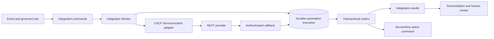
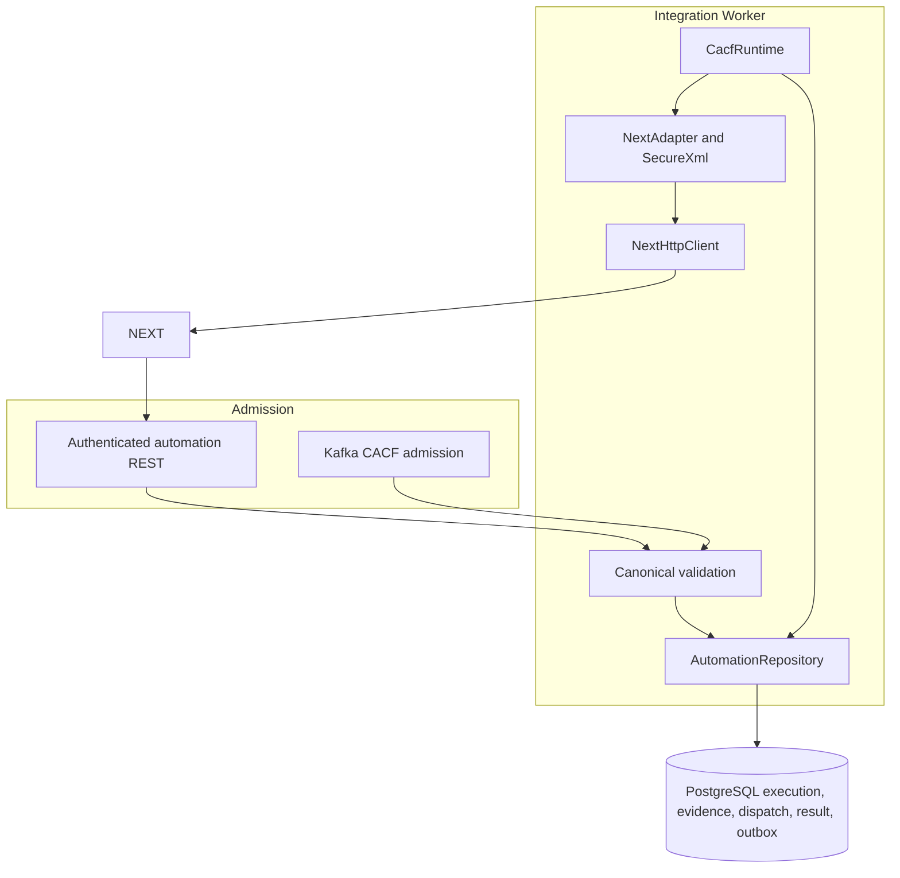
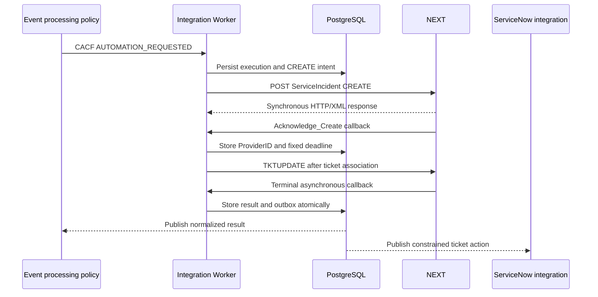
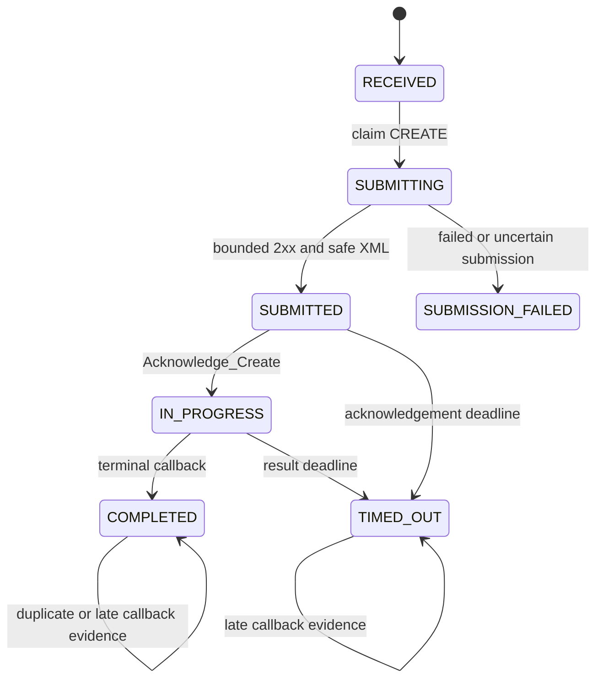

# CACF Automation

> **LOCAL_IMPLEMENTATION_VALIDATED · REAL_PROVIDER_UNVERIFIED**
>
> This page documents the verified local Event Management implementation and its
> historical Netcool compatibility model. It does not certify a production NEXT
> provider, deployment, endpoint, or customer configuration.

## 01. Overview

CACF is the bounded automation capability through which Event Management can
submit a legacy `ServiceIncident` request to a NEXT provider, correlate its
asynchronous acknowledgement and result, retain durable evidence, and request
constrained ticket actions. The provider vocabulary is isolated behind the CACF
adapter; Event Management does not import the obsolete Netcool/Impact runtime.

Three evidence labels apply throughout this page:

| Label | Meaning |
| --- | --- |
| **HISTORICAL_CONTRACT** | Recovered Netcool/Impact design knowledge; original provider artifacts were not independently certified. |
| **LOCAL_IMPLEMENTATION_VALIDATED** | Current adapter, persistence, mocks, and local contract tests support the statement. |
| **REAL_PROVIDER_UNVERIFIED** | No authorized contract test against a real NEXT provider establishes compatibility. |

## 02. Functional Purpose

CACF accepts a governed automation command, persists one execution identity,
serializes the provider request, records submission evidence, processes callbacks,
normalizes the provider outcome, and publishes a durable result. It does not
declare operational recovery, close a ticket automatically, or promise exactly-once
delivery across PostgreSQL, Kafka, and the external provider.

## 03. Solution Architecture



The diagram represents the local implementation boundary. The NEXT node is an
external contract target, not evidence that a production provider is deployed.

## 04. Technical Architecture



The Integration Worker owns provider execution. PostgreSQL owns the durable
execution record. Kafka transports commands and results at least once. The
ServiceNow integration retains ownership of ticket lookup and mutation.

## 05. Business Process



An HTTP response is submission evidence, not a terminal automation outcome.

## 06. Netcool Operational Equivalence

The historical model supplied the `ServiceIncident` vocabulary, CREATE,
TKTUPDATE, RequesterID, ProviderID, EWT, callback, and ticket-association concepts.
Event Management preserves those external concepts in a dedicated adapter while
replacing Netcool/Impact policy execution and legacy storage dependencies with a
canonical command, PostgreSQL state, Kafka results, and governed service owners.

This is functional mapping, not full equivalence. Original production policies,
provider XSD validation, and real-provider exchanges were not available for this
publication. Full equivalence remains **REAL_PROVIDER_UNVERIFIED**.

## 07. Current Implementation Status

| Capability | Status |
| --- | --- |
| Canonical admission, durable execution, XML adapter, callbacks, timeout, and outbox | **LOCAL_IMPLEMENTATION_VALIDATED** |
| Local NEXT and ServiceNow simulation | **LOCAL_IMPLEMENTATION_VALIDATED** |
| Historical Netcool vocabulary | **HISTORICAL_CONTRACT** |
| Real NEXT endpoint, response catalog, authentication, and callback interoperability | **REAL_PROVIDER_UNVERIFIED** |
| CACF Core Foundation package specifically identified as v1.3.0 | **UNVERIFIED / artifact not established** |

## 08. Provider Architecture

NEXT is represented as the current CACF provider vocabulary. Provider-specific
XML and outcome translation remain in `NextAdapter`; canonical requests and
results remain provider-neutral outside that boundary. Configured automation
profiles pin an account, connection, endpoints, credential references, policy,
and revision. They do not prove that the external provider accepts the contract.

## 09. Integration Worker

The worker uses a dedicated `cacf-admission` Kafka consumer group with manual
offset commit after durable admission. Background workers claim provider dispatch,
expire deadlines, and publish outbox entries. A dispatch is claimed and committed
before external HTTP. An uncertain mutation is marked for review and is not put
back into an automatic retry loop.

## 10. Automation Commands

The local Kafka contract uses `integrationType=CACF` and
`operation=AUTOMATION_REQUESTED`. The envelope identity must agree with the
payload event and tenant. Invalid CACF commands are represented in the dead-letter
stream with bounded error metadata; the automation payload is not copied there.

Direct authenticated CACF REST admission also exists in Engineering. This
functional page does not invent additional APIs or position REST as the only
business trigger.

## 11. ServiceIncident XML

The adapter builds a DOM so field values are escaped rather than interpolated.
CREATE contains requester, severity, trading partner, transaction, incident,
assignment, asset, description, and defined FlexFields. TKTUPDATE contains
requester, provider, trading partner, transaction, and the associated ticket.

The serialized document declares a schema location but the local implementation
does not retrieve or validate against an external XSD.

## 12. XML Namespace

The exact namespace is:

```text
http://b2b.ibm.com/schema/IS_B2B_CDM/R2_2
```

Callbacks must have the `ServiceIncident` root and this namespace. A missing or
different root/namespace is rejected.

## 13. Field Mapping

RequesterID is composed as:

```text
sourceSystem:sourceSerial:customerCode
```

Core CREATE mapping:

| XML field | Canonical source |
| --- | --- |
| `RequesterID` | Derived identity above |
| `RequesterSeverity` | `event.severity` |
| `TradingPartnerID` | `customer.code` |
| `TransactionName` | `CREATE` |
| `TransactionType` | `2` |
| `TransactionNumber` | `executionId` |
| `Incident/Abstract` | `event.summary` |
| `AssignedTo/AssignedGroup` | `ticket.holdingAssignmentGroup` |
| `Asset/AssetID` | `event.resourceId` |
| `Asset/Asset_Tag` | `event.node` |

The ordered Description labels are Summary, Date, Severity, ResourceId,
CustomerCode, InstanceId, InstanceSituation, AlertKey, TicketGroup,
InstanceValue, ComponentType, Component, SubComponent, ApplId, Node, NodeAlias,
AlertGroup, EventType, MonitoringSolution, and EventKey.

| FlexField `mappedTo` | Canonical event field |
| --- | --- |
| `originating_event_id` | `sourceSerial` |
| `event_class` | `eventClass` |
| `service_state`, `host_state` | `serviceState`, `hostState` |
| `ITEM`, `tec_id` | `item`, `sourceSystem` |
| `severity`, `ipcenabled` | `severity`, `automationEnabled` |
| `fqdn`, `ipaddress` | `node`, `nodeAlias` |
| `alertkey`, `alertgroup` | `alertKey`, `alertGroup` |
| `component`, `componenttype`, `subcomponent` | Corresponding component fields |
| `instanceid`, `instancevalue`, `instancesituation` | Corresponding instance fields |
| `monitoring`, `location`, `lastoccurrence` | `monitoringSolution`, `location`, `occurredAt` |

Absent optional event values serialize as empty text. That local behavior is not
evidence that every real provider accepts every omission.

## 14. CREATE Operation

The verified local adapter submits:

```text
POST /tupix/api/v1/netcool/tickets
Content-Type: text/xml
Authorization: Basic <redacted>
```

The body is UTF-8 ServiceIncident XML. Redirects are not followed. Configured
profiles can provide a validated full HTTPS CREATE endpoint. The route shown is
the verified local route, not a production NEXT certification.

## 15. Acknowledge_Create

An `Acknowledge_Create` callback correlates the execution, records the ProviderID,
sets `IN_PROGRESS`, stores the acceptance time, and establishes the fixed result
deadline. A repeated acknowledgement does not extend that deadline. EWT is stored
as provider information and does not replace the local deadline.

## 16. TKTUPDATE Operation

After both ProviderID and ticket number exist, an active execution can emit:

```text
POST /tupix/api/v1/netcool/incidents
```

The transaction name is `TKTUPDATE`; its transaction number is derived from the
execution identity with a ticket suffix. ProviderID is included and the ticket is
sent as `FlexField mappedTo="ipc"`. Configured profiles may supply a validated
full HTTPS UPDATE endpoint.

## 17. Callback Contract

The local worker accepts legacy `/data`, canonical provider callback, and a
profile-scoped configured callback described in Engineering. All require a CACF
token appropriate to their configuration. Accepted XML returns the plain-text
acknowledgement `request is applied` only after processing succeeds.

`TransactionName` is required. RequesterID, ProviderID, TransactionNumber,
WorkflowStatus, and WorkflowSubStatus are optional during parsing but are subject
to correlation and consistency checks. Repeated selected fields are rejected.

## 18. Callback Correlation

The repository searches known RequesterID, ProviderID, and TransactionNumber
identities. If identities resolve to different executions, processing returns a
conflict. Known requester and provider values must agree. A previously unknown
transaction number alone is insufficient to establish an execution.

## 19. Provider Execution Identity

Event Management owns `executionId`, `commandId`, event identity, RequesterID,
and the CREATE transaction number. NEXT supplies ProviderID. These identities are
stored separately and correlated; none should be replaced by a ticket number.

## 20. Automation Lifecycle



## 21. Execution State vs Outcome

Execution state describes the local lifecycle. Provider outcome is normalized
from callback vocabulary. Operational recovery is a separate monitoring fact.
Ticket status belongs to the ticketing system. For example, `COMPLETED` with
`REMEDIATED` does not prove that monitoring recovered or that a ticket closed.

Known normalized outcomes include `REMEDIATED`, `ESCALATED`, `TRANSFER`,
`NO_ACTION`, `NO_MATCHING_HOST`, `REPEATED_INCIDENT`, `TIMEOUT`, and `UNKNOWN`.

## 22. Timeout and EWT

After acknowledgement, the result deadline is fixed from the configured timeout.
Without an acknowledgement, the implementation uses submission time plus the HTTP
and acknowledgement timeouts. EWT is retained as text for audit and display; it
does not silently modify either deadline.

## 23. Human Escalation

Unknown, uncertain, and policy-constrained outcomes require review. Escalation
can request a constrained ticket note or reassignment where the validated local
mapping allows it. CACF does not grant itself authority to close incidents,
declare recovery, or execute arbitrary remediation.

## 24. Late Callback Handling

A callback received after a terminal result or deadline is retained as evidence
and marked late. It cannot reverse a terminal execution or create a second stored
result.

## 25. Idempotency

REST admission requires the idempotency key to equal executionId. SQL uniqueness
protects execution, requester, provider, transaction, result, and outbox
identities. Kafka publication remains at least once, so consumers must use stable
message identifiers. No distributed exactly-once guarantee is claimed.

## 26. Duplicate Prevention

Callback bytes are hashed with SHA-256. A byte-identical replay is marked as a
duplicate. A differently serialized callback may have a different hash, but row
locking and the one-result constraint still protect terminal execution state.

## 27. Retry Policy

CREATE and TKTUPDATE are mutating provider calls and are not retried blindly. If
the HTTP outcome is uncertain, the durable dispatch enters review. Retrying a
CREATE without provider reconciliation could create duplicate automation and is
explicitly unsafe.

## 28. Durable Execution

PostgreSQL stores the canonical request, identities, state, timeout, timestamps,
provider messages, raw callback bytes, payload hash, normalized result, dispatch
intent, and outbox. Execution rows serialize callbacks and timeout processing.

## 29. Transactional Outbox

Terminal result and outbox entry are created in one SQL transaction. The publisher
sends the oldest pending item and marks it published after Kafka accepts it. A
failure can cause redelivery, but stable IDs allow idempotent consumption.

## 30. ServiceNow Integration

CACF does not create tickets. It receives or later associates a confirmed ticket,
then requests constrained actions through the existing ServiceNow foundation and
its ledger. `UNKNOWN` produces no terminal ticket action. A locally validated
`REMEDIATED` outcome adds a note and does not automatically close the ticket.

## 31. Security

Configured non-laboratory provider endpoints must use HTTPS. Provider credentials
are resolved at execution time and are not embedded in commands or this page.
Authorization, tenant identity, pinned configuration revisions, payload bounds,
timeouts, no-redirect behavior, and least-privilege ticket actions protect the
boundary. The older direct configuration can accept HTTP and must not be presented
as a production TLS posture.

## 32. XML Security

Parsing enables secure processing and rejects DOCTYPE declarations, external
general and parameter entities, external DTD/schema access, XInclude, excessive
depth, empty payloads, and oversized payloads. Parser errors exposed to callers
are sanitized so provider content and resource names are not leaked.

## 33. SecretRef

Configured profiles refer to pinned secret metadata and versions. The registry
resolves Basic credentials and callback API token from the configured secret
provider. Secret values are not serialized into the command and the configuration
object renders as redacted. Production vault availability and credential rotation
remain operational controls, not claims made by this page.

## 34. Audit and Observability

Audit evidence includes request identity, state transitions, outgoing and incoming
provider messages, HTTP status, raw callback bytes, SHA-256, duplicate and late
flags, result, outbox status, and timestamps. This is component evidence, not a
claim of a universal platform audit event.

## 35. Monitoring and Health

When enabled, CACF readiness checks database access and its admission route.
Authenticated metrics expose bounded current-state gauges. Disabled CACF can be
healthy while its routes intentionally return not found. Component health does
not establish real NEXT availability.

## 36. Troubleshooting

| Symptom | Check |
| --- | --- |
| CACF routes return 404 | Confirm intentional feature enablement; do not infer an outage from disabled mode. |
| 401 callback | Verify the correct global or profile-bound token reference. |
| 400 XML | Check exact root/namespace, one occurrence per selected field, payload bounds, and safe XML. |
| 404 callback correlation | Check requester, provider, and transaction identities. |
| 409 callback | Resolve conflicting identities; do not rewrite evidence. |
| Dispatch is in review | Reconcile with provider evidence before considering any mutation retry. |
| Timeout | Confirm ACK/result deadline and escalate; a late callback cannot reverse terminal state. |
| Result says SUCCESS with review required | Evaluate `state`, `outcome`, and `requiresReview`; do not use transport status alone. |

## 37. Functional Example

All values below are synthetic.

### Canonical input

```json
{
  "executionId": "11111111-2222-4333-8444-555555555555",
  "eventId": "evt-demo-9001",
  "customer": { "code": "DEMO" },
  "event": {
    "sourceSystem": "MONITOR",
    "sourceSerial": "alert-9001",
    "summary": "Critical database listener unavailable",
    "resourceId": "db-demo-01",
    "severity": 5,
    "node": "db-demo-01.example.invalid",
    "automationEnabled": "true"
  },
  "ticket": {
    "originalAssignmentGroup": "Database Operations",
    "holdingAssignmentGroup": "Automation Holding"
  },
  "automation": { "provider": "NEXT", "resultTimeoutSeconds": 600 }
}
```

### Mapping and CREATE request

RequesterID becomes `MONITOR:alert-9001:DEMO`, TransactionNumber is the
executionId, and the synthetic XML shape is:

```xml
<ServiceIncident xmlns="http://b2b.ibm.com/schema/IS_B2B_CDM/R2_2">
  <RequesterID>MONITOR:alert-9001:DEMO</RequesterID>
  <RequesterSeverity>5</RequesterSeverity>
  <TradingPartnerID>DEMO</TradingPartnerID>
  <Transaction>
    <TransactionName>CREATE</TransactionName>
    <TransactionType>2</TransactionType>
    <TransactionDateTime>2026-10-19T20:00:00Z</TransactionDateTime>
    <TransactionNumber>11111111-2222-4333-8444-555555555555</TransactionNumber>
    <TransactionRouting>ASYNC::DEMOINC</TransactionRouting>
  </Transaction>
  <Incident>
    <Abstract>Critical database listener unavailable</Abstract>
  </Incident>
  <AssignedTo><AssignedGroup>Automation Holding</AssignedGroup></AssignedTo>
  <Asset><AssetID>db-demo-01</AssetID><Asset_Tag>db-demo-01.example.invalid</Asset_Tag></Asset>
</ServiceIncident>
```

The actual adapter also emits the complete ordered Description and FlexFields
listed in Field Mapping. The abbreviated sample avoids implying new fields.

### Acknowledgement and ticket association

NEXT returns an asynchronous `Acknowledge_Create` with synthetic ProviderID
`NEXT-DEMO-7001`. The worker correlates it, fixes the deadline, and enters
`IN_PROGRESS`. After the confirmed synthetic ticket `INC-DEMO-42` is associated,
TKTUPDATE sends that ticket as `mappedTo="ipc"` with the ProviderID.

### Callback and result

A terminal callback with `WorkflowStatus=RESOLVE` produces local outcome
`REMEDIATED`, stores the original bytes and hash, publishes one durable result,
and requests a ticket note. Monitoring recovery and ticket closure remain separate.

### Alternatives

- If the deadline expires first, the execution becomes `TIMED_OUT/TIMEOUT` and
  requires escalation. A later callback is retained but cannot reverse it.
- If a syntactically valid callback contains an unmapped outcome, the execution
  becomes `COMPLETED/UNKNOWN`, `requiresReview=true`, with no terminal ticket action.
- The audit trail retains identities, dispatch, messages, state, result, duplicate
  and late flags, timestamps, and outbox status.

## 38. Contract Testing

Local evidence covers adapter serialization/parsing, secure XML, repository
transactions, idempotency, duplicate and late callbacks, ACK deadline behavior,
timeout, unknown results, Kafka admission, TKTUPDATE, restart behavior, and
simulated ServiceNow actions. PostgreSQL and Kafka were real in the isolated local
certification; NEXT and ServiceNow were mocks.

No test in this documentation activity contacted a real NEXT provider. A real
contract test requires separate authorization, safe synthetic data, approved
credentials, and explicit safeguards against duplicate CREATE.

## 39. Known Conflicts

The verified local adapter and tests use:

```text
/tupix/api/v1/netcool/tickets
/tupix/api/v1/netcool/incidents
```

Later Engineering prose changed these to `/tupix/api/v1/tickets` and
`/tupix/api/v1/incidents` without changing the adapter. The route families are not
assumed interchangeable. Configured full HTTPS endpoints are the migration
boundary, but only provider-approved evidence can resolve which production paths
are correct.

## 40. Implementation Maturity

| Area | Maturity |
| --- | --- |
| Adapter, local routes, XML namespace/mapping | **LOCAL_IMPLEMENTATION_VALIDATED** |
| Durable state, callback correlation, timeout, outbox | **LOCAL_IMPLEMENTATION_VALIDATED** |
| Local mock provider and ticket workflow | **LOCAL_IMPLEMENTATION_VALIDATED** |
| Netcool/Impact operational vocabulary | **HISTORICAL_CONTRACT** |
| Unprefixed endpoint documentation | **CONFLICTED** |
| Real NEXT compatibility and production deployment | **REAL_PROVIDER_UNVERIFIED** |
| Original provider field requirements and full outcome catalog | **REAL_PROVIDER_UNVERIFIED** |
| Exactly-once external delivery | **NOT PROVIDED** |

## 41. Engineering References

- [CACF Core Foundation](/platform/cacf/README/)
- [CACF architecture and transactions](/platform/cacf/architecture/)
- [CACF contracts](/platform/cacf/contracts/)
- [CACF data and states](/platform/cacf/data-and-states/)
- [CACF operational runbook](/platform/cacf/operational-runbook/)
- [CACF validation boundary](/platform/cacf/validation/)
- [CACF defect prevention](/platform/cacf/defect-prevention/)
- [ServiceNow integration architecture](/integrations/servicenow/)
- [AI & Automation](/ai-automation/)

These preserved Engineering pages provide implementation detail and historical
evidence. This functional Home does not replace or rewrite them.
