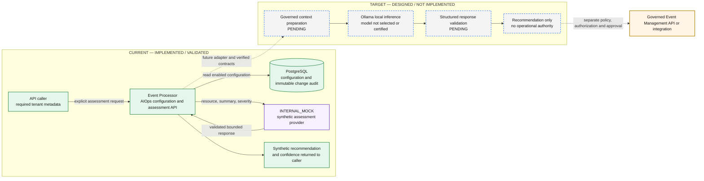
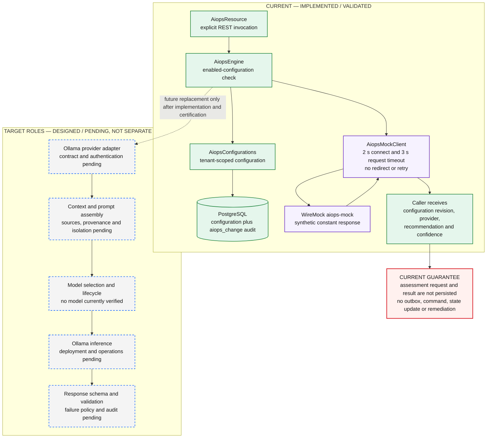
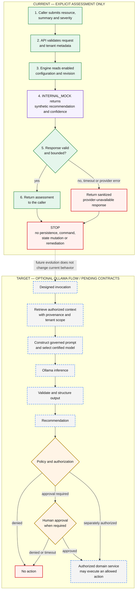

# AI-01 — Event Management AI Architecture

## 1. Architecture Overview

AI-01 separates the verified AIOps assessment implementation from a proposed Ollama-based architecture.

| Classification | Architecture position |
|---|---|
| **CURRENT — IMPLEMENTED / VALIDATED** | Event Processor configuration CRUD and an explicitly invoked assessment using the synthetic `INTERNAL_MOCK` provider |
| **TARGET — DESIGNED** | Optional local inference using Ollama behind a governed integration boundary |
| **PENDING** | Context retrieval, prompt construction, model selection, response governance, persistence decisions and operational integrations |

The current assessment is not part of the automatic event pipeline. It does not perform real inference, persist assessment inputs or results, update event state, emit commands, or authorize remediation. AI remains optional; Event Management core processing continues when the assessment provider is unavailable.

The diagrams use solid green and purple boundaries for verified current behavior and dashed blue boundaries for target or pending capabilities. The supplied raster overview was reviewed as a visual draft but is not published because several current-state labels and arrows are not supported by implementation evidence.

## 2. Solution Architecture

*Caption — D01 Solution Architecture: the solid path is the verified, explicit `INTERNAL_MOCK` assessment. The dashed path is a proposed Ollama evolution. No arrow connects the current assessment to ticketing, notifications, automation, or event-state mutation.*

The current provider contract returns only a synthetic recommendation and confidence value. `AiopsProvider` is an adapter boundary, but that boundary alone does not certify an Ollama provider, a real model, or a production integration.

## 3. Technical Architecture

*Caption — D02 Technical Architecture: the current implementation consists of Event Processor classes plus PostgreSQL configuration/audit storage and a WireMock provider. Future context, orchestration, model, Ollama, and response roles are logical responsibilities—not claims of separately deployed services.*

No verified configuration selects Llama 3.x or any other Event Management model. The separate OpenWebUI operator-tool setup references its own local model preset; it is not the Event Processor AIOps provider and is not evidence of the target architecture shown here.

## 4. Business Process

*Caption — D03 Business Process: the current process begins only with an explicit assessment call and always ends without an operational side effect. The proposed Ollama process is optional and requires separate output validation, policy, authorization, and—where required—human approval before an authoritative domain service could execute an action.*

A successful model response would not authorize an action. Human approval and policy authorization are distinct controls, and neither permits a model to bypass the service that owns the affected operational state.

## 5. How Ollama Receives Context

Ollama does not currently receive Event Management context through the Event Processor AIOps implementation. The current request to `INTERNAL_MOCK` contains only the verified assessment signal fields: resource, summary, and severity.

In the target design, context delivery remains **PENDING** and must be implemented behind governed interfaces. Before any Ollama request, the design requires:

1. an authorized invocation with tenant/customer scope;
2. approved source selection and data minimization;
3. provenance for event, history, configuration, rule, or knowledge context;
4. separation of system instructions from untrusted event or retrieved content;
5. a versioned prompt/instruction contract;
6. a selected and certified model plus bounded request limits; and
7. response-schema validation, audit, and failure handling.

Event State Service or search projections may become context sources only through verified contracts. The target design does not grant an AI component direct database access. Context Builder and AI Orchestrator are names for possible logical roles; they are not evidenced as deployed services.

## 6. Model Inference vs Training

| Concept | Meaning in AI-01 | Current status |
|---|---|---|
| Prompt construction | Assemble system instructions, task, and bounded context | **PENDING** for the Event Processor AIOps path |
| Context injection | Include authorized facts in an inference request | **PENDING** |
| Retrieval | Select facts from approved sources before inference | **PENDING**; no RAG or vector retrieval claim |
| Inference | Generate output from a configured model without changing model weights | **TARGET** for Ollama; not active in Processor |
| Model training | Learn model weights from a training corpus | Out of scope and not implemented |
| Fine-tuning | Modify an existing model for a specialized task | Out of scope and not implemented |

Ollama execution would be inference, not training. Downloading or naming a model does not make it configured, validated, approved, or certified. No Llama 3.x configuration is asserted by AI-01.

## 7. Current Implementation Status

| Capability | Status | Evidence boundary |
|---|---|---|
| AIOps configuration CRUD, revision handling, soft delete, and change audit | **IMPLEMENTED / VALIDATED** | Event Processor and PostgreSQL |
| Explicit assessment request | **IMPLEMENTED / VALIDATED** | Enabled configuration required |
| Synthetic `INTERNAL_MOCK` provider | **IMPLEMENTED / VALIDATED** | WireMock; not real inference |
| Bounded provider response validation and sanitized unavailability | **IMPLEMENTED / VALIDATED** | Recommendation and confidence only |
| Automatic event-pipeline AI stage | **NOT IMPLEMENTED** | Assessment is explicitly invoked |
| Assessment/result persistence | **NOT IMPLEMENTED** | No assessment history or outbox write |
| Event-state update or command emission | **NOT IMPLEMENTED** | No operational side effects |
| Ollama provider integration | **PENDING** | No certified adapter or deployment |
| Model selection and configured model | **PENDING / UNKNOWN** | No verified Event Management model |
| Context retrieval, prompt governance, and orchestration | **PENDING** | No verified contracts |
| AI-triggered ticketing, notification, or automation | **PENDING** | Must use separately authorized domain integrations |

## 8. Known Architectural Gaps

- Define and certify a real provider contract; changing only the mock URL is not sufficient.
- Decide whether Ollama is the approved target provider and document its deployment, health, authentication, network, resource, upgrade, and model-lifecycle controls.
- Select and certify a model for an explicit use case; no model family is implied.
- Define context sources, provenance, minimization, tenant isolation, prompt format, request limits, and untrusted-content handling.
- Define response schemas, validation, confidence semantics, failure policy, audit, retention, and observability.
- Decide whether assessments are persisted and identify the authoritative owner; the current implementation deliberately does not persist them.
- Define policy, service authorization, human approval, and idempotent command boundaries before any operational integration.
- Keep real inference failure isolated so core event processing remains available.

## 9. Engineering References

- [AIOps Engine implementation evidence](../platform/event-processor/aiops-engine.md)
- [AIOps frontend handoff](../platform/event-processor/frontend-handoffs/aiops.md)
- [Local LLM Runtime — Ollama](/ai-automation/local-llm-runtime-ollama/)
- [D0 — Event Management Logical Architecture](d0-logical-current.md)
- [Data Authority & Replay](data-authority-replay.md)
- [Multi-Surface Interaction](multi-surface-interaction.md)
- [AI-02 — AI Delivery & Governance Lifecycle](evolution/future-architecture-register.md)
- [Architecture Evolution Register](evolution/index.md)

AI-01 documents architecture and maturity boundaries. It does not deploy Ollama, configure a model, implement a new service, or authorize an operational action.
