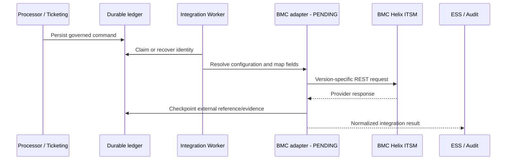
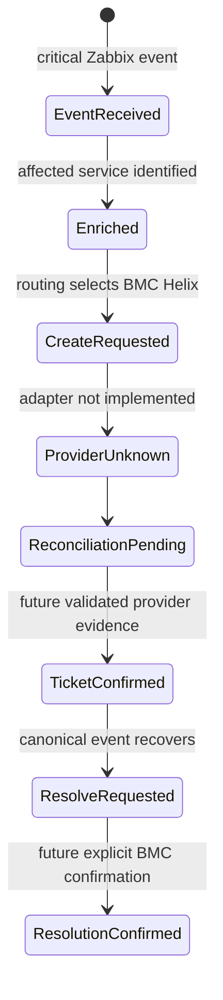

# BMC Helix ITSM Integration

## 01. Overview

BMC Helix ITSM is a planned Event Management ticketing provider. This page defines
the evidence-backed integration boundary and separates the reusable Event Management
provider pattern from BMC's version-specific APIs.

> **DESIGNED:** Event Management provider configuration, Integration Worker adapter,
> field mapping, normalized results, external references, and reconciliation.
>
> **PENDING:** an OEM BMC adapter, executable registration contract, BMC tenant,
> credentials, connectivity, provider validation, and production certification.
>
> **NOT CLAIMED:** implemented incident, problem, change, or worklog operations.

## 02. Solution Architecture

Processor and ticketing policy decide whether a provider action is eligible. The
Integration Worker would own bounded external execution through a dedicated adapter.
BMC Helix owns its ITSM records. ESS would consolidate normalized evidence without
making the provider authoritative for canonical Event Management state.

## 03. Integration Model

The model reuses the durable `integration.commands` / `integration.results` boundary:
a tenant-scoped, versioned provider configuration selects one compatible BMC API
family and product version; mapping converts canonical event data; a provider adapter
executes only declared capabilities; and normalized results retain command,
configuration, provider, and external-record identity.

This is **DESIGNED**. The present provider catalog label does not constitute an
adapter, configured endpoint, or activated integration.

## 04. ServiceNow Pattern Reuse

The ServiceNow pattern supplies the architectural roles: Processor decides, Worker
executes, the provider owns its ticket, normalized results return through ESS, and
PostgreSQL remains the Event Management operational source of truth. Bounded timeout,
durable command identity, error classification, external references, and explicit
confirmation are reusable requirements.

BMC differs in authentication, resource names, form interfaces, field vocabulary,
lifecycle rules, and available API families. ServiceNow tables, `sys_id`, state codes,
endpoints, and retry assumptions must not be copied into a BMC adapter.

## 05. BMC Helix Product Scope

The target product domain is BMC Helix ITSM, including Incident Management and
potential Problem, Change, and worklog integration. It is not BMC Helix Operations
Management, Discovery, Digital Workplace, or an arbitrary Innovation Studio
application API.

Official BMC documentation currently exposes product spaces through 26.1 and later,
while the concrete API examples verified for this page are from the BMC Helix ITSM
21.3 / AR System 21.3 documentation. Compatibility with any target tenant is
**PENDING** an exact product-version inventory and its bundled API specification.

## 06. Provider Model

A future provider configuration must include an immutable provider identity, tenant,
environment, base URL, selected API family, product/API version, authentication mode,
SecretRef, timeout policy, capability allow-list, mapping revision, and enabled state.

Provider registration must not accept arbitrary forms or endpoints per event. The
adapter—not event payloads—must own allowed paths, methods, headers, field maps, and
response normalization.

## 07. Supported API Families

| Family | Verified scope | Event Management status |
| --- | --- | --- |
| BMC Platform / AR REST API | Form-oriented `/api/arsys/v1` entry and merge operations; ITSM interface forms documented for 21.3 | **DOCUMENTED BY BMC / OEM PENDING** |
| BMC Simplified REST API | Introduced in BMC Helix ITSM 21.3 for user-friendly ticket search/update and related functions | **DOCUMENTED BY BMC / EXACT OEM CONTRACT PENDING** |

The families are alternatives with distinct paths, payloads, and semantics. A single
configuration must not mix Platform form operations with Simplified resource payloads.

## 08. API Version Compatibility

The Platform examples on this page are pinned to BMC Helix ITSM/AR System **21.3** and
use `/api/arsys/v1`. BMC's product documentation lists later ITSM releases, but this
page does not infer unchanged forms or workflows from the stable-looking path.

The Simplified API was introduced in 21.3. Its exact endpoint, schema, authentication,
pagination, filtering, and lifecycle compatibility for the future target tenant remain
**PENDING** because no target-version specification was available in project evidence.
Adapter activation must require a supported compatibility matrix and contract tests.

## 09. Functional Capabilities

| Capability | BMC documentation | OEM implementation |
| --- | --- | --- |
| Incident create/read/update | Platform REST 21.3 documents form operations | **PENDING** |
| Incident resolve/close | Provider fields/workflows exist; exact lifecycle must be validated | **PENDING** |
| Problem creation | Platform REST 21.3 documents `PBM:ProblemInterface_Create` | **PENDING** |
| Change create/update | Platform REST 21.3 documents change interface forms | **PENDING** |
| Incident/change worklogs | Platform REST 21.3 documents worklog forms | **PENDING** |
| Simplified ticket search/update | Introduced in ITSM 21.3 | **PENDING exact contract** |
| Provider reconciliation and normalized results | Reusable Event Management design | **DESIGNED** |

Provider documentation is not evidence that Event Management supports the operation.

## 10. Prerequisites

Before implementation or activation, obtain:

1. exact BMC Helix ITSM product and patch version;
2. selected API family and its tenant-specific specification;
3. approved provider service identity and least-privilege permissions;
4. HTTPS endpoint and trusted certificate chain;
5. SecretRef-backed credentials and rotation owner;
6. incident lifecycle, assignment, company, service, and CI mapping decisions;
7. capability-specific sandbox tests and rate/timeout limits;
8. approved external-reference and reconciliation policy.

## 11. Network Connectivity

The future Worker needs outbound HTTPS access only to the approved BMC host and port.
DNS, proxy, firewall, egress allow-list, certificate chain, SNI, connection timeout,
read timeout, and response-size bounds must be verified in the deployment environment.

Private endpoints, credentials, and network topology must not appear in public docs or
event payloads. No connectivity has been established by INT-03.

## 12. Authentication

For the verified AR System 21.3 Platform REST flow without BMC Helix SSO, BMC documents
`POST /api/jwt/login` using form-encoded `username` and `password`, followed by
`Authorization: AR-JWT <token>` on REST requests and `/api/jwt/logout` for logout.
BMC also documents a separate OAuth path when Helix SSO is enabled.

The target mechanism is **PENDING** tenant/version confirmation. Credentials and tokens
must remain behind SecretRef and provider-side trust. Event Management Keycloak tokens
must not be sent to BMC unless a future BMC-supported, explicitly validated federation
contract authorizes it.

## 13. Authorization and Permissions

The provider service identity must receive only the BMC form, record, company,
assignment, and operation permissions required by approved capabilities. Read access
does not imply update, resolve, close, problem, change, or worklog authority.

Event Management authorization governs who may configure or request the integration;
BMC authorization independently governs what the provider identity may do. Both
decisions and the tenant/configuration scope must be auditable.

## 14. TLS and Certificate Validation

Production traffic must use HTTPS with hostname verification and a trusted certificate
chain. The adapter must not disable certificate validation, silently trust arbitrary
self-signed certificates, downgrade to HTTP, or follow redirects to an unapproved host.

Certificate renewal, private CA distribution, expiry monitoring, and failure behavior
belong to the deployment runbook. No certificate is installed or trusted by this page.

## 15. SecretRef and Credential Management

Provider usernames/passwords, client credentials, tokens, and private endpoints are
secret material. Registration stores only a SecretRef and metadata; runtime resolves
the selected version through the authorized private secret workload.

Rotation creates a governed revision and requires validation before activation. Logs,
commands, results, screenshots, Git, and customer documentation must redact credentials
and tokens. Revocation must block new execution without erasing audit history.

## 16. Installation

There is no BMC Helix adapter to install in the current Event Management baseline.
Future installation would require the adapter artifact, provider descriptor, schema,
configuration migration, Worker routing, health checks, and rollback controls.

INT-03 installs no runtime component and changes no application code.

## 17. Configuration

Configuration is **DESIGNED** to capture the provider instance, selected API family,
product/API version, base URL, authentication mode, SecretRef, capabilities, mapping
revision, timeout policy, and tenant/environment scope.

Incident assignment, company, service, impact/urgency transformation, status mapping,
and optional fields must be versioned separately from credentials. Arbitrary headers,
forms, or scripts must not be supplied by an event.

## 18. Provider Registration

Registration is a configuration-plane operation, not a provider call and not runtime
activation. It must validate identity, scope, API family, version compatibility, URL,
authentication metadata, SecretRef existence, declared capabilities, mappings, and
execution bounds before producing a disabled or reviewable revision.

No implemented BMC registration endpoint or command was found.

## 19. Registration Input

| Field | Requirement | Status |
| --- | --- | --- |
| provider/instance identity | stable and unique in tenant/environment | **DESIGNED** |
| tenant and environment | explicit governed scope | **DESIGNED** |
| API family and product version | one compatible family/version | **DESIGNED** |
| base URL | approved HTTPS origin | **DESIGNED** |
| authentication mode and SecretRef | reference only, never values | **DESIGNED** |
| capabilities | explicit allow-list | **DESIGNED** |
| mapping and lifecycle revisions | immutable references | **DESIGNED** |
| timeout/retry limits | bounded policy | **DESIGNED** |

## 20. Registration Validation

Validation must reject unsupported versions/families, mixed-family paths, untrusted
URLs, missing secrets, excessive timeouts, undeclared capabilities, incomplete required
mappings, cross-tenant references, and incompatible lifecycle transitions.

Remote validation must be read-only unless a separately authorized test record is
approved. A successful login or metadata query does not certify incident operations.

## 21. Registration Output

A future output should contain status, provider identity, tenant/environment, selected
family/version, configuration revision, declared capabilities, validation findings,
and activation state. It must not return credentials, tokens, private response bodies,
or secret values.

The exact schema is **PENDING** and is not invented here.

## 22. CLI

No canonical BMC Helix CLI command exists in the inspected Event Management evidence.
A future CLI must call governed configuration APIs, accept SecretRefs rather than
secret values, support non-destructive validation, and display no tokens. Syntax and
exit codes remain **PENDING**.

## 23. Event Management API

The existing API catalog and integration command/result contracts remain authoritative.
INT-03 introduces no `/bmc`, `/helix`, ticket, provider-registration, or proxy endpoint.

Any future configuration API must be added to the governed API catalog. Runtime
execution must remain asynchronous through the durable command boundary rather than
allowing clients to call BMC through an unrestricted pass-through API.

## 24. BMC Platform REST API

The verified 21.3 family uses form-oriented resources below `/api/arsys/v1`. Entry
requests use JSON such as `{"values": {...}}`; create responses use HTTP `201` and a
`Location` header, while documented updates can return `204`.

Verified ITSM form examples include:

- `HPD:IncidentInterface_Create` — incident create;
- `HPD:IncidentInterface` — incident search/read/update;
- `PBM:ProblemInterface_Create` — problem investigation create;
- `CHG:ChangeInterface_Create` and `CHG:ChangeInterface` — change create/update;
- `HPD:WorkLog` and `CHG:WorkLog` — work information.

Entry collection queries may use URL-encoded `q`, `fields`, `limit`, and `sort`
parameters. The exact target forms, workflow overlays, required fields, and pagination
behavior must be verified against the target version.

## 25. BMC Simplified REST API

BMC introduced the Simplified REST API in BMC Helix ITSM 21.3 with friendlier resource
and attribute naming, standard search/filter/sort behavior, and improved status/error
handling. BMC describes ticket search/update, attachments, people data, and recommended
knowledge/ticket access as use cases.

The reviewed authoritative source did not expose a target-version endpoint/schema set
for this project. Therefore authentication headers, concrete paths, payloads,
pagination, filtering grammar, rate limits, and operation coverage are **PENDING**.
Platform form endpoints and payloads must never be presented as Simplified API examples.

## 26. Field Mapping

The following is a conceptual mapping anchored only where the 21.3 Platform reference
verifies a BMC field. Target-version metadata and customer workflow remain mandatory.

| Canonical event | BMC incident target | Rule |
| --- | --- | --- |
| event identity | customer-approved external-reference field | **PENDING custom field**; never assume `Request ID` |
| summary | `Description` | verified field name; apply length/sanitization policy |
| description | target detailed-text field | exact field **PENDING** target metadata |
| severity | `Impact` + `Urgency` | configurable matrix; do not map directly to priority |
| impact | `Impact` | BMC enumerated value, version/customer specific |
| urgency | `Urgency` | BMC enumerated value, version/customer specific |
| service | service-related field | exact field **PENDING** target workflow |
| configuration item | CI relationship/field | exact contract **PENDING** |
| assignment group | customer-approved assignment field | validate group and company scope |
| external reference | `Incident Number` plus provider entry ID | preserve both when returned |
| correlation reference | approved external-reference/custom field | **PENDING** schema decision |
| lifecycle state | `Status`, `Status_Reason`, `Resolution` | explicit transition map required |

The BMC sample also verifies `Reported Source`, `Service_Type`, `First_Name`, and
`Last_Name`; whether they are required depends on the selected interface and workflow.

## 27. Incident Creation

| Property | Platform REST 21.3 reference | OEM support |
| --- | --- | --- |
| Preconditions | authorized identity, compatible interface, required customer fields | **PENDING validation** |
| Method/path | `POST /api/arsys/v1/entry/HPD:IncidentInterface_Create?fields=values(Incident Number)` | **PENDING adapter** |
| Headers | `Authorization: AR-JWT ...`, `Content-Type: application/json` | **PENDING auth selection** |
| Body | `values` with documented fields such as `Description`, `Impact`, `Urgency`, `Status`, `Reported Source`, `Service_Type` | mapping **PENDING** |
| Response | created entry / incident identity according to selected fields and `Location` semantics | normalize only after validation |
| Idempotency | no OEM/BMC idempotency key established | durable preflight/design required |

Creation is not implemented by Event Management.

## 28. Incident Query

The Platform family supports `GET /api/arsys/v1/entry/{formName}/{entryId}` and entry
collection queries with encoded qualification `q`. BMC's ITSM reference demonstrates
incident retrieval through an incident interface and work-information retrieval from
`HPD:Help Desk`.

The adapter must distinguish provider entry ID from `Incident Number`, request only
approved fields, paginate bounded collections, and normalize not-found separately from
transport/authentication failure. Exact Simplified query paths are **PENDING**.

## 29. Incident Update

BMC's 21.3 Platform reference documents
`PUT /api/arsys/v1/entry/HPD:IncidentInterface/{entryId}` with a `values` body. A
successful update can return `204`; `If-Unmodified-Since` may protect an update and
return `412` when the record changed.

Event Management update support is **PENDING**. Allowed fields and transitions must be
capability-scoped; a general form update or arbitrary `values` object is prohibited.

## 30. Incident Resolution

The Platform example updates `Status` to `Resolved` and supplies `Status_Reason` and
`Resolution`. This shows provider API vocabulary, not an approved OEM lifecycle map.

A future `RESOLVE_TICKET` capability must require an owned external reference, mapped
reason/resolution, explicit provider confirmation, and ESS reconciliation. It must not
infer resolution from an HTTP request alone. OEM support remains **PENDING**.

## 31. Incident Closure

No separately verified close example or target-tenant transition policy was found.
Closure may be constrained by BMC workflow and may require a prior resolved state,
reason, resolution, or customer-specific fields.

`CLOSE_TICKET` is therefore **PENDING / UNSUPPORTED** for Event Management until the
selected API family, allowed transition, required fields, response, and confirmation
query are tested. Resolution must not be equated with closure.

## 32. Problem Integration

The Platform 21.3 reference documents
`POST /api/arsys/v1/entry/PBM:ProblemInterface_Create`. Its example uses fields such as
`Status`, `Investigation Driver`, `Description`, `Company`, `Impact`, `Urgency`, and
`z1D_Action=PROBLEM`.

Event Management problem creation, query, update, relationships, and lifecycle are
**PENDING / UNSUPPORTED**. No problem command or normalized result is implemented.

## 33. Change Integration

The Platform 21.3 reference documents create through
`CHG:ChangeInterface_Create` and update through `CHG:ChangeInterface`, with fields such
as `z1D_Action=CREATE`, `Description`, `Impact`, `Urgency`, `Risk Level`, `Status`,
`Company`, `Location Company`, `Change Type`, and `Change Timing` in its example.

Event Management change creation/update/relationship support is **PENDING /
UNSUPPORTED**. No event-to-change policy is inferred from provider API availability.

## 34. Worklog Integration

BMC 21.3 documents incident worklog merge through
`POST /api/arsys/v1/mergeEntry/HPD:WorkLog` and identifies `CHG:WorkLog` for change
work information. The example includes an `Incident Number`, descriptions, submitter,
work-log type, merge options, and qualification.

Event Management worklog append is **PENDING / UNSUPPORTED**. Exact workflow flags,
visibility, author identity, duplicate protection, and customer policy require approval.

## 35. Event-to-Ticket Relationships

A future relationship record must bind tenant, event/correlation lifecycle, durable
command, provider instance and revision, BMC entry ID, human-facing incident number,
operation, and confirmation state. Provider identifiers must not replace canonical
event identity.

One event may require a governed policy for reopen, new ticket, or existing-ticket
update. That policy is **PENDING** and must not be inferred from similar ServiceNow
behavior.

## 36. External Ticket References

Store both the provider's stable entry identifier and display identifier when the
selected BMC response supplies them. Each reference must include provider, instance,
tenant, API family/version, ticket type, and configuration revision.

Before update, resolve, close, or worklog actions, the Worker must verify that the
reference was established by an owned completed command or an approved reconciliation
process. Arbitrary incident numbers from event payloads must not authorize mutation.

## 37. Runtime Input Data

A future command should use the existing envelope identity and contain only a declared
ticketing operation, canonical event/correlation reference, pinned provider
configuration, mapping revision, bounded provider payload, and prior external reference
where required.

Credentials, tokens, arbitrary BMC paths/forms, unrestricted `values`, and tenant
overrides must not be runtime input. The exact BMC payload schema is **PENDING**.

## 38. Runtime Processing

The design requires capability validation, field transformation, token acquisition,
bounded request execution, response parsing, external-reference checkpointing,
confirmation where necessary, result normalization, and durable completion.

## 39. Runtime Output Data

A normalized result should retain result/command/event/correlation identity, tenant,
provider instance, configuration/mapping revisions, operation, execution status,
provider HTTP classification, BMC entry ID and incident number when confirmed,
provider lifecycle evidence, completion time, and review/retry classification.

Raw credentials, tokens, private endpoints, unrestricted response bodies, and
sensitive ticket content must not be included. Exact schema is **PENDING**.

## 40. Provider Response Normalization

Normalization must distinguish transport acceptance, record creation/update,
provider-side validation failure, authentication/authorization failure, not-found,
conflict/precondition failure, throttling, timeout, and unknown outcome.

The Platform API documents common HTTP outcomes including 200, 201, 204, 400, 401,
403, 404, 412 for conditional update, and 500 depending on operation. Status alone is
insufficient; the adapter must parse the documented error body for the pinned version
and retain only approved, redacted evidence.

## 41. Retry and Timeout

Timeouts must cover connection and total request duration. Retry policy must be
operation-aware: reads may be retried within bounds; mutations must not be repeated
after an ambiguous response unless an idempotency or reconciliation contract proves
safety.

No authoritative BMC rate limit was established in the reviewed references. Limits,
`Retry-After` behavior, quotas, and safe backoff remain **PENDING** target-tenant
verification. Generic retry assumptions must not be published as BMC guarantees.

## 42. Idempotency

The Event Management ledger provides stable command identity and collision detection,
but no verified BMC request-id/idempotency-key contract was found. Before a create
retry, the adapter needs an approved external correlation field or deterministic query
that can prove whether the ticket already exists.

Without that proof, an uncertain create must remain unknown and require reconciliation;
it must not automatically repeat the mutation.

## 43. Duplicate Prevention

Duplicate prevention combines durable command identity, a tenant/provider-scoped
external correlation reference, preflight lookup where authorized, checkpointing of
the provider reference, and single terminal result semantics.

Matching only summary, host, or timestamps is insufficient. The selected customer
field and qualification must be indexed/usable, unique within policy scope, and tested
against the target BMC workflow. This capability is **DESIGNED / PENDING**.

## 44. Reconciliation

Reconciliation should query by a confirmed entry ID or an approved unique external
reference, verify provider instance and tenant scope, compare the expected operation
with observed BMC state, and emit a normalized result without duplicating a mutation.

The query, fields, terminal states, ownership rules, and review path are **PENDING**
target-family implementation and validation.

## 45. Failure Handling

Failures before provider execution may be rejected safely. Authentication,
authorization, schema, mapping, or compatibility failures should be permanent until
configuration changes. Timeouts and connection loss after a mutation begins are
uncertain until reconciled.

Operators must preserve command and audit identity, redact provider content, avoid
manual replay without ownership checks, and separate provider unavailability from an
invalid ticket transition.

## 46. Security and Audit

Security requires HTTPS, certificate validation, provider service identity,
SecretRef-backed credentials, bounded token lifetime, rotation/revocation, least
privilege, tenant isolation, input/output allow-lists, sensitive-field minimization,
and redacted logging.

Audit correlation should cover actor/request, tenant, rule decision, command,
configuration/mapping revision, provider request class, external reference, response
classification, ESS reconciliation, and manual review—never credential values.

## 47. Monitoring and Health

Future health checks should distinguish configuration validity, secret availability,
authentication, network/TLS reachability, API compatibility, command backlog,
latency, error classes, throttling, unknown outcomes, reconciliation age, and external
reference completeness.

A successful login or generic API health check does not certify create/update/resolve
behavior. No BMC runtime health indicator exists today.

## 48. Troubleshooting

| Symptom | Evidence to inspect | Safe next action |
| --- | --- | --- |
| 401 | token expiry, auth family, redacted login outcome | refresh through approved flow; never log token |
| 403 | BMC permission and HTTPS policy | correct least-privilege grants; do not elevate broadly |
| 404 | host/path/form/entry and pinned version | confirm family and identifier type |
| 400 | versioned schema, required fields, enum mapping | correct mapping revision |
| 412 | conditional update conflict | retrieve and reconcile; do not overwrite blindly |
| timeout after mutation | ledger checkpoint and provider query | mark unknown; do not repeat automatically |
| duplicate ticket | external correlation and command ownership | suspend mutation and reconcile |

## 49. Functional Example

This is an illustrative design, not an executed BMC test.

1. A critical Zabbix event enters the canonical pipeline.
2. Enrichment identifies the affected service; routing selects a pinned BMC Helix
   provider and ticketing decides `CREATE_INCIDENT` conceptually.
3. A future command would carry event/correlation identity and configuration revision.
4. Mapping would derive BMC `Description`, `Impact`, and `Urgency`; severity would not
   map directly to BMC priority.
5. The adapter would authenticate with its provider service identity and send the
   request through exactly one pinned API family.
6. Only a verified response/query would establish the BMC entry ID and incident number.
7. ESS would reconcile the normalized result and audit would correlate every identity.
8. On event recovery, policy could request resolve; the adapter would require the owned
   external reference and explicit provider confirmation.
9. A timeout after either mutation would remain unknown and enter reconciliation rather
   than blind retry.

Every provider action in this scenario is **DESIGNED / PENDING IMPLEMENTATION**.

## 50. Integration Testing

Required tests include family/version contract fixtures; authentication and token
expiry; TLS and hostname failures; least privilege; required/optional field matrices;
enum and lifecycle mapping; create/read/update/resolve/close separately; problem,
change, and worklog only if authorized; pagination/filter encoding; response and error
normalization; timeout and ambiguous mutation; duplicate prevention; reconciliation;
SecretRef rotation/revocation; tenant isolation; restart/replay; and redaction.

Real-provider tests need a governed non-production BMC tenant and explicit authorization.
Current result: **PENDING — no OEM BMC adapter test exists**.

## 51. Implementation Status

| Area | Status |
| --- | --- |
| BMC catalog/placeholder presence | **IMPLEMENTED** |
| Dedicated functional Integration Home | **IMPLEMENTED by INT-03** |
| Provider architecture and mapping model | **DESIGNED** |
| Platform REST 21.3 research | **VERIFIED DOCUMENTATION** |
| Simplified REST introduction in 21.3 | **VERIFIED DOCUMENTATION** |
| Target Simplified endpoints/schemas | **PENDING** |
| BMC provider registration and adapter | **PENDING / NOT IMPLEMENTED** |
| Incident CRUD/lifecycle execution | **PENDING / NOT IMPLEMENTED** |
| Problem, change, and worklog execution | **PENDING / NOT IMPLEMENTED** |
| Production credentials/connectivity/certification | **PENDING** |

## 52. Release History

- **Existing baseline:** public BMC Helix placeholder; no implementation claim.
- **BMC Helix ITSM 21.3:** BMC introduced its Simplified REST API; Platform REST form
  examples are also documented in the 21.3 product space.
- **INT-03:** dedicated documentation, provider design, family separation, security,
  field-mapping boundary, and validation; no application or adapter change.

## 53. Customer Documentation

Customer onboarding remains **PENDING** implementation and must be version-specific.
It should identify the BMC product/patch, API family, service identity owner,
permissions, endpoint/certificate ownership, SecretRef rotation, mapping revision,
supported operations, lifecycle semantics, test evidence, monitoring, support path,
and rollback/deactivation steps.

Never include credentials, tokens, private endpoints, unrestricted forms, or examples
from a different API family/version.

## 54. Existing Engineering References

Event Management references:

- [ServiceNow Integration](/integrations/servicenow/)
- [Custom API Integration](/integrations/custom-api/)
- [Integration Architecture — Instances](/integrations/integration-architecture/)
- [Ticketing Operations](/operations/ticketing/)
- [Routing Operations](/operations/routing/)
- [Security Operations](/operations/security/)
- [Event State Service lifecycle](/platform/event-state-service/lifecycle-contract/)
- [OEM API Catalog](/platform/api/oem-api-catalog/)

Authoritative BMC references reviewed:

- [BMC Helix ITSM 26.1 product documentation](https://docs.bmc.com/xwiki/bin/view/Service-Management/IT-Service-Management/BMC-Helix-ITSM/itsm261/)
- [BMC Helix ITSM 21.3 Platform REST API references](https://docs.bmc.com/xwiki/bin/view/Service-Management/IT-Service-Management/BMC-Helix-ITSM/itsm213/Developing/Integrating-third-party-applications-with-BMC-Helix-ITSM-by-using-the-platform-REST-API/The-platform-REST-API-references/)
- [AR System 21.3 entry GET/PUT examples](https://docs.bmc.com/docs/ars213/examples-of-using-the-rest-api-to-get-update-and-delete-an-entry-from-a-form-1027568868.html)
- [AR System 21.3 Swagger and authentication guidance](https://docs.bmc.com/docs/ars213/using-the-rest-api-with-swagger-1027568890.html)
- [BMC Helix ITSM 21.3 Simplified REST introduction](https://docs.bmc.com/docs/itsm213/21-3-enhancements-1027559841.html)
- [AR REST general principles](https://docs.bmc.com/docs/display/ars221/General%2Bprinciples%2Bfor%2Busing%2Bthe%2BREST%2BAPI)
- [AR REST error model](https://docs.bmc.com/docs/innovationsuite/233/error-handling-for-the-rest-api-1223793239.html)
