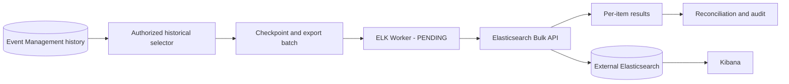
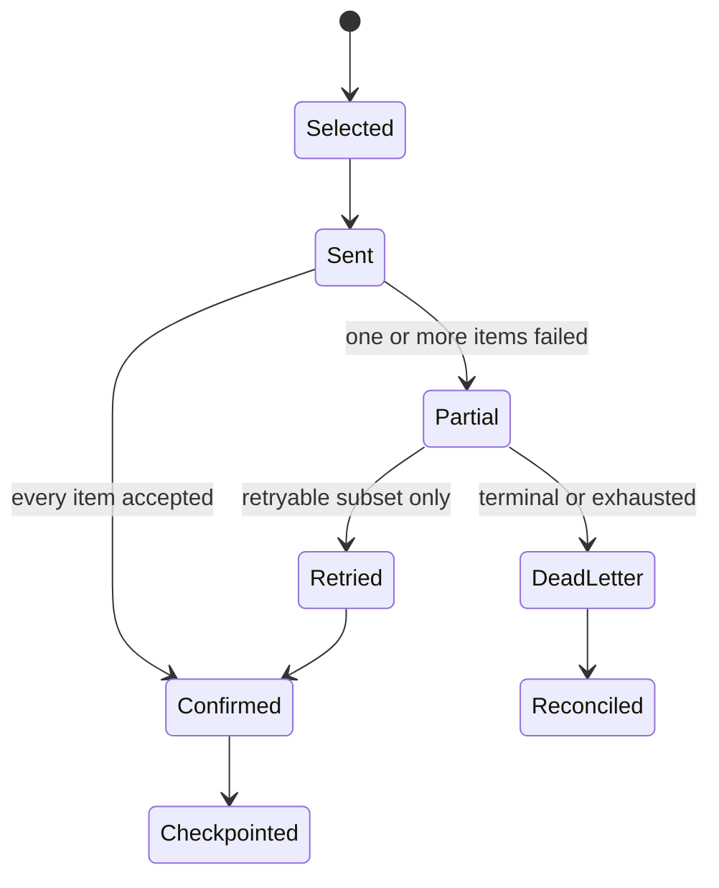

# ELK Historical Event Export

## 01. Overview

ELK Historical Event Export is a proposed integration that copies selected Event
Management history to an external Elasticsearch deployment for search, analytics,
and Kibana visualization.

> **DESIGNED:** export modes, provider boundary, index strategy, checkpoints,
> idempotency, reconciliation, security, and operational controls.
>
> **PENDING:** an ELK Worker/adapter, registration and status contracts, target
> Elasticsearch version, credentials, connectivity, mappings, and production tests.
>
> **NOT CLAIMED:** an active export, existing indices, exactly-once delivery, or
> compatibility between Elasticsearch and the internal OpenSearch projection.

## 02. Solution Architecture



Event Management retains authority for event lifecycle and history. Elasticsearch
is an external, reconstructible search and analytics destination.

## 03. Integration Model

An authorized selector reads a stable historical sequence, the worker converts a
bounded batch into Elasticsearch documents, and every Bulk response item is
classified before checkpoint movement. Provider configuration is tenant scoped and
versioned. It references credentials through SecretRef and records the selected
Elastic API/version, mapping revision, target, and lifecycle policy.

## 04. ServiceNow/BMC Provider Pattern Reuse

The ServiceNow and BMC patterns contribute separation of decision and execution,
durable command identity, a dedicated adapter, normalized results, provider-owned
records, least privilege, and explicit implementation maturity. This export differs:
it sends historical documents rather than ticket lifecycle commands and must process
each Bulk item independently. ServiceNow tables, BMC forms, identifiers, and state
codes do not apply.

## 05. Historical Event Export Purpose

The purpose is bounded export of approved historical representations for external
search, investigation, dashboards, and analytics. Indexing does not transfer data
authority, authorize source deletion, or establish a backup or recovery mechanism.

## 06. Existing ELK Pull vs Export

[ELK Pull Data](/integrations/elk-pull-data/) is an existing, separately named
documentation placeholder and is preserved. “Pull Data” describes an inbound or
retrieval-oriented capability; this page describes outbound historical export to
Elasticsearch. Neither direction is silently redefined, and neither is claimed to be
implemented.

## 07. Functional Capabilities

| Capability | Maturity |
| --- | --- |
| Initial bounded backfill | **DESIGNED** |
| Incremental checkpointed export | **DESIGNED** |
| Controlled replay | **DESIGNED** |
| Bulk per-item validation and retry | **DESIGNED** |
| Reconciliation by stable identity | **DESIGNED** |
| Kibana consumption | **PROPOSED / customer-owned** |
| Runtime adapter and production certification | **PENDING** |

## 08. Architecture and Dependencies

Dependencies are Event State Service (ESS), authoritative historical persistence,
governed configuration, SecretRef resolution, controlled egress, the proposed ELK
Worker, Elasticsearch REST APIs, and operational audit/monitoring. Kafka is a
transport and replay boundary, not the source of historical authority.

## 09. Historical Data Source

The export source must be an authorized historical view backed by Event Management
authority. Selection semantics, retention coverage, snapshot consistency, and schema
version are **PENDING**. The adapter must not query internal databases directly or
invent an unsupported public OEM endpoint.

## 10. Event State Service Authority

ESS consolidates lifecycle results and Event Management retains the authoritative
record. A successful external write is delivery evidence only. Elasticsearch failure
cannot mutate canonical event state, and Elasticsearch loss is repaired by controlled
re-export rather than by promoting the destination to authority.

## 11. Provider Model

A future provider profile needs immutable identity, tenant, environment, Elastic
distribution and version, base URL, authentication mode, SecretRef, target naming,
template/mapping revision, export mode, batch and timeout bounds, checkpoint identity,
enabled state, and audit metadata. Exact registration fields remain **PENDING**.

## 12. Prerequisites

Confirm the authoritative source contract, data classification, tenant boundaries,
Elastic Stack distribution/version, licensed lifecycle features, endpoint, CA chain,
least-privilege API key, SecretRef owner, index design, retention, capacity, mapping,
checkpoint store, reconciliation policy, and non-production acceptance environment.

## 13. Network Connectivity

Allow only outbound HTTPS from the authorized worker to the approved Elasticsearch
host. Validate DNS, proxy, firewall, SNI, certificate chain, connection/read timeouts,
response bounds, and retry budget. Never expose a cluster directly because a document
mentions a URL.

## 14. Authentication

Elasticsearch supports API-key authentication using
`Authorization: ApiKey <REDACTED>`. The real encoded key is resolved at runtime from
SecretRef and never stored in Git, configuration payloads, examples, logs, or audit
details. Other target-supported methods require separate approval and validation.

## 15. Authorization

Use a dedicated principal limited to the proposed target pattern and necessary
operations. Template, lifecycle, or alias administration should be separated from
routine document writes when possible. Search verification receives read-only access.
Cluster-wide administration is not required for normal export.

## 16. TLS and Certificate Validation

Require HTTPS, hostname verification, a trusted CA chain, and controlled certificate
rotation. Do not disable verification, silently accept self-signed certificates, or
follow redirects to unapproved hosts. Record certificate expiry and trust failures as
provider health signals without exposing certificate secrets.

## 17. SecretRef and Credential Rotation

Configuration stores a SecretRef and non-secret metadata only. Rotation creates a
governed provider revision, validates the replacement credential, activates it, and
revokes the predecessor without erasing audit evidence. Key material must be redacted
from requests, responses, traces, screenshots, and handoffs.

## 18. Installation

No adapter is installed by this documentation release. A future installation must
package the worker/adapter through normal release governance, pin compatible clients,
publish provenance, expose health checks, and avoid embedding credentials or index
resources in the image.

## 19. Configuration

Configuration should bind provider identity, version, target alias/data stream,
template revision, mapping revision, modes, limits, retry policy, checkpoint store,
tenant/data filters, sensitive-field rules, and SecretRef. Defaults must not silently
enable export or create resources.

## 20. Provider Registration

Registration is **DESIGNED**, not implemented. It validates syntax and references,
but activation additionally requires connectivity, authorization, compatibility,
template/mapping, and sample Bulk tests. Event payloads cannot override destination,
credentials, or arbitrary request paths.

## 21. CLI

A future CLI may validate, activate, pause, inspect checkpoint, reconcile, and request
controlled replay through governed Event Management APIs. It must not connect directly
to PostgreSQL or Elasticsearch, accept plaintext secrets, or bypass authorization.
No executable CLI contract is claimed.

## 22. Event Management API

No new OEM endpoint is defined here. A future management API would expose provider
configuration, validation, mode control, status, reconciliation, and audit through the
canonical API inventory. Historical selection must use an approved internal contract.

## 23. Elasticsearch REST API

The selected target specification is authoritative. Relevant official APIs include
Index, Bulk, Search, composable index/component templates, aliases, data streams, ILM,
and Data Stream Lifecycle (DSL) where supported. REST stability does not remove the
need to test the exact major/minor version and distribution.

## 24. Index Design

For mutable historical records, start by evaluating conventional indices behind a
write alias. Proposed resources, which do not exist as a result of this page:

- `event-management-history-template`
- `event-management-history-write`
- `event-management-history-v1-*`

Names must be reconciled with tenant isolation, naming policy, rollover, and existing
Elastic resources before creation.

## 25. Index Templates

Composable index templates apply settings, mappings, and aliases to newly created
indices or data streams. Component templates provide reusable blocks. Template
priority, pattern collision, component order, and explicit creation settings matter;
changing a template does not retroactively change existing indices.

## 26. Mappings and Field Types

Explicitly map timestamps as `date`, stable identifiers and state as `keyword`,
numeric counters as numeric types, booleans as `boolean`, and searchable descriptions
according to approved analysis needs. Avoid uncontrolled dynamic-field growth. A
mapping revision belongs in template metadata and exported provenance.

## 27. Index Aliases

An index alias can present a stable read name and route writes to an index marked
`is_write_index`. Aliases support controlled rollover and migration. Alias filters can
assist query scoping but do not replace authorization, and direct document retrieval
does not apply Query DSL alias filters.

## 28. Data Streams vs Indices

Elastic recommends data streams for append-only time-series data. Event histories may
receive lifecycle corrections or late updates using the same stable identity; frequent
last-write-wins updates favor conventional indices with a write alias. Data streams
remain an alternative only after target-version and mutability tests.

## 29. Retention and Lifecycle

ILM can manage phases and rollover for versioned Elastic Stack indices/data streams.
Elasticsearch Serverless instead provides Data Stream Lifecycle. The selected product
and version determine availability. Retention is a customer decision and cannot delete
authoritative Event Management history. Lifecycle changes require capacity, legal,
audit, and recovery review.

## 30. Historical Event Schema

No actual OEM storage schema is exposed or invented. A versioned export envelope
should contain stable event identity, tenant scope, occurred/updated timestamps,
normalized category/severity/state, sanitized source attributes, lifecycle summary,
schema/mapping revision, source revision, and export provenance.

## 31. Field Mapping

| Conceptual source | Proposed Elastic field | Type | Rule |
| --- | --- | --- | --- |
| stable event identity | `event.id` | `keyword` | feeds deterministic `_id` |
| tenant scope | `oem.tenant.id` | `keyword` | mandatory isolation dimension |
| occurrence time | `@timestamp` | `date` | UTC normalized |
| current revision time | `event.updated_at` | `date` | checkpoint ordering component |
| severity | `event.severity` | `keyword` | canonical value, not vendor code |
| source system | `event.provider` | `keyword` | e.g. fictional `zabbix-lab` |
| message | `message` | `text` plus keyword policy | filtered and length bounded |
| export schema | `oem.schema.version` | `keyword` | provenance |

All names are illustrative until the export contract is approved.

## 32. Initial Backfill

`INITIAL_BACKFILL` selects a frozen, authorized historical range, records its upper
bound and schema revision, processes deterministic pages in order, and checkpoints
only confirmed items. The range, snapshot semantics, concurrency, and throttling are
approved before execution. Backfill does not imply source deletion.

## 33. Incremental Export

`INCREMENTAL_EXPORT` resumes after the last confirmed position and reads records in a
stable composite order such as update time plus immutable identity. Late mutations
must reappear under defined change-capture semantics. Polling interval and source
contract remain **PENDING**.

## 34. Checkpoint and Cursor Management

A checkpoint identifies provider/configuration revision, tenant, export mode, source
boundary, last fully confirmed ordering key, schema/mapping revision, batch identity,
and audit timestamps. It must be durable, monotonic for its stream, and fenced against
concurrent owners. It never advances past an unconfirmed record.



## 35. Bulk API Processing

Use `POST /_bulk` with `Content-Type: application/x-ndjson`. Each action metadata line
is followed by its document line, and the final line ends with a newline. A stable
`_id` enables deterministic re-submission. HTTP 200 is not complete success: inspect
the top-level `errors` flag and every corresponding item status/error.

## 36. Batch Size and Throughput

Elastic documents no universal correct Bulk action count. Tune by encoded byte size,
document count, latency, heap/queue pressure, provider responses, network limits, and
source impact. Apply bounded concurrency and backpressure. Defaults and service-level
objectives are **PENDING** environment tests.

## 37. Idempotency

Derive `_id` from tenant plus immutable canonical event identity using a versioned,
documented algorithm. Re-exporting the same logical revision should converge on the
same document. Idempotency reduces duplicates but does not create exactly-once
delivery; mapping or lifecycle conflicts still require handling.

## 38. Duplicate Prevention

Stable `_id`, fenced checkpoint ownership, deterministic ordering, immutable batch
identity, and result-ledger checks prevent most duplicates. Never generate a random
`_id` for a retry. A new mapping/index generation must define migration behavior rather
than accidentally duplicating documents across searchable targets.

## 39. Partial Bulk Failures

Preserve positional association between each request action and response item.
Classify successes, retryable failures (for example transient capacity/service
conditions), conflicts requiring policy, and terminal mapping/auth failures. Advance
only across a contiguous confirmed source boundary or retain an equivalent durable
gap ledger.

## 40. Retry and Backoff

Retry only failed retryable items using the same identity, bounded exponential backoff
with jitter, an attempt/elapsed-time budget, and provider guidance such as
`Retry-After` when applicable. Authentication, authorization, invalid mapping, and
malformed NDJSON require remediation rather than blind retry.

## 41. Dead Letter and Replay

After the retry budget, store a redacted failure envelope containing source identity,
batch, mapping revision, classification, attempts, and audit reference—not secrets or
unbounded sensitive payloads. `CONTROLLED_REPLAY` requires authorization, fixed scope,
idempotency review, corrected cause, and recorded results.

## 42. Reconciliation

Reconciliation compares an authoritative selection manifest with destination evidence
using stable IDs, counts, revisions, and bounded samples. Search verification should
use a consistent strategy; deep pagination can use `search_after`, preferably with a
point in time when the selected Elastic version supports the needed consistency.

## 43. Export Status

Status should expose enabled/paused state, mode, provider revision, checkpoint age,
last attempted/confirmed batch, source lag, accepted/retried/dead-letter counts,
health classification, and last reconciliation—never credentials or raw sensitive
documents. The exact status contract is **PENDING**.

## 44. Audit and Provenance

Record who authorized configuration/mode changes, provider and mapping revisions,
selection scope, batch and checkpoint identities, request correlation, per-item result
summary, retries, replay approvals, reconciliation outcome, and redaction policy. An
audit record is evidence, not permission to retain unrestricted payloads.

## 45. Monitoring and Health

Monitor source lag, checkpoint age, batch latency/bytes/items, success and partial
failure rates, retries, dead letters, authentication/TLS failures, throttling, mapping
rejections, worker ownership, queue pressure, reconciliation drift, destination health,
and index/storage growth. Alert thresholds require operational baselines.

## 46. Security and Tenant Isolation

Scope provider profiles, checkpoints, document IDs, indices/aliases, API-key
privileges, queries, metrics, and audit evidence by tenant. Shared-index isolation needs
explicit approval and defense in depth. Event Management identity (Keycloak/OneID) and
Elasticsearch provider identity are separate trust boundaries.

## 47. Sensitive Data Handling

Classify fields before export; allow-list required data; minimize or transform personal,
credential, token, network, and proprietary content; enforce length limits; redact
diagnostics; define destination retention and access; and support approved correction
or deletion workflows without weakening source authority.

## 48. Kibana Search and Dashboards

Kibana may query the approved alias/data stream for investigations and dashboards.
Saved objects, roles, spaces, dashboards, and detection logic are customer-owned unless
separately delivered. A visualization cannot be treated as authoritative operational
state, and this page creates no Kibana resources.

## 49. Troubleshooting

| Symptom | Check | Safe response |
| --- | --- | --- |
| 401/403 | key validity and least-privilege role | rotate/fix authorization; do not retry blindly |
| TLS failure | hostname, CA chain, expiry | repair trust; never disable verification |
| `errors: true` | every Bulk item error | retry only classified items |
| mapping rejection | template/mapping revision and field | pause affected scope and remediate |
| lag growth | source rate, batch limits, throttling | bound tuning; preserve source health |
| reconciliation drift | IDs, checkpoint gaps, target generation | controlled replay after approval |

## 50. Functional Example

**Conceptual only; identifiers and fields are fictional.** Zabbix emits event
`evt-lab-0042`. Event Management processes it and authoritative history records a
normalized lifecycle revision. `INCREMENTAL_EXPORT` selects it after checkpoint
`cp-demo-107`, mapping revision `map-v1` targets proposed alias
`event-management-history-write`.

Illustrative historical representation:

```json
{"eventId":"evt-lab-0042","tenantId":"tenant-demo","occurredAt":"2026-10-19T10:15:00Z","updatedAt":"2026-10-19T10:18:00Z","severity":"major","source":"zabbix-lab","message":"Fictional router latency","revision":3}
```

Illustrative NDJSON (with a required final newline):

```text
{"index":{"_index":"event-management-history-write","_id":"tenant-demo:evt-lab-0042"}}
{"@timestamp":"2026-10-19T10:15:00Z","event":{"id":"evt-lab-0042","updated_at":"2026-10-19T10:18:00Z","severity":"major","provider":"zabbix-lab"},"oem":{"tenant":{"id":"tenant-demo"},"schema":{"version":"1"}},"message":"Fictional router latency"}
```

Illustrative partial response:

```json
{"errors":true,"items":[{"index":{"_id":"tenant-demo:evt-lab-0042","status":201}},{"index":{"_id":"tenant-demo:evt-lab-0043","status":429,"error":{"type":"es_rejected_execution_exception","reason":"fictional capacity rejection"}}}]}
```

The first item is confirmed. The second retains its stable ID, is retried with bounded
backoff, and blocks checkpoint progression past its source position. After confirmation,
the worker advances the checkpoint, records audit evidence, reconciles by ID/revision,
and Kibana may query the projection. If attempts exhaust, the second item enters the
dead-letter path for authorized replay.

## 51. Integration Testing

Contract tests must cover the selected Elasticsearch version; TLS/auth failures;
least privilege; template/mapping validation; NDJSON final newline; stable IDs; mixed
Bulk results; 429/5xx backoff; 400/401/403 terminal handling; timeouts; restart and
ownership fencing; checkpoint gaps; replay; reconciliation with `search_after`;
tenant isolation; redaction; and source-load bounds. Production execution is not part
of this documentation release.

## 52. Implementation Status

| Element | Status |
| --- | --- |
| Authority and export invariants | **VALIDATED architecture** |
| Elastic REST behavior documented here | **VALIDATED against official current docs; target version pending** |
| Export/index/checkpoint/security design | **DESIGNED** |
| ELK Worker and provider registration | **PENDING / NOT IMPLEMENTED** |
| Elasticsearch resources and Kibana assets | **PROPOSED / NOT CREATED** |
| Production connectivity and certification | **PENDING** |

## 53. Release History

| Documentation release | Change |
| --- | --- |
| INT-04 / 1.0.0 | Initial Historical Event Export design and Elastic API research |

## 54. Customer Documentation

Customer-specific instructions must identify the supported Elastic version,
deployment type, approved endpoint, CA process, SecretRef procedure, least-privilege
role, index/alias choice, mappings, retention, sizing evidence, activation/rollback,
monitoring, reconciliation, and support ownership. Never publish credentials, private
topology, raw sensitive samples, or unsupported guarantees.

## 55. Existing Engineering References

- [Integration Architecture — Instances](/integrations/integration-architecture/)
- [Custom API](/integrations/custom-api/)
- [ServiceNow](/integrations/servicenow/)
- [BMC Helix ITSM](/integrations/bmc-helix/)
- [ELK Pull Data](/integrations/elk-pull-data/)
- [Data Authority & Replay](/architecture/data-authority-replay/)
- [Architecture Definition](/architecture/oem-architecture-definition/)
- [Event State Service](/knowledge/application/event-state-service/)
- [OEM API Catalog](/platform/api/oem-api-catalog/)

Official Elastic references used for this design:

- [Bulk API](https://www.elastic.co/docs/api/doc/elasticsearch/operation/operation-bulk-3)
- [Index API](https://www.elastic.co/docs/api/doc/elasticsearch/operation/operation-index-2)
- [Search API](https://www.elastic.co/docs/api/doc/elasticsearch/operation/operation-search)
- [Paginate search results](https://www.elastic.co/docs/reference/elasticsearch/rest-apis/paginate-search-results)
- [Index and component templates](https://www.elastic.co/docs/manage-data/data-store/templates)
- [Aliases](https://www.elastic.co/guide/en/elasticsearch/reference/current/aliases.html)
- [Set up a data stream](https://www.elastic.co/guide/en/elasticsearch/reference/current/set-up-a-data-stream.html)
- [Index lifecycle management](https://www.elastic.co/guide/en/elasticsearch/reference/current/ilm-concepts.html)
- [Data Stream Lifecycle](https://www.elastic.co/docs/manage-data/lifecycle/data-stream)
- [Create API keys](https://www.elastic.co/docs/api/doc/elasticsearch/operation/operation-security-create-api-key)
- [Secure HTTP communications](https://www.elastic.co/docs/deploy-manage/security/set-up-basic-security-plus-https)
- [REST API compatibility](https://www.elastic.co/docs/reference/elasticsearch/rest-apis/compatibility)

OpenSearch remains Event Management's internal derived projection in the documented
architecture. This external Elasticsearch design does not assert API equivalence or
transfer OpenSearch responsibilities.
