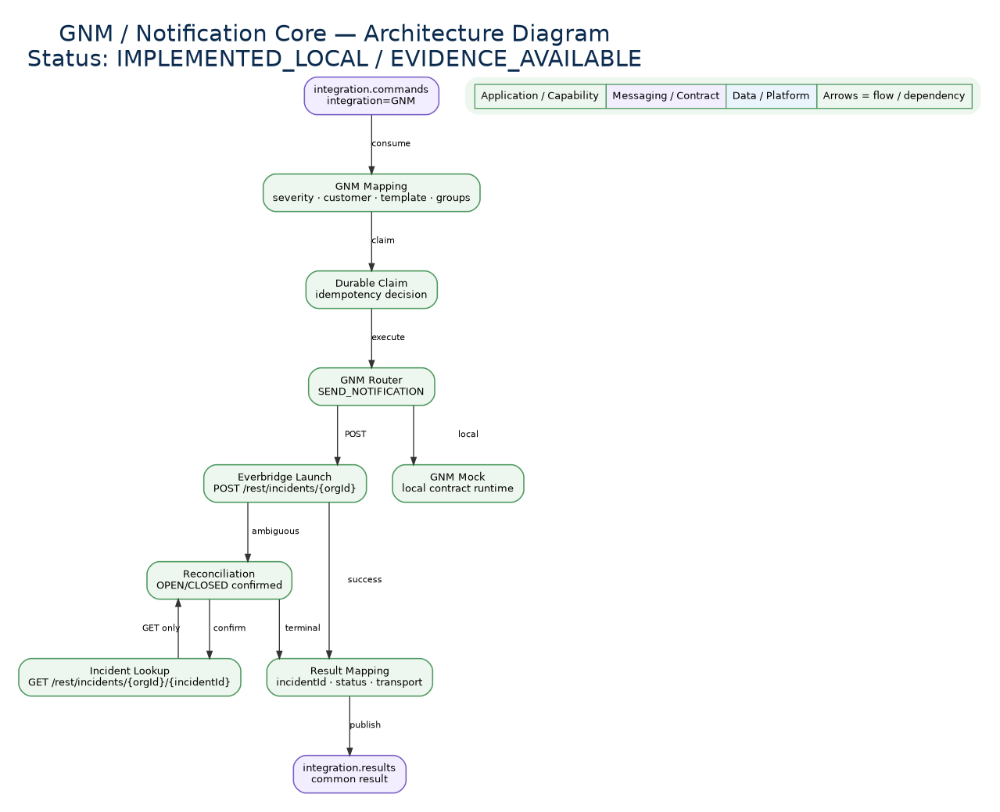
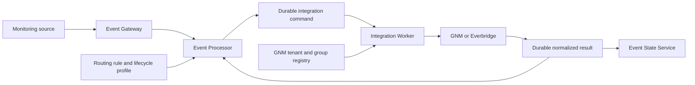
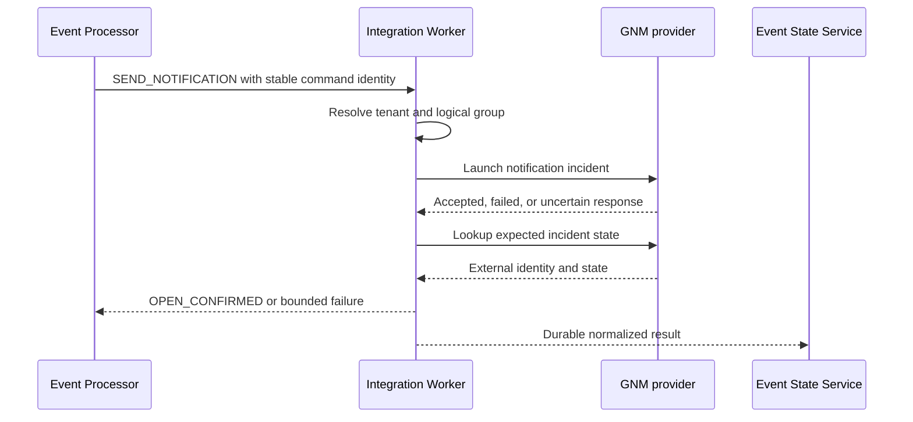
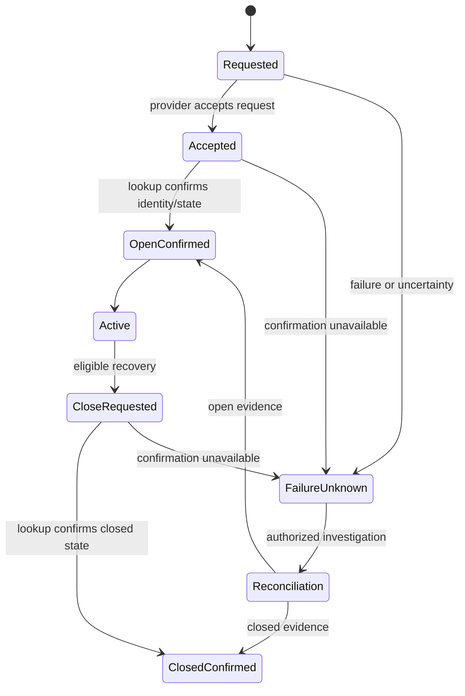

# GNM / Everbridge Integration

## 01. Overview

GNM connects Event Management to an Everbridge-backed incident-notification lifecycle.
An eligible lifecycle decision becomes a durable Integration Worker command; the Worker
resolves the tenant and logical notification group, calls the provider, confirms the
external incident by lookup, and publishes a normalized result for Processor and Event
State Service reconciliation.

> **IMPLEMENTED:** `SEND_NOTIFICATION` and `CLOSE_NOTIFICATION`, registry resolution,
> provider launch/close, confirmation by lookup, durable result identity, and lifecycle
> checkpoints.
>
> **VALIDATED:** the shared ticket → GNM → CACF → recovery → GNM-close flow against
> local simulated providers, including restart and duplicate handling.
>
> **PENDING:** real Everbridge connectivity, recipient delivery/acknowledgement,
> production credentials, and production provider certification.

## 02. Solution Architecture





Processor owns eligibility and lifecycle sequencing. Worker owns provider execution,
claims, retries, lookup, reconciliation, and normalized results. Everbridge owns its
external incident. ESS consolidates provider evidence without replacing those owners.

## 03. Integration Model

The implemented path is provider-specific and opt-in. A versioned Routing rule supplies
a strict lifecycle profile and logical `notificationGroup`; the Worker-owned registry
maps tenant and group to GNM configuration. Event payloads cannot supply arbitrary
endpoints, credentials, or provider operations.

Dynamic integration instances are **DESIGNED**. Saving a future instance or SecretRef
will not prove runtime activation until the Worker consumes that governed revision.

## 04. Provider Model

GNM/Everbridge is an external notification-incident provider. The provider owns its
incident state and reference. Event Management stores the command, result, confirmation,
and relationship to tenant, event/correlation cycle, ticket, and automation execution.

The current registry is classpath or local-file startup configuration for laboratory
tenants. It is not a public provider CRUD resource, general recipient directory, or
universal notification API.

## 05. Capabilities

| Capability | Maturity | Boundary |
| --- | --- | --- |
| Open notification incident | **IMPLEMENTED** | Requires supported lifecycle profile and registry mapping |
| Confirm open state by lookup | **IMPLEMENTED** | Produces `OPEN_CONFIRMED` with external identity |
| Close notification incident | **IMPLEMENTED** | Uses the previously confirmed incident identity |
| Confirm closed state by lookup | **IMPLEMENTED** | Produces `CLOSED_CONFIRMED` |
| Durable identity, retry, and reconciliation | **IMPLEMENTED / VALIDATED** | Local simulated provider evidence |
| Real Everbridge account | **PENDING** | No production-account certification |
| Dynamic instance and SecretRef management | **DESIGNED** | Not active runtime administration |
| Per-recipient delivery or acknowledgement | **PENDING / UNKNOWN** | Not established by current contracts |

## 06. Provider Lifecycle

The lifecycle preserves these distinct observations:

1. **Notification requested:** Processor makes an eligible durable intention.
2. **Request accepted:** Worker/provider transport accepts work; creation is not proven.
3. **Notification created:** provider reports an external incident candidate.
4. **Open confirmation:** lookup confirms identity and expected state.
5. **Notification active:** the confirmed incident remains externally active.
6. **Closure requested:** recovery policy emits a close command using confirmed identity.
7. **Closure confirmation:** lookup confirms the closed state.
8. **Reconciliation:** lookup resolves retry or uncertain transport evidence.
9. **Failure / Unknown:** insufficient evidence stops advancement and remains reviewable.

## 07. Prerequisites

Before enabling the documented lifecycle, operators need an authorized tenant, an
eligible versioned Routing rule, explicit lifecycle values, a logical notification group,
a matching Worker registry entry, provider endpoint/configuration, backend-owned
credentials, Kafka/PostgreSQL dependencies, and healthy Processor, Worker, and ESS.

Real provider prerequisites, approved organization/group values, quotas, certificates,
and production support contacts are **PENDING** per deployment.

## 08. Installation

The implemented integration is installed with the Integration Worker runtime and its
GNM adapter/configuration. Shared-runtime activation has been validated against a local
mock. This page does not authorize running activation scripts, provisioning an Everbridge
tenant, or deploying production credentials.

Dynamic installation through an Integration Home is **DESIGNED / PENDING**. Existing
deployment and rollback procedures remain authoritative.

## 09. CLI

There is no documented public GNM registration CLI. The target command family may follow
the governed integration-instance model, but exact commands and flags remain **DESIGNED**
until implemented and added to the CLI contract.

Current operational scripts and internal diagnostics are engineering tools, not customer
provider-registration contracts. Credentials must never be CLI arguments.

## 10. API

No dedicated public GNM management endpoint is established. The internal diagnostic
surface under `/internal/gnm/incidents` is not public CRUD. The OEM API Catalog and
Administration API Inventory remain authoritative; this Home does not create a new API.

Provider-native calls remain behind the Worker adapter. Clients do not call Everbridge
through an undocumented Event Management proxy.

## 11. Registration Input

Current runtime registration is startup configuration. Its logical inputs include tenant,
notification group, provider/base configuration, authentication reference or backend
configuration, and supported adapter settings. Exact provider fields remain defined by
the implementation/configuration authority.

For the **DESIGNED** integration-instance model, registration would carry stable instance
identity, tenant, environment, provider `GNM`, endpoint, non-secret configuration,
SecretRefs, revision, and enabled state. Secret values are never registration fields.

## 12. Registration Validation

Validate that tenant and logical group are non-empty and unique in scope; provider and
endpoint settings are supported; credential references exist and match tenant/environment;
required lifecycle fields are present; and configuration contains no plaintext secret.

Configuration validation does not prove connectivity, recipient membership, permission,
or successful notification creation. Those require separate bounded checks and runtime
evidence.

## 13. Registration Output

The current registry provides an internal resolved mapping, not a customer API response.
A future governed response may expose only instance identity, tenant/environment,
provider, revision, enabled/validation state, and non-secret metadata. It must not return
credentials, provider tokens, or remote response bodies.

No output schema is claimed as implemented.

## 14. Runtime Input Data

The implemented lifecycle command preserves tenant, event/correlation identity, stable
command identity, operation, logical notification group, confirmed ticket number where
required, bounded event summary/context, severity, and lifecycle metadata. Closure also
requires the previously confirmed provider incident identity.

The command never accepts an arbitrary provider endpoint, credential, or free-form
operation. Field details remain governed by the current Worker and Processor contracts.

## 15. Runtime Processing



Worker validates and claims the command, resolves configuration, executes the adapter,
persists the result, and publishes through its durable result path. Processor advances
only on the required confirmed state.

## 16. Runtime Output Data

Normalized results preserve tenant, event/correlation identity, command ID, stable
result ID, provider/operation, external incident reference, outcome, confirmation state,
timestamps, error/retry classification, and review requirement where applicable.

A provider HTTP success is evidence, not the normalized terminal truth. Incomplete or
conflicting identity is rejected or retained for review rather than converted to success.

## 17. Notification Creation

`SEND_NOTIFICATION` is eligible only through the supported lifecycle profile. The Worker
resolves the logical notification group and sends a provider launch request. A durable
command crossing the Worker boundary proves neither provider acceptance nor creation.

The same logical operation retains one stable identity through retries and reconciliation.

## 18. Notification Confirmation

After launch, the Worker looks up the provider incident. Only the evidenced external
identity and expected active/open state produce `OPEN_CONFIRMED`. That confirmation may
unlock the next lifecycle dependency; it does not prove delivery to, or acknowledgement
by, every recipient.

Acceptance without confirmable identity/state remains pending, failed, or unknown.

## 19. Notification Closure

After eligible recovery, Processor sends `CLOSE_NOTIFICATION` using the previously
confirmed incident identity. The provider close request is a new bounded operation and
does not itself prove closure.

If recovery arrives before open confirmation, the lifecycle follows its documented
pending/review behavior and does not manufacture an incident identity.

## 20. Closure Confirmation

Worker performs provider lookup after the close request. Only the confirmed expected
closed state produces `CLOSED_CONFIRMED`. Timeout, conflicting state, or lost response
remains reviewable and does not become closed by assumption.



## 21. Integration With Ticketing

The implemented opt-in lifecycle waits for a confirmed ServiceNow ticket number before
creating the GNM notification. Ticket and GNM incident identities remain separate.
Ticket creation does not imply notification creation, and GNM closure does not imply
ticket resolution.

General ticket-provider/notification composition beyond documented profiles is
**PROPOSED / PENDING**.

## 22. Integration With CACF

In the validated shared lifecycle, CACF automation becomes eligible only after a GNM
incident is `OPEN_CONFIRMED`. GNM acceptance alone is insufficient. CACF completion does
not close the GNM incident; monitored recovery later authorizes the separate close path.

The lifecycle was validated with mocks. Real Everbridge and real NEXT certification are
not claimed.

## 23. Integration With Routing

Routing owns the eligible action and explicit lifecycle profile. The implemented base
Routing contract is not a general GNM notification action; the supported GNM path is the
documented opt-in ServiceNow lifecycle profile.

Editing a rule does not rewrite configuration frozen on an active correlation cycle.

## 24. Integration With Automation

Automation and notification are independent external effects joined by an explicit
business lifecycle. The confirmed GNM incident is a prerequisite in the validated
profile, not proof that automation succeeded. Automation results retain their own
execution identity and review semantics.

No universal pipeline order is asserted for future notification or automation providers.

## 25. Event State Service Integration

ESS consumes normalized integration results and consolidates them with the relevant
event/correlation aggregate. It does not call GNM, own the external incident, or turn
provider uncertainty into success. Source `OPEN`/`CLOSE` state remains distinct from
GNM `OPEN_CONFIRMED`/`CLOSED_CONFIRMED`.

The shared lifecycle validated persistence, projection, restart, duplicates, and empty
outboxes against simulated providers.

## 26. Security and SecretRef

Credentials remain backend-owned and never enter rules, events, Kafka commands, logs,
screenshots, examples, or Git. The target integration-instance model stores opaque
SecretRefs and resolves them only inside the authorized runtime adapter.

SecretRef/OpenBAO administration is **DESIGNED / PLANNED**, not an active GNM runtime
configuration claim. Current startup configuration must follow deployment secret policy.

## 27. Authentication and TLS

Provider authentication is adapter/deployment-specific. Use a dedicated service identity,
least privilege, tenant/environment separation, protected credential storage, rotation,
and TLS certificate/hostname validation. mTLS may be used where the provider contract
supports it, but it does not replace operation or tenant authorization.

Keycloak and Kyndryl OneID are target platform identity architecture; no evidence shows
that the current GNM provider adapter authenticates through either one.

## 28. Timeout and Retry

Worker owns bounded claims, timeout classification, retry, and reconciliation. Expired
claims republish the original command; they do not create a new logical intention.
Provider-specific quota values, backoff intervals, and rate-limit headers are not defined
by current public documentation and remain **PENDING**.

Do not retry permanent validation/authentication failures as transient errors.

## 29. Idempotency and Replay

Stable command and result identities prevent duplicate lifecycle advancement. Duplicate
or late results are retained but do not create a second terminal effect. Kafka replay
reconstructs transport processing; it is not authorization to repeat an uncertain
provider mutation.

Exactly-once behavior across Event Management and Everbridge is not claimed.

## 30. Failure and Recovery

| Condition | Required behavior |
| --- | --- |
| Invalid/missing mapping | Reject before provider call; preserve reason |
| Provider unavailable | Retain bounded failure/retry state |
| Acceptance without incident identity | Mark uncertain; reconcile, do not recreate blindly |
| Lookup conflicts with expected state | Keep pending/reviewable |
| Duplicate or late result | Deduplicate by stable identity; retain audit |
| Open confirmed, close uncertain | Preserve active/reference evidence and review |
| Unknown recipient delivery | Report `UNKNOWN`, not delivered |

Recovery uses provider evidence and the original identities. Operators do not edit
ledgers, delete audit history, or fabricate confirmations.

## 31. Audit and Observability

The minimum trace links tenant, event/correlation cycle, rule/profile revision, command
ID, result ID, provider, operation, external incident ID, ticket/automation references,
timestamps, confirmation state, retry/reconciliation decision, and outcome. Secret values
and sensitive recipient content are excluded.

Auditability is **IMPLEMENTED** for bounded command/result identities; common IAM actor
correlation and production retention policy remain **PENDING**.

## 32. Health and Monitoring

Monitor Worker readiness, registry/configuration resolution, Kafka lag, claims, pending
results/outbox delivery, open/close confirmation latency, retry/review counts, provider
errors, ESS integration state, and reconciliation backlog. Health does not prove that a
notification was created or delivered.

Provider dashboards, production SLOs, recipient telemetry, and quota alerts are
**PENDING**.

## 33. Troubleshooting

1. Correlate tenant, cycle, command, and result identities.
2. Confirm the lifecycle profile and frozen notification group.
3. Verify registry resolution without displaying credentials.
4. Inspect Worker result/review reason and durable outbox state.
5. Use the confirmed external identity for provider lookup where authorized.
6. Compare provider state with Processor and ESS evidence.
7. Retry or repair only under the documented reconciliation contract.

Never convert missing evidence to success or use an undocumented endpoint to mutate state.

## 34. Testing and Validation

The local certification corpus validates open/close confirmation, stable identities,
duplicate handling, restart/republication, lifecycle ordering, ESS consolidation,
projection, and drained outboxes using simulated GNM/Everbridge. The shared-runtime
activation reports PASS with mocks.

This evidence does not validate a production Everbridge tenant, recipient delivery,
provider quotas, every crash point, production TLS, or production credentials.

## 35. Functional Example

**Illustrative scenario — not a production API contract:** Zabbix emits a critical
problem for `db-pay-01`. Gateway normalizes it, Processor evaluates the active rule, and
the event joins correlation cycle `corr:db-payments:042`. Routing first obtains confirmed
ticket `INC0042187`, then makes one stable GNM intention for logical group
`primary-operations`.

```json
{
  "source": "zabbix",
  "resource": "db-pay-01",
  "severity": "critical",
  "tenant": "example-tenant",
  "correlationCycle": "corr:db-payments:042",
  "operation": "SEND_NOTIFICATION",
  "notificationGroup": "primary-operations",
  "ticketReference": "INC0042187"
}
```

Worker resolves the group, records the command, calls the adapter, and receives provider
acceptance. It then looks up the external incident. Only confirmed identity/state yields
`OPEN_CONFIRMED`; that normalized result is published to Processor and ESS with the audit
chain. A timeout retains the same command and triggers bounded reconciliation; it does
not create another logical notification.

After independent monitoring reports recovery, Processor emits `CLOSE_NOTIFICATION`
with the confirmed incident identity. Worker requests close and verifies it by lookup.
Only then is `CLOSED_CONFIRMED` recorded. If lookup cannot confirm closure, the operation
remains pending/reviewable; retry and reconciliation preserve the original identities.

## 36. Implementation Status

| Area | Status |
| --- | --- |
| GNM adapter and open/close lifecycle | **IMPLEMENTED** |
| Provider lookup and explicit confirmations | **IMPLEMENTED** |
| Durable identity, retry, replay, reconciliation | **IMPLEMENTED / VALIDATED** |
| Shared ticket → GNM → CACF → recovery lifecycle | **VALIDATED** with mocks |
| Real Everbridge environment | **PENDING** |
| Dynamic integration-instance and SecretRef activation | **DESIGNED** |
| General GNM routing/notification rule | **PROPOSED / PENDING** |
| Recipient delivery/acknowledgement | **UNKNOWN / PENDING** |
| Production identity, TLS, quotas, and SLO certification | **PENDING** |

## 37. Release History

The Engineering changelog records checkpoint D06 (`909f3b3712ea`) for the GNM
notification core and Everbridge lifecycle and later unreleased lifecycle hardening.
Commit history is implementation provenance, not proof of release, deployment, or real
provider certification.

See the preserved [GNM / Everbridge Engineering Changelog](/platform/gnm/CHANGELOG/).

## 38. Issue Activity Log

| Topic | Status |
| --- | --- |
| Durable open/close lifecycle and lookup confirmation | Implemented in D06 lineage |
| Full identity and stable result handling | Implemented in OS_11 lifecycle work |
| Shared-runtime mock activation and restart validation | Validated |
| Authorized repair of review cases without incident ID | Pending |
| Dynamic tenant/provider registry administration | Pending |
| Real Everbridge certification | Pending |

This table is a documentation summary, not a replacement for the Engineering changelog
or project issue tracker.

## 39. Customer Documentation

Administrators configure only approved tenant/group mappings and backend credentials;
operators observe requested, accepted, confirmed, failed, and unknown states separately.
Customers should not receive internal class names, source links, raw provider responses,
credentials, or laboratory-only commands as production instructions.

Support escalation must include non-secret tenant, correlation, command/result, external
incident, timestamp, and confirmation-state evidence.

## 40. Existing Engineering References

- [GNM / Everbridge Engineering Changelog](/platform/gnm/CHANGELOG/)
- [Lifecycle Orchestration](/platform/event-processor/lifecycle-orchestration/)
- [CACF/GNM Shared Activation](/platform/cacf/shared-activation/)
- [Notifications Operations](/operations/notifications/)
- [Routing Operations](/operations/routing/)
- [Automation Operations](/operations/automation/)
- [Recovery Operations](/operations/recovery/)
- [Event State Service lifecycle](/platform/event-state-service/lifecycle-contract/)
- [Event State Service validation](/platform/event-state-service/validation/)
- [Administration API Inventory](/platform/administration-api-inventory/)
- [Integration Architecture — Instances](/integrations/integration-architecture/)
- [OEM API Catalog](/platform/api/oem-api-catalog/)

These references remain authoritative for their respective contracts. This Home does not
modify them, expose source-code hyperlinks, or upgrade local/mock evidence to production.
