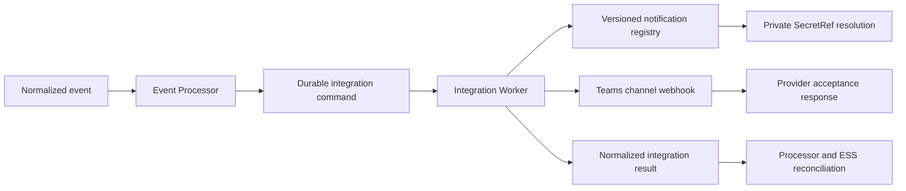
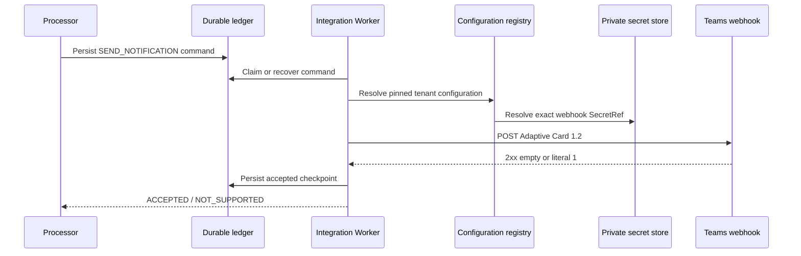
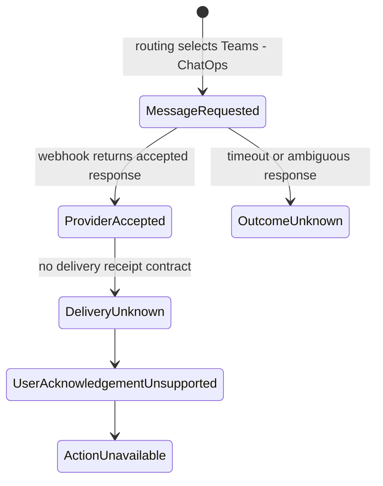

# Teams - ChatOps Integration

## 01. Overview

Teams - ChatOps delivers Event Management notifications to a Microsoft Teams
channel through the channel's configured webhook. The current adapter renders an
Adaptive Card 1.2 message and records whether the webhook provider accepted the
request.

> **IMPLEMENTED:** outbound Teams Webhook notification delivery through the
> `CHATOPS_TEAMS` provider.
>
> **VALIDATED:** configuration, tenant isolation, secret resolution, card rendering,
> provider acceptance, durable checkpoint recovery, revocation, and failure boundaries
> against local simulated providers.
>
> **PENDING:** a real Teams workflow/webhook certification, final message delivery
> observation, Microsoft Graph, Teams bots, interactive commands, and human
> acknowledgement.

## 02. Solution Architecture

Processor owns eligibility and orchestration. Integration Worker owns the provider
request, idempotency decision, durable provider checkpoint, and normalized result.
The Teams workflow/webhook owns processing beyond the HTTP boundary. Event State
Service (ESS) consolidates durable evidence without inventing provider or user state.

## 03. Integration Model

The implemented model is a tenant-scoped, version-pinned notification profile. A
profile references a Teams Webhook account, an exact account and connection revision,
a single destination, and title/body templates. The connection's signed URL is
resolved privately at execution time; it is not copied into profiles, commands,
results, logs, or public documentation.

Dynamic provider and SecretRef administration exists in the configuration plane, but
runtime execution remains protected by an explicit feature gate that is off by
default. Saving configuration alone does not send a notification or activate runtime
delivery.

## 04. Microsoft Teams Concepts

The current transport targets the Teams channel represented by a configured webhook.
The destination is fixed by that webhook rather than selected dynamically by team,
channel, or user identifiers in each event.

- **Channel webhook:** signed provider URL and current delivery boundary.
- **Adaptive Card:** version 1.2 title and body message payload.
- **Workflow acceptance:** successful HTTP response accepted by the adapter.
- **Teams app or bot:** **PENDING**; not part of the webhook implementation.
- **Graph-managed team/channel:** **PENDING**; no Graph lookup or directory contract.

## 05. Microsoft Graph Integration

Microsoft Graph integration is **PENDING / NOT IMPLEMENTED**. The current adapter does
not acquire Graph tokens, call Graph endpoints, query teams or channels, or register a
bot. No delegated or application permission set is established by current evidence.

A future Graph design must specify the exact endpoint, permission type, least-privilege
scope, tenant consent, application identity, token audience, operational owner, and
revocation behavior before implementation. This page intentionally names no Graph
permission because none is authorized by the current contract.

## 06. Provider Model

The provider identifier remains `CHATOPS_TEAMS` for compatibility. Its configured
operation is `NOTIFY`, its transport is `WEBHOOK`, and its credential purpose is
`webhook`. The provider accepts `SEND_NOTIFICATION`; notification close is not a Teams
Webhook operation.

The provider response proves only that the request met the adapter's acceptance rule.
It does not prove that Teams displayed the message or that a person read it.

## 07. Functional Capabilities

| Capability | Maturity | Boundary |
| --- | --- | --- |
| Adaptive Card 1.2 webhook POST | **IMPLEMENTED** | Title and body text blocks |
| Tenant-scoped, revision-pinned configuration | **IMPLEMENTED** | Exact profile/account/connection revisions |
| Private signed webhook resolution | **IMPLEMENTED** | Secret value excluded from commands and results |
| Durable idempotency and accepted checkpoint | **IMPLEMENTED / VALIDATED** | Same command/content replays the result |
| Local simulated-provider verification | **VALIDATED** | No real Teams tenant was contacted |
| Final message delivery observation | **PENDING / UNKNOWN** | Webhook acceptance is not delivery proof |
| Microsoft Graph and Entra OAuth flow | **PENDING** | No permission or token contract implemented |
| Interactive actions, bot commands, or user acknowledgement | **PENDING** | Not supported by current webhook transport |

## 08. Notification Delivery

The Worker renders the configured templates, produces an Adaptive Card 1.2 envelope,
and sends one HTTP `POST` to the secret webhook URL. A 2xx response with an empty body
(workflow behavior) or literal `1` (classic incoming webhook behavior) becomes
`deliveryState=ACCEPTED` and `acknowledgementState=NOT_SUPPORTED`.

Any other response is not promoted to success. `ACCEPTED` means provider request
acceptance only; it is neither final delivery nor human acknowledgement.

## 09. Interactive ChatOps

Interactive ChatOps is **PENDING / NOT IMPLEMENTED**. The current card has no buttons,
inputs, callback actions, or bot conversation. There is no implemented path from a
Teams user interaction to an Event Management state transition.

Before interactive behavior can be introduced, its callback identity, authorization,
anti-replay controls, tenant mapping, audit record, and lifecycle authority must be
defined and validated.

## 10. Commands and Actions

The implemented provider command is `SEND_NOTIFICATION`. The current adapter does not
implement Teams commands such as acknowledge, assign, close, suppress, automate, or
create ticket. Those action names are not public API contracts.

Any future user action must remain distinct from the notification request and from the
provider's acceptance response.

## 11. Identity and Authentication

The implemented webhook authenticates through possession of the signed URL stored as
a secret. It does not use a Microsoft Entra ID application identity or OAuth2 token.

A future Microsoft Graph or bot integration would require a governed Entra application
identity, approved tenant, token issuer and audience, credential type, and service
owner. Those elements are **DESIGNED CONCERNS / PENDING IMPLEMENTATION**.

Keycloak and Kyndryl OneID Connect are separate Event Management identity boundaries.
They do not replace Microsoft Entra ID authentication for Microsoft Graph.

## 12. Authorization and RBAC

Current configuration APIs apply their documented tenant, revision, and administrative
controls. Runtime resolution also requires the tenant's customer, connection, account,
profile, and secret references to remain enabled.

Interactive Teams RBAC is **PENDING**. A future callback must map a verified external
identity to an authorized Event Management actor and evaluate the requested resource,
action, scope, and tenant before executing anything.

## 13. Teams Application Registration

No Teams or Microsoft Entra application registration is required by the implemented
signed-webhook transport, and none is certified by this page. A workflow or incoming
webhook must be provisioned under the owning Teams tenant according to its current
Microsoft policy.

Application registration becomes relevant only for a future Graph or bot capability.
Client type, redirect/callback URIs, credentials, permissions, admin consent, and
rotation remain **PENDING**.

## 14. Integration Prerequisites

The implemented path requires:

1. an enabled customer and linked `CHATOPS_TEAMS` connection;
2. an enabled, tenant-scoped webhook secret and fixed version;
3. an enabled Teams Webhook notification account and profile;
4. exactly one profile destination representing the configured webhook channel;
5. valid title and body templates using the supported variables;
6. required Worker database and private secret-store access;
7. explicit authorization to enable the runtime feature gate;
8. verification of the specific Teams workflow/webhook response contract.

## 15. Installation

No Teams client, Graph SDK, or bot package is installed by this documentation. The
current runtime is part of the Integration Worker and Console configuration surfaces.
Environment deployment, database migration, private secret workload, and runtime gate
must follow their existing controlled deployment procedures.

This publication does not deploy or enable the application runtime.

## 16. Configuration

Configuration is split deliberately:

- **Origin/connection:** provider, environment, timeout, operation, and pinned secret.
- **Notification account:** linked connection and exact connection revision.
- **Notification profile:** account revision, templates, mode, and destination.
- **Destination:** the channel already encoded in the webhook; no public URL field.

Supported template variables are `summary`, `hostname`, `severity`, `customerCode`,
and `eventId`. They are literal substitutions, not executable expressions or scripts.

## 17. Registration

An administrator registers or reuses the private webhook secret in the governed
Origins surface, creates the Teams Webhook account, and then creates a versioned
notification profile. Registration validates tenant ownership, revision references,
provider type, uniqueness, limits, and supported settings.

Registration is not runtime activation and sends no test notification by itself.
Editing a profile creates a new revision; it does not mutate older pinned commands.

## 18. CLI

No production CLI command for Teams - ChatOps registration or delivery is established
by the current evidence. A future CLI must call governed APIs and must never accept,
print, or persist the signed webhook URL in command history. CLI examples are therefore
**PENDING**, not invented here.

## 19. API

The implemented configuration API is rooted at
`/api/catalog/notification-profiles` and requires a tenant query context. Documented
resources include connections, accounts, profiles, revision history, disable actions,
and a non-sending command-reference preview. The shared API owns registration and
revision management; it is not a general message-send API.

Runtime delivery is driven by the existing durable Integration Worker command
contract. No dedicated public `/teams`, `/chatops`, `/messages`, or Microsoft Graph
proxy endpoint is introduced by this page.

## 20. Input Data

Runtime input uses the existing notification command and a version-pinned
`configurationRef` containing `profileId`, `profileRevision`, and `destinationId`.
Message rendering reads only the supported event fields plus the command's tenant and
event identity.

The input cannot select an arbitrary URL, provide credentials, inject a Graph token,
or add executable template behavior.

## 21. Runtime Processing

The Worker validates the operation and command identity, resolves the exact active
configuration, renders bounded templates, enforces payload limits, calls the provider
without redirects, checkpoints acceptance, and emits a normalized result.

## 22. Output Data

The normalized result contains the existing integration identity, result identity,
completion time, pinned configuration reference, `deliveryState=ACCEPTED`, and
`acknowledgementState=NOT_SUPPORTED` when acceptance succeeds.

It does not expose the webhook URL, credential value, raw provider response, Graph
token, message-read state, or user identity. Teams Webhook does not provide an external
message identifier in the current contract.

## 23. Message Templates

Templates provide a title and body with literal placeholders. The rendered title is
limited to 200 characters, the body to 4,000 characters, and the full provider payload
to 28,000 bytes. Blank or oversized required values are rejected.

Templates do not support HTML execution, JavaScript, arbitrary field lookup, Adaptive
Card actions, or provider-specific Graph extensions.

## 24. Channels and Recipients

The channel is determined by the configured webhook. A profile contains one logical
destination for that channel. Current evidence does not establish dynamic channel
lookup, team/channel IDs, direct user delivery, mentions, distribution lists, or
recipient acknowledgement.

Changing the destination channel requires a separately governed webhook/connection
and versioned configuration update.

## 25. Incident Collaboration

Teams - ChatOps can present event context to a collaboration channel, but the current
transport does not create an Event Management incident, a Teams meeting, a threaded
incident workspace, or a durable collaboration session. Collaboration beyond message
acceptance is operational behavior outside the implemented contract.

Ticket and event identities may appear in the rendered text when the configured
template uses supported fields; this does not transfer lifecycle authority to Teams.

## 26. Ticketing Integration

A routing action may require ticketing to complete before the Teams notification is
eligible. That dependency belongs to orchestration and configuration, not the Teams
adapter. Teams delivery does not create, update, assign, or close a ticket.

See [Ticketing Operations](/operations/ticketing/) for ticket lifecycle ownership.

## 27. Routing Integration

Routing may select the `chatops` target, the profile reference, a delay, and a
ticketing dependency. The exact execution order is owned by the authorized routing and
lifecycle configuration; the adapter does not infer a universal pipeline order.

See [Routing Operations](/operations/routing/) for rule maturity and ordering
boundaries.

## 28. Notifications Integration

Teams Webhook and GNM share the notification account/profile model, revision controls,
private secret resolution, and durable Worker path while retaining distinct provider
semantics. GNM has an external incident lifecycle; Teams Webhook has request acceptance
only.

See [Notifications Operations](/operations/notifications/) and
[GNM / Everbridge](/integrations/gnm/).

## 29. Automation Integration

An automation outcome may be described in a notification, but Teams Webhook does not
execute automation or convert a message into an approved action. Automation commands,
approval gates, execution identities, retries, and results remain owned by their
automation contracts.

See [Automation Operations](/operations/automation/).

## 30. Approval Gates

The implemented outbound webhook is not an approval mechanism. Provider acceptance and
message visibility do not constitute human approval. Interactive approval is
**PENDING** and would require a verified user identity, explicit action, authorization
decision, replay protection, expiration, and durable audit before downstream execution.

The runtime feature gate is a separate operational exposure control; enabling it is not
equivalent to approving an event-level action.

## 31. Security and SecretRef

The complete signed webhook URL, including its private query, is stored through the
governed secret mechanism under the `webhook` purpose. Runtime resolves the pinned
secret version through a private workload path. Values are excluded from notification
configuration fields, commands, results, raw evidence, and public documentation.

Least privilege requires tenant-scoped database reads, only the necessary secret path,
and no general ability to enumerate or export secrets. Rotation creates a new governed
version; it does not silently replace a revision already pinned by a profile.

## 32. OAuth2 and Microsoft Graph

OAuth2 and Microsoft Graph are **PENDING / NOT IMPLEMENTED** for Teams - ChatOps. No
access token, refresh token, scope, role, consent grant, Graph endpoint, or Entra client
is part of the webhook runtime.

If Graph is later authorized, the design must distinguish delegated from application
access, document the exact least-privilege permissions, bind consent to the owning
tenant, protect credentials with SecretRef, validate token issuer/audience/expiry, and
provide revocation and audit evidence.

## 33. Webhook and Callback Security

The runtime accepts HTTPS webhook URLs with a host, preserves the required private
query, rejects user information and fragments, follows no redirects, applies bounded
timeouts, and limits provider responses. Plain HTTP is allowed only for explicitly
enabled loopback laboratory testing.

There is no implemented inbound Teams callback. Future callbacks must verify provider
authenticity, bind tenant and configuration identity, authorize the actor and action,
prevent replay, apply request limits, and produce a durable audit record.

## 34. Retry and Idempotency

The ledger binds `commandId` to command content. The same ID and content replay the
stored result; an ID collision with different content is rejected. Once provider
acceptance is checkpointed, recovery emits the accepted result without another POST.

If a timeout or ambiguous response occurs before an accepted checkpoint, the outcome
remains uncertain. Teams Webhook provides no current GET reconciliation contract, so
the Worker does not automatically repeat the POST or convert uncertainty into success.
HTTP 429 is not automatically resent.

## 35. Failure Handling

Failures before provider mutation may be rejected safely. Failures after request start
or during reconciliation remain pending/uncertain for manual investigation. Disabling
the customer, connection, account, profile, or secret blocks subsequent resolution,
including references to older revisions.

Operators must preserve the command identity and checkpoint evidence, avoid ad hoc
reposts, and never copy the signed URL into a ticket or log.

## 36. Audit and Observability

Configuration audit records revision and disable actions without secret values. The
runtime ledger preserves command identity, claim, checkpoint, normalized result, and
recovery decisions. Useful correlation fields include tenant, command, event, profile
revision, destination, result, and completion time.

Observability must not record the webhook query, secret value, raw token, or raw
provider response. `ACCEPTED`, `UNKNOWN`, and a future human action must remain distinct
metrics and audit events.

## 37. Monitoring and Health

Monitor the enabled configuration chain, secret availability, Worker claim backlog,
transport latency, accepted results, uncertain outcomes, validation failures, and
recovery activity. A healthy Worker alone does not prove that Teams displayed a
message.

Real-provider availability and end-to-end delivery remain **PENDING** until a governed
Teams tenant and workflow are certified.

## 38. Troubleshooting

| Symptom | Check | Safe response |
| --- | --- | --- |
| Configuration unavailable | customer, link, connection, account, profile, revision, secret state | Restore the governed dependency; do not rewrite the command |
| Template rejection | supported variables and title/body/payload limits | Correct a new profile revision |
| HTTP rejection | workflow contract and non-secret status evidence | Investigate without logging the URL |
| Timeout or ambiguous response | ledger checkpoint and provider-side evidence | Keep outcome unknown; do not repost automatically |
| No visible Teams message after `ACCEPTED` | Teams workflow/channel administration | Treat delivery as unconfirmed |
| Interactive action unavailable | current capability boundary | Do not infer bot/Graph support |

## 39. Functional Example

This scenario is illustrative; identifiers are synthetic and the provider interaction
does not claim production certification.

1. A critical normalized Zabbix event identifies a host outage.
2. A governed routing decision selects the `chatops` target and a pinned Teams Webhook
   notification profile.
3. Processor persists a `SEND_NOTIFICATION` command: **message requested**.
4. Worker resolves the tenant, profile revision, destination, and private webhook.
5. It renders the approved title/body variables and posts the Adaptive Card.
6. The simulated provider returns an accepted response: **provider accepted**.
7. Worker checkpoints acceptance and emits `ACCEPTED / NOT_SUPPORTED`.
8. Processor/ESS reconcile that result and the audit trail retains the command and
   configuration identities.
9. **Message delivered** remains unknown because the transport provides no delivery
   receipt. **User acknowledged**, **action authorized**, and **action completed** are
   unsupported and are not inferred.
10. If the response is ambiguous, the command remains uncertain and is not reposted
    automatically.

## 40. Implementation Status

| Area | Status | Evidence boundary |
| --- | --- | --- |
| Teams Webhook Adaptive Card delivery | **IMPLEMENTED** | Integration Worker and notification configuration contract |
| Tenant/revision/secret isolation | **IMPLEMENTED** | Registry and configuration controls |
| Local PostgreSQL/OpenBao/HTTP verification | **VALIDATED** | Isolated certification suites and browser checks |
| Production Teams workflow | **PENDING** | No real SaaS call or deployment certification |
| Final delivery/read receipt | **PENDING / UNKNOWN** | No provider receipt contract |
| Microsoft Graph integration | **PENDING** | Explicitly excluded from current implementation |
| Entra application identity and permissions | **PENDING** | No approved permission set |
| Bot, interactive commands, acknowledgement, approvals | **PENDING** | No callback/action contract |
| Keycloak and OneID relationship | **DESIGNED / SEPARATE** | Platform identity architecture, not Graph authentication |

## 41. Release History

- **2026-09-13 — IMPLEMENTED / VALIDATED locally:** Teams Webhook notification
  configuration and Worker delivery were completed under OEM improvement M06. The
  change retained `CHATOPS_TEAMS`, used private webhook secrets, and explicitly
  excluded Graph and bot behavior.
- **INT-02 — DOCUMENTATION:** dedicated public Integration Home and public name
  `Teams - ChatOps`; no application runtime change.

## 42. Customer Documentation

Customer-facing onboarding must be approved for the specific Teams tenant and workflow.
It should cover channel ownership, webhook provisioning, permitted event content,
secret handling, template review, operational contact, rotation, revocation, and the
meaning of provider acceptance.

It must not publish signed URLs, imply Microsoft Graph permissions, promise delivery or
read receipts, or describe interactive actions that are not implemented.

## 43. Existing Engineering References

- [Notifications Operations](/operations/notifications/)
- [Routing Operations](/operations/routing/)
- [Ticketing Operations](/operations/ticketing/)
- [Automation Operations](/operations/automation/)
- [Security Operations](/operations/security/)
- [Integration Architecture — Instances](/integrations/integration-architecture/)
- [OEM API Catalog](/platform/api/oem-api-catalog/)
- [Event Processor routing backend](/platform/event-processor/routing-backend/)

The historical [ChatOps page](/integrations/chatops/) remains available for URL
continuity. It is not the dedicated Teams - ChatOps Integration Home.
