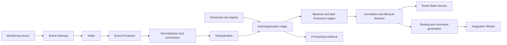
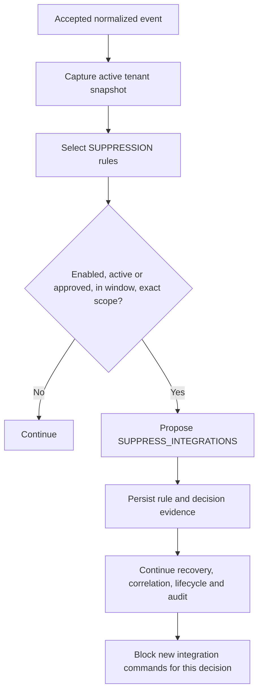
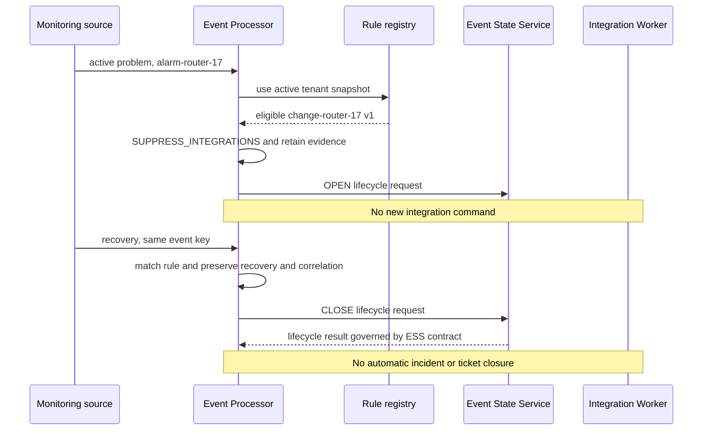

# Auto-Suppression Operations

## 01. Module Overview

Auto-Suppression is a governed Event Processor capability that automatically
evaluates operator-managed, time-bounded `SUPPRESSION` rules for each event. A
matching eligible rule proposes `SUPPRESS_INTEGRATIONS`, preventing new downstream
integration commands while preserving the event, recovery processing, correlation,
lifecycle handling, and audit evidence.

The automation is the evaluation and application of an approved local rule. It is
not automatic event deletion, event clearing, incident closure, severity change,
or removal of history.

> **IMPLEMENTED:** tenant-scoped rules, finite windows, exact scope matching,
> runtime evaluation, evidence, and the `SUPPRESS_INTEGRATIONS` decision.
> **VALIDATED:** local backend certification covers administration, runtime
> matching, recovery continuity, command suppression, and deactivation.

## 02. Functional Capabilities

The current baseline provides:

- versioned `SUPPRESSION` definitions in the shared Event Processor rule registry;
- declared sources `MANUAL`, `MAINTENANCE`, and `CHANGE`;
- declared external states `ACTIVE`, `APPROVED`, `CANCELLED`, and `COMPLETED`;
- exact tenant/resource scope and a required finite validity window;
- explicit validation, save, activation, disable, and retirement operations;
- deterministic runtime evidence containing rule identity, version, source,
  external reference, state, window match, scope match, and eligibility;
- simulation through the production compiler/evaluator without outbox writes;
- continued processing of recovery, correlation, lifecycle, and audit evidence;
- suppression of new integration-command generation when the directive wins.

External maintenance/change synchronization and provider verification of a declared
approval are **PENDING**. The current source of truth is the local Processor registry.

## 03. Architecture and Dependencies



The Event Gateway owns admission and mapping. The Event Processor owns rule
administration, snapshots, Auto-Suppression evaluation, correlation context,
routing eligibility, and durable command intent. Event State Service owns event
lifecycle state. The Integration Worker owns provider execution and its retry and
reconciliation behavior.

## 04. Main Processing Flow

The current Processor documents Auto-Suppression after Deduplication and before
Blackout, Correlation, Policy Evaluation, Routing, and Command Generation:



This is the evidenced order of the current Processor implementation, not a
universal order for every service or future capability. Cross-capability precedence
beyond the documented directive resolver is **PENDING** architectural governance.

## 05. Auto-Suppression Policies

An Auto-Suppression policy is a `SUPPRESSION` rule with:

- a stable ID, immutable version, enabled flag, and priority;
- a declared source: `MANUAL`, `MAINTENANCE`, or `CHANGE`;
- a declared external status;
- exact scope over supported tenant/resource fields;
- an IANA time zone plus explicit `validFrom` and `validTo` instants;
- a reason and optional owner/external reference metadata.

The rule is local configuration. `APPROVED` describes the registered external
status; it is not proof that Event Management contacted or authenticated an
external change provider.

## 06. Trigger Conditions

A rule is eligible only when all documented conditions hold:

1. Its registry identity is enabled with the intended version active.
2. Its declared external status is `ACTIVE` or `APPROVED`.
3. The event belongs to the same tenant.
4. Every configured scope value matches exactly.
5. Evaluation time is within the finite window: start inclusive, end exclusive.

`CANCELLED` and `COMPLETED` never suppress. Source alone does not determine the
decision. An empty scope applies to the whole tenant and must be presented as such.
There is no regex, arbitrary attribute, recurrence, or open-ended window in this
contract.

## 07. Rule Creation and Registration

The following is an **IMPLEMENTED contract example** using illustrative values:

```json
{
  "id": "change-router-17",
  "version": 1,
  "type": "SUPPRESSION",
  "enabled": true,
  "priority": 10,
  "source": "CHANGE",
  "externalStatus": "APPROVED",
  "scope": {"customerCode": "tenant-demo", "node": "router-17"},
  "schedule": {
    "timezone": "America/Mexico_City",
    "validFrom": "2026-10-19T16:00:00Z",
    "validTo": "2026-10-19T17:00:00Z"
  },
  "reason": "Illustrative approved maintenance",
  "metadata": {"owner": "operations", "externalReference": "change-demo-17"}
}
```

Use the shared `/api/v1/rules` administration contract; there is no dedicated
Auto-Suppression write API. Save `{rule, reason}` with the current `If-Match`
revision and one stable `Idempotency-Key` per logical action. Rule IDs share the
tenant namespace with other rule capabilities.

## 08. Rule Validation and Activation

Validate before saving. Backend validation is authoritative for schema, supported
source/status values, ID, scope, timestamps, time zone, window order, limits, and
unknown fields.

Saving creates the next immutable version but does not activate it. Activation is
separate and uses the selected version, current ETag, reason, and an idempotency
key. Re-read active/latest versions and history after each change. A `409` requires
refresh and reconciliation rather than automatic overwrite.

Saving a `CANCELLED` version does not replace an earlier active `APPROVED` version.
Activate the cancellation version, or disable the currently active version when
the effect must stop immediately.

## 09. Runtime Evaluation

Each accepted event uses a stable active-rule snapshot. Auto-Suppression evaluates
the rule's administrative eligibility, external status, exact scope, and window at
the documented evaluation time. A match records evidence and proposes
`SUPPRESS_INTEGRATIONS`.

The stage does not contact a change provider at runtime. It does not turn an
unverified declaration into authorization. Rule administration authorization and
runtime eligibility are separate controls.

## 10. Authorized Actions

The implemented runtime action is limited to the `SUPPRESS_INTEGRATIONS` directive.
It prevents new eligible ticket, notification, or automation commands from being
generated for that processing decision. It does not call a provider itself.

Any future automatic clear, closure, or provider mutation requires a separate
capability contract, authorization policy, idempotent command identity, failure
semantics, and acceptance evidence. Those actions are **PROPOSED**, not implied by
the current Auto-Suppression rule.

## 11. Event Clear and Closure Semantics

A monitoring recovery is an input lifecycle fact, not an Auto-Suppression action.
The Gateway/Processor lifecycle contract maps an eligible recovery to a `CLOSE`
request; Event State Service owns the event aggregate and applies or classifies the
transition. Auto-Suppression preserves that flow even while integration commands
are suppressed.

These concepts are distinct:

- **Event clear/recovery:** a source reports recovery for the event identity.
- **Event closure:** Event State Service applies a lifecycle `CLOSE` request.
- **Incident closure:** a provider-side operation requiring a separate routed
  command and confirmation.
- **Ticket resolution:** lifecycle orchestration may request a configured provider
  transition for a correlated situation; it is not automatic ticket closure.

An event recovery does not by itself close a correlated situation while other
members remain active, and it does not automatically close an external incident.

## 12. Idempotency and Retry Handling

Administrative mutations use an `Idempotency-Key` and optimistic revision. An
uncertain retry must reuse the same key, actor, body, and revision; a different
logical mutation requires a new key. The interface must not allow a second write
until the uncertain result is reconciled.

At runtime, Processor replay checks and transactional persistence prevent the same
accepted input from creating a second decision effect. Event State Service records
message identity and classifies equivalent repeats as duplicates. Integration
commands have their own durable identity and Worker retry/reconciliation contract.
Auto-Suppression does not replace those boundaries.

## 13. Failure and Recovery Behavior

- Invalid rules are rejected before activation.
- Registry unavailability prevents silent evaluation with an empty ruleset.
- A persistence failure rolls back the Processor unit of work; Kafka is not
  confirmed until the transaction commits.
- A missing original event may be preserved as an orphan recovery in correlation
  evidence or become a closed lifecycle aggregate with zero tally under the ESS
  contract; Auto-Suppression must not invent an original event.
- Provider execution failures belong to the Integration Worker and do not turn a
  suppression decision into success or closure.
- Uncertain external mutations require reconciliation; they are not blindly
  retried by Auto-Suppression.

## 14. Integration With Suppression

[Suppression Operations](/operations/suppression/) documents Policy Engine rules
whose typed conditions propose `SUPPRESS_INTEGRATIONS`. Auto-Suppression reaches the
same directive through a specialized `SUPPRESSION` rule with source, status, exact
scope, and finite-window semantics. They remain different rule types, stages, and
evidence records.

Directive resolution controls the effective downstream behavior. It does not merge
the ownership or lifecycle of the two rule families.

## 15. Integration With Correlation

Auto-Suppression does not remove correlation. The current contract explicitly
preserves group membership and recovery processing. A recovery can update member
and group state while new integration commands remain suppressed.

A member clear does not resolve a group that still has active members. An orphan
recovery is recorded without manufacturing prior membership. See
[Correlation Operations](/operations/correlation/).

## 16. Integration With Deduplication

Deduplication runs earlier in the current Processor pipeline. It classifies and
records repeated semantic occurrences; Auto-Suppression does not change the
fingerprint, content hash, duplicate classification, or occurrence counter.

A duplicate recovery remains subject to replay, deduplication, correlation, and
lifecycle identities. It must not create a second external action. See
[Deduplication Operations](/operations/deduplication/).

## 17. Integration With Other Operational Rules

- **Ingestion and normalization:** establish the accepted canonical event.
- **Enrichment:** supplies context but does not verify external approvals.
- **Blackouts and Maintenance:** use separate blackout rule semantics and stage;
  they are not aliases for `SUPPRESSION` rules.
- **Policy Engine:** may independently propose another directive later in the
  current Processor pipeline.
- **Event State Service:** owns lifecycle state and preserves Processor decisions;
  it does not reevaluate suppression.
- **Routing:** creates command intent only when the resolved directive permits it.
- **Notifications, ticketing, and automation:** execute only from authorized,
  durable commands in the Worker/provider boundary.

The documented Processor order must not be generalized to every ingress path or
future capability. Conflicts between business owners beyond directive precedence
remain **PENDING**.

## 18. Security and Auditability

Tenant, actor, reason, revision, and idempotency controls are mandatory parts of
administration. Immutable versions and change history preserve who declared what
and when. Processing evidence preserves the exact active version, snapshot,
matching dimensions, external reference, decision, and processing identity.

The current local backend documentation records API identity/RBAC as deferred.
Therefore administrative network exposure must not be treated as production-ready
authorization merely because rule validation succeeds. Credentials and arbitrary
provider payloads are not part of the rule contract.

## 19. Operational Monitoring

Operators should monitor:

- administrative state, active/latest version, revision, checksum, and history;
- declared source/status and external reference without presenting them as remotely
  verified facts;
- window and scope match evidence for the `AutoSuppression` stage;
- resolved directive and absence of new commands when suppression is effective;
- normalized output, correlation/recovery evidence, lifecycle requests, and audit;
- registry, transactional outbox, Kafka, Event State Service, and Worker health;
- truncated catalog views and stale console data.

`enabled: true` alone does not prove an effective rule. Confirm the active version,
eligible status, current window, exact scope, stage match, and resolved directive.

## 20. Disable and Delete Lifecycle

Disable the active version through the shared rule lifecycle with its version,
reason, ETag, and a new idempotency key. The change affects later snapshots; it
does not replay previously suppressed actions.

Retirement is terminal, preserves immutable history, and prevents ID reuse. There
is no physical delete in the documented contract. Expiry makes a rule ineligible
after its end instant but does not remove or retire it. No autonomous reevaluation
occurs merely because a window expires; a later event drives a new evaluation.

## 21. Functional Example

The following is a **CONCEPTUAL example using implemented boundaries**.

At 16:10Z, monitoring source `monitor-demo` reports `evt-problem-17`, key
`alarm-router-17`, as an active problem for `router-17`. At 16:35Z it reports
recovery as `evt-recovery-17` with the same event key. Active rule
`change-router-17` is `APPROVED`, in its finite window, and matches the tenant and
node. The administration identity was authorized before activation.



Expected successful behavior:

| Check | Result |
|---|---|
| Original identity | event key links problem and recovery; original event identity remains auditable |
| Matching criteria | tenant, node, status, active version, and `[validFrom, validTo)` all match |
| Current state | read by the responsible lifecycle/correlation boundary; not invented by the rule |
| Authorization | administrative activation is recorded; declared approval is not remote verification |
| Idempotency | stable mutation key and event/message identities prevent duplicate effects |
| Action | `SUPPRESS_INTEGRATIONS` blocks new commands for both decisions |
| Result | recovery continues; ESS may apply `CLOSE`; correlation is preserved |
| Audit | rule/version/reference, stage evidence, directive, processing and lifecycle evidence remain |

Exception behavior:

- **Duplicate recovery:** classified by existing replay/dedup/lifecycle identities;
  no second external action is created.
- **Missing original event:** do not manufacture an opening; preserve the orphan or
  zero-tally close result defined by the responsible subsystem.
- **Expired policy:** no match at or after `validTo`; a new event evaluates the new
  snapshot/time, but expiry alone triggers no replay.
- **Unauthorized action:** reject administration or command execution; do not infer
  authority from `externalStatus`.
- **Execution failure:** roll back an uncommitted Processor decision or preserve the
  Worker/ESS failure state at its owning boundary.
- **Retry:** reuse the same administrative idempotency inputs, event/message identity,
  or durable command identity according to the subsystem contract.

## 22. Current Implementation vs Target Architecture

| Capability | Status | Boundary |
|---|---|---|
| Local versioned `SUPPRESSION` registry | **IMPLEMENTED** | Shared `/rules` contract |
| Exact scope, status, finite-window evaluation | **IMPLEMENTED** | Start inclusive, end exclusive |
| `SUPPRESS_INTEGRATIONS` and no-command behavior | **VALIDATED** | Backend runtime certification |
| Recovery, correlation, and audit continuity | **VALIDATED** | Local end-to-end evidence |
| Read-only Auto-Suppression catalog | **IMPLEMENTED** | Maximum/truncation rules apply |
| Browser administration workflow | **DESIGNED** | Frontend V1 handoff; acceptance **PENDING** |
| External maintenance/change synchronization | **PENDING** | No provider lookup or freshness verification |
| Automatic event clear by Auto-Suppression | **NOT IMPLEMENTED** | Recovery is a source/lifecycle fact |
| Automatic incident or ticket closure | **NOT IMPLEMENTED** | Requires separate lifecycle/provider contracts |
| Provider-specific authorized automation | **PROPOSED** | Needs explicit capability and acceptance evidence |
| Production RBAC and security certification | **PENDING** | Local validation is insufficient |
| Production-scale and disaster-recovery certification | **PENDING** | Not established by local tests |

## 23. Existing Engineering References

- [Auto-Suppression backend closure and validation](/platform/event-processor/auto-suppression/)
- [Auto-Suppression frontend V1 handoff](/platform/event-processor/frontend-handoffs/auto-suppression/)
- [Correlation, Auto-Suppression and command contract](/platform/event-processor/correlation-suppression-commands/)
- [Event Processor rules and contracts](/platform/event-processor/rules-and-contracts/)
- [Event Processor implementation status](/platform/event-processor/implementation-status/)
- [Event Processor lifecycle orchestration](/platform/event-processor/lifecycle-orchestration/)
- [Event State Service lifecycle contract](/platform/event-state-service/lifecycle-contract/)
- [Policy Engine backend evidence](/platform/event-processor/policy-backend/)
- [Blackouts and maintenance](/platform/event-processor/rest-and-blackouts/)
- [Routing and command evidence](/platform/event-processor/routing-backend/)
- [Event Gateway rules API](/platform/event-gateway/rules-api/)
