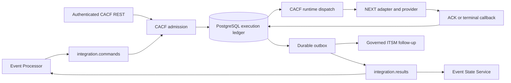
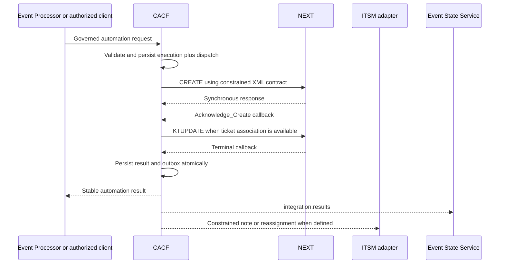
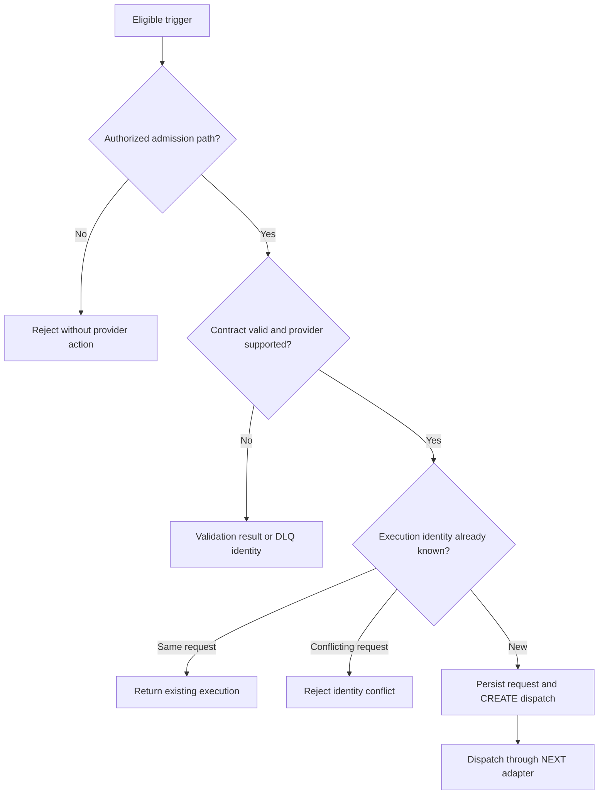

# Automation Operations

## 01. Module Overview

Automation converts an explicitly authorized Event Management intention into a durable
provider execution while preserving event, correlation cycle, command, execution,
provider, ticket, result, and audit identities. The implemented foundation is CACF in
the Integration Worker with the NEXT provider adapter.

> **IMPLEMENTED:** authenticated REST and Kafka admission, durable execution state,
> NEXT CREATE/TKTUPDATE dispatch, callbacks, deadlines, idempotent results, outbox
> publication, and constrained ITSM follow-up actions.
>
> **VALIDATED:** local CACF/NEXT behavior and the opt-in ticket → notification →
> automation lifecycle against simulated providers. This is not certification of a
> real NEXT, ServiceNow, or GLPI account.

Automation does not receive an authorization bypass because it is machine initiated.
It does not create the base ticket, clear the source event, or infer monitoring recovery.

## 02. Functional Capabilities

Current capabilities include:

- canonical execution admission through documented REST or Kafka boundaries;
- strict provider and operation validation for `NEXT` and `AUTOMATION_REQUESTED`;
- immutable execution identity and conflict detection through idempotency keys;
- durable request, provider-message, dispatch, result, and outbox records;
- asynchronous provider acknowledgement and terminal callbacks;
- bounded acknowledgement and result deadlines;
- safe normalization of remediation, escalation, transfer, no-action, timeout, and
  unknown outcomes;
- ServiceNow or GLPI follow-up only through their supported provider contracts;
- preservation of duplicate, late, invalid, and uncertain evidence;
- metrics, readiness, review state, and auditable result publication.

Arbitrary commands, generic scripts, production provider certification, and universal
workflow orchestration are not established.

## 03. Architecture and Dependencies



CACF resides in the Integration Worker and reuses PostgreSQL and the existing Kafka
topics. Processor owns lifecycle eligibility and ordering. Worker owns admission,
provider execution, deadlines, reconciliation evidence, and result publication. NEXT
owns its provider execution; ticket providers own their records; ESS owns consolidated
event state.

## 04. Main Processing Flow



Synchronous HTTP success proves neither functional provider acknowledgement nor a
terminal outcome. The execution becomes `IN_PROGRESS` only after a correlated provider
acknowledgement and completes only from a terminal callback or governed timeout.

## 05. Automation Providers

| Provider or category | Status | Evidence boundary |
| --- | --- | --- |
| NEXT through CACF | **IMPLEMENTED / VALIDATED** | Adapter, XML mapping, callbacks, deadlines, result/outbox; local simulated provider |
| Real NEXT environment | **PENDING** | Credentials, operational contract, and production behavior are not certified |
| ServiceNow | **IMPLEMENTED dependency** | Receives constrained follow-up actions; it is not the automation engine |
| GLPI | **IMPLEMENTED dependency** | Supported provider-aware follow-up contract; advanced lifecycle remains ServiceNow-specific |
| Generic scripts, runbooks, webhooks, or other engines | **PROPOSED** | No current CACF adapter or execution contract is established |
| Dynamic automation provider instances | **DESIGNED** | Integration-instance and SecretRef administration is not active runtime configuration |

Registering a provider in a catalog does not make it an implemented adapter or expand
the Processor contract.

## 06. Trigger Conditions

The implemented end-to-end profile starts automation only after an eligible Routing
rule created a ticket and GNM returned a confirmed open notification incident. The
Processor persists this ordering in the correlation-cycle lifecycle.

REST admission can also accept a directly authorized canonical CACF request. Kafka
admission requires `integrationType=CACF`, `operation=AUTOMATION_REQUESTED`, and matching
tenant/event identities between envelope and payload.

An event match, enrichment fact, AI recommendation, rule save, or provider registration
does not by itself authorize execution. A clear received before automation eligibility
prevents a stale lifecycle request from being launched under the implemented profile.

## 07. Automation Rules

The current opt-in automation decision is part of an explicit lifecycle profile on the
owning Routing rule. There is no separate universal Automation rule type or arbitrary
command DSL. The first profile for a correlation cycle is frozen so later rule edits do
not rewrite in-flight work.

Rules establish eligibility and bounded parameters; they do not contain provider
credentials or free-form executable commands. General action catalogs, schedules,
multi-step workflow authoring, and autonomous AI-generated actions are **PROPOSED /
PENDING**.

## 08. Action Contracts

The canonical version 1.0 request requires a UUID `executionId`, event identity and
summary, tenant/customer code, source identity, resource and severity, ticket assignment
groups, provider `NEXT`, and a bounded result timeout. A ticket number may arrive with
the request or be associated later, but it cannot be changed to a different ticket.

Documented current endpoints are:

- `POST /api/v1/automations` with `Idempotency-Key` equal to `executionId`;
- `GET /api/v1/automations/{executionId}`;
- `PUT /api/v1/automations/{executionId}/ticket`;
- `POST /data` and `POST /api/v1/providers/next/callback` for provider callbacks; and
- `GET /metrics` for authenticated local metrics.

Provider-native XML remains behind the adapter. `CREATE` and `TKTUPDATE` use the
documented NEXT contract; callers cannot submit an arbitrary endpoint or command. These
CACF routes are operational integration surfaces, not a universal OEM workflow API.

## 09. Human Approval Gates

The implemented CACF admission contract authenticates, validates, and deduplicates an
execution request, but the evidence does not establish a product approval queue,
approve/reject API, approver role model, or approval timeout workflow.

- **IMPLEMENTED:** explicit enablement, authenticated admission, strict contract
  validation, and opt-in lifecycle configuration.
- **DESIGNED:** policy-driven human approval for sensitive or high-impact actions,
  with identity, scope, decision, and audit evidence.
- **PENDING:** an operational approval UI/API and provider-specific approval policies.

When a policy requires approval, no action may execute until that approval is durably
confirmed. Absence, expiration, or ambiguity must not be interpreted as consent.

## 10. Execution Requests



REST acceptance returns HTTP 202 with execution identity and state. Kafka admission
commits its offset only after durable SQL acceptance; invalid CACF commands emit bounded
error identity without copying the sensitive request payload to logs or DLQ.

## 11. Execution Status and Outcomes

| State or outcome | Operational meaning |
| --- | --- |
| `RECEIVED` | Valid execution persisted |
| `SUBMITTING` | CREATE dispatch claimed |
| `SUBMITTED` | Synchronous provider response accepted syntactically |
| `IN_PROGRESS` | Correlated provider acknowledgement received |
| `COMPLETED / REMEDIATED` | Terminal result requests a note; monitoring may still be open |
| `COMPLETED / ESCALATED` or `TRANSFER` | Governed reassignment and note are eligible |
| `NO_ACTION`, `NO_MATCHING_HOST`, `REPEATED_INCIDENT` | Terminal provider outcome with defined follow-up |
| `TIMED_OUT / TIMEOUT` | Governed deadline expired; follow-up is provider-policy constrained |
| `COMPLETED / UNKNOWN` | Evidence retained, `requiresReview=true`, no terminal ITSM action |
| `SUBMISSION_FAILED / UNKNOWN` | Provider dispatch was not established; review uncertainty |

Consumers must evaluate state, outcome, and `requiresReview` together. The current
result envelope can carry `status=SUCCESS` for an `UNKNOWN` outcome; therefore `SUCCESS`
alone must never be interpreted as remediation.

## 12. Retry, Idempotency, and Reconciliation

Execution ID, command ID, requester ID, provider execution ID, transaction number,
result ID, and outbox identity protect each boundary. Repeating the same REST request or
callback is idempotent; a conflicting identity returns an error. Terminal state is not
reversed by a duplicate or late callback.

The result and outbox are committed together. Kafka publication is at least once, with
stable identifiers for consumer deduplication. CACF does not promise distributed
exactly-once behavior across SQL, Kafka, and provider HTTP.

NEXT `CREATE`, `TKTUPDATE`, and uncertain ITSM mutations are not retried blindly. An
in-flight dispatch with uncertain external effect moves to review; no public retry or
cleanup endpoint is documented. Preserve the original execution identity and obtain
provider evidence before repair.

## 13. Failure Handling

| Failure | Required response |
| --- | --- |
| Invalid request or identity mismatch | Reject before provider execution; retain bounded error identity |
| Provider HTTP failure before known acceptance | Preserve submission failure/uncertainty; do not invent a second execution |
| Missing acknowledgement | Expire using the separate ACK deadline |
| Missing terminal result | Mark timeout using the persisted result deadline |
| Unknown callback vocabulary | Store original evidence, set `UNKNOWN`, require review |
| Invalid or oversized XML | Reject safely; do not parse DTD, external entities, or XInclude |
| Late/duplicate callback | Retain evidence without changing terminal result |
| Outbox/Kafka failure | Keep the durable publication pending with stable identity |
| Uncertain ITSM mutation | Do not repeat automatically; require review/reconciliation |

No missing response is upgraded to success. Provider acknowledgement, execution
completion, ticket follow-up, and event recovery are independent facts.

## 14. Security and SecretRef

Current CACF APIs require the documented external token and return 404 when the feature
is disabled. NEXT credentials and the CACF token are runtime configuration; they do not
belong in requests, results, rules, logs, screenshots, or public evidence. Laboratory
fixture credentials are not usable provider credentials.

XML parsing rejects DTDs, external entities, XInclude, excess depth, and oversized
payloads. Database writes use prepared statements and explicit transactions.

Integration instances with SecretRefs, rotation, environment scopes, and optimistic
revision control are **DESIGNED**. Saving a proposed instance record does not currently
reconfigure the Worker. Production authentication, authorization/RBAC, and real secret
backend certification remain **PENDING**.

## 15. Auditability and Operational Monitoring

The audit chain retains tenant, event and correlation identity, command and execution
IDs, provider identity, ticket reference, request hash/evidence, dispatch state,
provider messages, result ID, outcome, review flag, timestamps, and outbox publication.
Raw provider evidence is restricted and must not be copied into public handoffs.

Authenticated gauges cover executions, results, duplicate/late callbacks, pending
outbox entries, and provider-review work. Readiness proves the SQL query path and CACF
admission route, not NEXT or ITSM availability or scheduler progress. Operators should
monitor prolonged submitted states, deadlines, review counts, and oldest pending outbox
records without manually rewriting state.

## 16. Integration With Other Operational Modules

- **Routing:** owns the current opt-in lifecycle profile; arbitrary Automation Routing
  actions are **PENDING**.
- **Ticketing:** supplies the confirmed ticket association and receives constrained
  notes or reassignment; CACF does not create the base ticket.
- **Notifications:** the implemented lifecycle waits for confirmed GNM open state before
  starting automation.
- **Correlation:** one tenant/group cycle scopes eligibility and durable identity.
- **Suppression / Auto-Suppression / Blackouts:** may prevent a new intention at their
  governed boundary but do not cancel an execution already sent to the provider.
- **Deduplication:** input and result duplication must not cause another external effect.
- **Enrichment / Filters & Criteria:** may provide validated context or eligibility;
  neither grants execution approval.
- **Event State Service:** consolidates results and lifecycle projection without
  executing automation or owning provider state.

The stated order belongs to the explicit implemented lifecycle profile and is not a
universal order for future workflow engines.

## 17. Configuration Lifecycle

Current activation requires runtime CACF settings plus an explicitly eligible lifecycle
profile. Validate provider, operation, tenant, assignment groups, timeout bounds, and
ticket association requirements before activation. Configuration changes must not
rewrite active executions or correlation cycles.

To disable new execution, deactivate the owning route/profile or set the documented
runtime feature control through its authorized deployment process. Drain or review
in-flight executions and preserve tables, evidence, mappings, offsets, and outboxes.
Destructive deletion is not a rollback procedure.

Dynamic create/update/delete, SecretRef rotation, version promotion, and one-click
rollback for provider instances are **DESIGNED / PENDING**.

## 18. Deterministic Functional Example

This example is conceptual and illustrates existing contracts; its field selection is
not a new public API schema.

A critical monitoring event is accepted into correlation cycle
`corr:payments-db:077`. Routing creates and confirms ticket `INC0043182`; Notifications
opens and confirms its GNM incident. Processor then creates one stable automation
execution for NEXT:

```json
{
  "executionId": "2abf6c50-65ec-4eeb-9b74-70e3f339f55c",
  "eventId": "evt-payments-db-077",
  "customer": { "code": "example-tenant" },
  "event": {
    "sourceSystem": "monitoring",
    "sourceSerial": "alert-077",
    "summary": "Payments database unavailable",
    "resourceId": "db-payments-01",
    "severity": 5
  },
  "ticket": {
    "number": "INC0043182",
    "originalAssignmentGroup": "database-operations",
    "holdingAssignmentGroup": "automation-holding"
  },
  "automation": { "provider": "NEXT", "resultTimeoutSeconds": 600 }
}
```

CACF persists the request, dispatches CREATE, correlates `Acknowledge_Create`, associates
the provider execution, and awaits a terminal callback. A `REMEDIATION` signal becomes
`COMPLETED / REMEDIATED`, publishes one stable result, and adds the governed success
note. It does not close the source event or ticket; observed monitoring recovery drives
the later lifecycle closures.

A duplicate request with the same identity reuses the execution. A conflicting request
is rejected. If the callback is unknown, the original evidence is retained as
`UNKNOWN` with review required and no terminal ITSM mutation. If no result arrives, the
persisted deadline yields `TIMEOUT`; a new execution ID must not be invented to force a
second provider action.

## 19. Current Implementation vs Target Architecture

| Capability | Status | Boundary |
| --- | --- | --- |
| CACF REST/Kafka admission and durable ledger | **IMPLEMENTED** | Current Integration Worker contract |
| NEXT adapter, callbacks, deadlines, result/outbox | **IMPLEMENTED / VALIDATED** | Local simulated provider |
| Shared ticket → GNM → CACF lifecycle | **VALIDATED** | Local shared runtime with mocks |
| Real NEXT and ITSM accounts | **PENDING** | Separate authorized certification required |
| Provider-aware ServiceNow/GLPI follow-up | **IMPLEMENTED** | GLPI advanced lifecycle remains limited |
| Human approval workflow | **DESIGNED / PENDING** | No current approval queue/API/UI |
| Dynamic automation instances and SecretRefs | **DESIGNED** | Not connected to runtime activation |
| Arbitrary scripts, runbooks, and additional engines | **PROPOSED** | No implemented provider adapter |
| Exactly-once external effects | **PENDING / not guaranteed** | Durable uncertainty and review are preserved |

## 20. Existing Engineering References

- [CACF Core Foundation](/platform/cacf/README/)
- [CACF Architecture](/platform/cacf/architecture/)
- [CACF Contracts](/platform/cacf/contracts/)
- [CACF Data and States](/platform/cacf/data-and-states/)
- [CACF Validation](/platform/cacf/validation/)
- [Lifecycle Orchestration](/platform/event-processor/lifecycle-orchestration/)
- [Processor Rules and Contracts](/platform/event-processor/rules-and-contracts/)
- [System Integration Instances](/platform/architecture/system-integration-instances/)
- [Multi-Surface Interaction](/architecture/multi-surface-interaction/)
- [Operations Home](/operations/)
