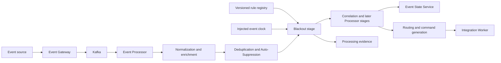
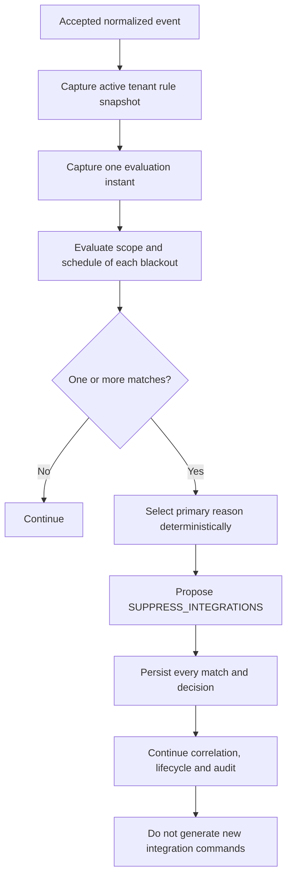
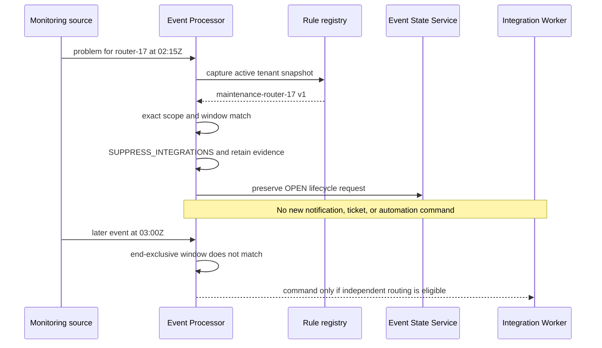

# Blackouts & Maintenance Operations

## 01. Module Overview

Blackouts & Maintenance govern time-bounded decisions that prevent new downstream
integration commands for selected events while preserving accepted events,
deduplication, correlation, lifecycle processing, and audit evidence.

The Event Processor implements blackout capability through versioned `IMMEDIATE`,
`SCHEDULED`, and bounded `RECURRING` rules in the shared registry. A matching rule
proposes `SUPPRESS_INTEGRATIONS`; it does not delete an event, clear it, close an
incident, change severity, or erase history.

> **IMPLEMENTED:** local versioned rules, exact scope, explicit schedules, runtime
> matching, overlap evidence, and downstream-command suppression.
> **VALIDATED:** backend and end-to-end evidence cover immediate/scheduled windows,
> boundaries, administration, audit, and absence of commands. Recurrence exists,
> but exhaustive DST and calendar-boundary validation remains **PENDING**.

## 02. Functional Capabilities

The current baseline provides:

- tenant-scoped, immutable rule versions and administrative history;
- `IMMEDIATE`, `SCHEDULED`, and `RECURRING` blackout definitions;
- exact conjunction over supported tenant/resource selectors;
- explicit IANA timezone and start time;
- finite scheduled windows, optionally open-ended immediate windows, and bounded
  daily/weekly recurrence;
- start-inclusive and end-exclusive evaluation;
- one captured evaluation instant per event;
- deterministic handling of overlapping matching windows;
- simulation through the same evaluator without production writes;
- complete match evidence, resolved directive, and no-command verification;
- explicit enable, disable, and terminal retirement lifecycle.

Blackout rules are local Event Management configuration. They do not synchronize
automatically with an external maintenance provider.

## 03. Architecture and Dependencies



The Event Gateway owns admission and normalization inputs. The Event Processor owns
the rule snapshot, time/scope evaluation, directive resolution, and command intent.
Event State Service owns event lifecycle state. The Integration Worker owns provider
execution and reconciliation for commands already authorized and durably emitted.

## 04. Main Processing Flow

In the current Processor, Blackout evaluates after Deduplication and Auto-Suppression
and before Correlation, Policy Evaluation, Routing, and Command Generation:



This is an evidenced implementation order, not a universal ordering contract for
all future services or ingress paths.

## 05. Blackout Semantics

A blackout is a Processor rule that governs integration-command eligibility during
an applicable time/scope window. Its rule type is `IMMEDIATE`, `SCHEDULED`, or
`RECURRING`; `BLACKOUT` is the capability name, not a valid `rule.type`.

When a rule matches, the Blackout stage records all matching definitions and proposes
`SUPPRESS_INTEGRATIONS`. Processing continues. A blackout is not an event-state
transition and does not create a parallel lifecycle.

## 06. Maintenance Window Semantics

Planned maintenance is an operational reason for configuring a blackout window.
It is not a separate automatic lifecycle action. A `SCHEDULED` or `RECURRING` rule
may express a planned period, and `IMMEDIATE` may express an operator-started period.

These concepts remain distinct:

- **Blackout:** time/scope rule controlling new integration commands.
- **Planned maintenance:** operational context for a configured window.
- **Suppression:** typed Policy Engine decision documented separately.
- **Auto-Suppression:** specialized `SUPPRESSION` rule with declared external state.
- **Event clear/closure:** source recovery and Event State Service transition.
- **Incident closure:** provider operation requiring its own command and confirmation.

None of these distinctions permits event deletion or automatic incident closure.

## 07. Scope and Target Selection

Scope is exact equality and conjunction over supported selectors:

| Selector | Canonical event input |
|---|---|
| `customerCode` | tenant |
| `node` | resource name |
| `nodeAlias` | resource address |
| `component` | resource component |
| `instanceId` | condition instance |
| `monitoringSolution` | source system |

If `customerCode` is present, it must equal the registry tenant. An omitted selector
is not manufactured from inventory or arbitrary original payload fields. Empty scope
applies to the whole tenant and should be called out during confirmation.

Tags, arbitrary attributes, and regex selectors remain **PENDING**. Unsupported
selectors are rejected rather than ignored.

## 08. Schedule and Timezone Handling

All rule types require an explicit `validFrom`, making activation/replay independent
of an implicit wall-clock “now.” Evaluation uses:

```text
validFrom <= evaluatedAt < validTo
```

- `SCHEDULED` requires `validTo` and `validFrom < validTo`.
- `IMMEDIATE` may omit `validTo`; it remains eligible until disabled/retired.
- `RECURRING` requires a bounded base interval and a recurrence expression.
- Timezone must be a valid IANA identifier.
- Timestamps are ISO 8601 instants with `Z` or an explicit offset.
- The engine compares instants and does not silently reinterpret ambiguous local
  clock values.
- A single injected clock instant is used for one event evaluation.

Current recurrence accepts `FREQ=DAILY` or `FREQ=WEEKLY`, optional positive
`INTERVAL`, and optional `BYDAY`. Exhaustive daylight-saving transitions, calendar
limits, and long-horizon recurrence behavior are **PENDING** validation.

Clock synchronization between hosts is an operational dependency. The rule engine
does not implement distributed clock correction; production time monitoring and
tolerance policy are **PROPOSED**.

## 09. Window Creation and Registration

The following is an **IMPLEMENTED contract example** with illustrative values:

```json
{
  "id": "maintenance-router-17",
  "version": 1,
  "type": "SCHEDULED",
  "enabled": true,
  "scope": {"customerCode": "tenant-demo", "node": "router-17"},
  "schedule": {
    "timezone": "America/Mexico_City",
    "validFrom": "2026-10-20T02:00:00Z",
    "validTo": "2026-10-20T03:00:00Z"
  },
  "priority": 20,
  "reason": "Illustrative network maintenance",
  "metadata": {"owner": "operations", "externalReference": "maint-demo-17"}
}
```

Register through the shared `/api/v1/rules` contract using `{rule, reason}`, the
current `If-Match` revision (`"0"` for a new identity), and a stable
`Idempotency-Key`. There is no dedicated blackout write endpoint or parallel store.

## 10. Validation and Activation

Backend validation is authoritative for rule type, ID, version, scope, schedule,
timezone, recurrence syntax, priority, reason, metadata, and structural limits.
Validate before saving.

Saving creates an immutable version but does not activate it, even when
`enabled: true`. Activation is a separate operation against a selected version and
current ETag. A newer saved version does not replace the active version until it is
explicitly enabled. Handle `409` by refreshing and reconciling rather than overwriting.

## 11. Runtime Evaluation

Each event uses one active tenant snapshot and one captured evaluation instant.
For each blackout rule, the engine records window match, scope match, rule ID,
version, checksum, timezone, start, end, reason, and scope.

Rules are sorted by priority descending, then ID and version ascending. Every match
remains in evidence; the first in that deterministic order supplies the primary
reason. This ordering does not discard overlapping windows and is not a cancellation
or ownership hierarchy.

## 12. Event Handling During Windows

When Blackout resolves to `SUPPRESS_INTEGRATIONS`:

- the accepted and normalized event remains traceable;
- deduplication and Auto-Suppression evidence remain available;
- correlation, Policy Evaluation, lifecycle requests, and processing audit continue;
- new routing candidates and durable integration commands are not generated;
- no provider is called by the Blackout stage.

Recovery events are evaluated too. A blackout does not hide recovery from event
lifecycle or correlation, but it can suppress new integration intentions, including
closure-related commands, while active. A later eligible event may continue pending
orchestration; window expiry alone triggers no autonomous reevaluation.

## 13. Policy Precedence and Conflicts

Blackout, Auto-Suppression, and Policy Suppression can each propose
`SUPPRESS_INTEGRATIONS`. The global directive resolver combines stage results; a
more permissive proposal does not override an already restrictive directive.

Overlapping blackout windows all remain auditable. Priority, ID, and version select
the primary reason deterministically; there is no implemented “most specific wins,”
“latest wins,” or implicit cancellation rule. Business ownership and cross-capability
conflict escalation beyond directive precedence remain **PENDING**.

## 14. Integration With Suppression

[Suppression Operations](/operations/suppression/) uses typed `POLICY` criteria and
evaluates later in the current Processor. Blackout uses explicit time/scope rules.
Both may suppress integrations, but their definitions, stages, evidence, and
administrative intent remain distinct.

## 15. Integration With Auto-Suppression

[Auto-Suppression Operations](/operations/auto-suppression/) uses a specialized
`SUPPRESSION` rule with declared `MANUAL`, `MAINTENANCE`, or `CHANGE` source and an
external status. Blackout does not carry that eligibility-state model. Neither
capability contacts an external maintenance provider during evaluation.

## 16. Integration With Correlation

The current Processor evaluates Blackout before Correlation. Blackout does not
delete group membership or prevent recovery calculation. Correlation can therefore
remain current even when the event produces no integration command.

A member recovery does not close a group while other members remain active. See
[Correlation Operations](/operations/correlation/).

## 17. Integration With Deduplication

Deduplication evaluates earlier in the current Processor. Blackout does not alter
the event fingerprint, duplicate classification, occurrence count, or content hash.
A repeated event may be both classified as a duplicate and matched by a blackout,
with each decision recorded independently.

See [Deduplication Operations](/operations/deduplication/).

## 18. Integration With Other Operational Rules

- **Ingestion:** Gateway admission/rejection remains separate.
- **Normalization and enrichment:** provide canonical selectors for exact matching.
- **Filters:** do not become blackout selectors unless the contract explicitly maps them.
- **Event State Service:** owns event lifecycle and preserves Processor decisions;
  it does not recalculate windows.
- **Routing:** creates command intent only when the resolved directive permits it.
- **Notifications, ticketing, and automation:** execute in the Worker/provider
  boundary from durable authorized commands.

The documented stage order is current implementation evidence, not a universal
execution order for every future rule engine.

## 19. Security and Auditability

Administrative mutations require tenant, revision, reason, and idempotency controls.
Actor is recorded, but the current local API documentation states that tenant and
actor headers are client declarations rather than authenticated identity. Production
OIDC/RBAC remains **PENDING** and must not be inferred from successful validation.

Immutable versions, administrative history, checksums, snapshot identity, every
runtime match, the primary reason, and processing identity preserve auditability.
Rules contain no credentials or arbitrary provider payload.

## 20. Operational Monitoring

Operators should monitor:

- active/latest version, registry revision, status, checksum, and history;
- timezone, start/end, recurrence, tenant/resource scope, and external reference;
- evaluation time, every scope/window match, primary reason, and directive;
- absence of new commands during a matching window;
- normalized output, correlation/recovery, lifecycle, audit, and outbox health;
- clock synchronization and unexpected drift between event timestamps and processing;
- rules approaching expiry and open-ended immediate windows;
- truncated or stale administrative catalog views.

`enabled: true` alone does not prove effect. Verify active version, time, scope,
stage match, resolved directive, and command outcome.

## 21. Modification and Cancellation

Modification creates `latestVersion + 1`; the earlier active version remains in
force until the new version is explicitly activated. Schedule changes never rewrite
past evidence.

There is no separate cancellation flag for blackout rules. To cancel current effect,
disable the active version; terminally remove future use by retiring the identity.
Creating a replacement with a past end does not cancel the active version until that
replacement is activated. Operators must distinguish “saved” from “effective.”

## 22. Disable and Delete Lifecycle

Disable uses the selected active version, reason, current ETag, and a new idempotency
key. It affects later snapshots and does not retroactively emit commands suppressed
by prior events.

Retirement is terminal, preserves immutable versions/history, and prevents ID reuse.
The shared rule contract exposes no physical delete. Natural expiration makes a
window ineligible but does not delete or retire it.

## 23. Failure and Recovery Behavior

- Invalid schedules, timezones, scope, or recurrence are rejected before activation.
- Registry unavailability does not silently evaluate an empty ruleset.
- Processor persistence failure rolls back the unit of work and prevents Kafka
  acknowledgement before commit.
- Stale revisions and idempotency-content conflicts return explicit conflicts.
- Window expiry does not autonomously replay a suppressed action.
- A command that crossed the durable boundary before blackout is not withdrawn.
- Provider uncertainty and retries remain owned by the Integration Worker.
- Recovery still reaches correlation/lifecycle; provider closure is not inferred.

## 24. Functional Example

The following is a **CONCEPTUAL example using implemented semantics**.

Window `maintenance-router-17` targets tenant `tenant-demo` and node `router-17`
from 02:00Z inclusive to 03:00Z exclusive, with IANA timezone
`America/Mexico_City`. At 02:15Z a normalized problem event for that node arrives.



| Element | Expected result |
|---|---|
| Window identity | `maintenance-router-17`, active version 1 |
| Target | tenant `tenant-demo`, node `router-17` |
| Schedule | `[02:00Z, 03:00Z)`, IANA timezone retained |
| Matching event | 02:15Z event matches exact target and time |
| Decision | Blackout proposes `SUPPRESS_INTEGRATIONS` |
| Allowed actions | normalization, evidence, deduplication, correlation, lifecycle, audit |
| Restricted actions | new notification, ticket, and automation commands |
| Audit | rule/version/checksum, scope/window match, reason, evaluated time, directive |
| Expiration | at 03:00Z the window no longer matches |
| After expiration | a new event can route normally if all independent rules permit it |

Edge cases:

- **Overlapping windows:** preserve all matches; priority then ID/version selects the
  primary reason. No undocumented precedence cancels another match.
- **Boundary event:** start matches; exact end does not match.
- **Cancelled window:** disabling removes it from later active snapshots; saved-only
  replacement data has no effect until activation.
- **Expired window:** does not match and does not autonomously replay past actions.
- **Invalid timezone:** validation rejects the definition.
- **Unauthorized modification:** reject at the authorization boundary; current local
  headers alone are not production identity and require pending RBAC controls.

## 25. Current Implementation vs Target Architecture

| Capability | Status | Boundary |
|---|---|---|
| Immediate and scheduled blackout rules | **IMPLEMENTED** | Shared versioned registry |
| Start-inclusive/end-exclusive evaluation | **VALIDATED** | One evaluation instant per event |
| Exact tenant/resource scope | **VALIDATED** | Supported selectors only |
| Overlap evidence and deterministic primary reason | **IMPLEMENTED** | Not business-owner precedence |
| Daily/weekly bounded recurrence | **IMPLEMENTED** | `INTERVAL`/`BYDAY` supported |
| Exhaustive DST/calendar recurrence validation | **PENDING** | Current implementation is not full certification |
| Backend administration and runtime suppression | **VALIDATED** | Writes, audit, Gateway/Kafka, no commands |
| Browser administration | **IMPLEMENTED** | Complete recurring-browser acceptance remains **PENDING** |
| Tags, arbitrary attributes, regex scope | **PROPOSED** | Rejected today |
| External maintenance synchronization | **PENDING** | Local registry is authoritative |
| Dedicated blackout administration API | **PROPOSED** | Shared `/rules` is current contract |
| Authenticated administration boundary | **DESIGNED** | OIDC/RBAC implementation and certification remain **PENDING** |
| Event or incident automatic closure | **NOT IMPLEMENTED** | Separate lifecycle/provider ownership |
| Production RBAC, scale, and DR certification | **PENDING** | Local validation is insufficient |

## 26. Existing Engineering References

- [REST administration and Blackouts](/platform/event-processor/rest-and-blackouts/)
- [Blackouts frontend handoff](/platform/event-processor/frontend-handoffs/blackouts/)
- [Event Processor rules and contracts](/platform/event-processor/rules-and-contracts/)
- [Event Processor Defect Prevention](/platform/event-processor/defect-prevention/)
- [Event Processor implementation status](/platform/event-processor/implementation-status/)
- [Event Processor lifecycle orchestration](/platform/event-processor/lifecycle-orchestration/)
- [Event State Service lifecycle contract](/platform/event-state-service/lifecycle-contract/)
- [Policy Engine backend evidence](/platform/event-processor/policy-backend/)
- [Correlation, Auto-Suppression and command contract](/platform/event-processor/correlation-suppression-commands/)
- [Event Gateway rules API](/platform/event-gateway/rules-api/)
