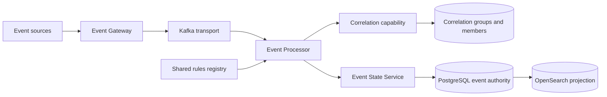
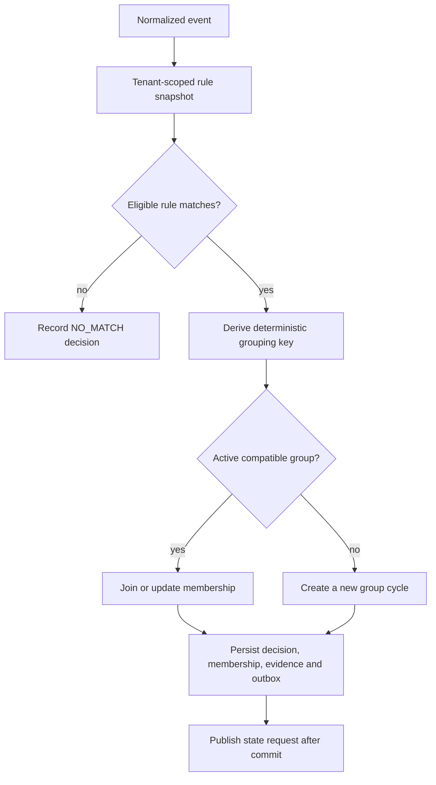
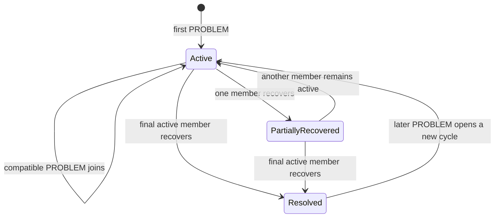
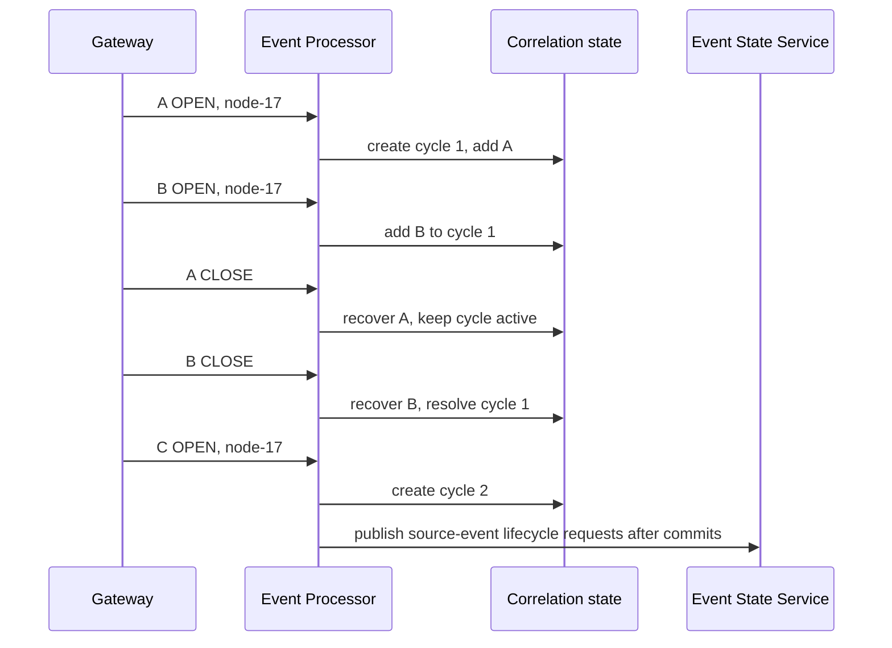

# Correlation Operations

## 1. Module Overview

Correlation is the Event Processor capability that deterministically relates
normalized events and assigns them to a tenant-scoped correlation group. The
current implementation evaluates manually administered `ATTRIBUTE` rules with a
`GROUP` relationship. It preserves each source event identity: membership is a
calculated relationship, not a replacement for the event.

This Operations page explains the functional workflow. The existing
[Correlation engineering documentation](/platform/event-processor/correlation-service-manual-rules/)
remains the detailed technical authority.

> **Current:** deterministic correlation and durable group membership.
> **DESIGN:** AI-assisted suggestions and relationship recommendations.

## 2. Functional Capabilities

The implemented baseline provides:

- tenant-scoped, versioned correlation rules in the shared `/rules` registry;
- deterministic matching against one to four approved string attributes;
- configured correlation windows from 1 to 86,400 seconds;
- grouping of active events with durable group identity, members, revision and
  lifecycle cycle;
- partial and complete recovery handling;
- sequential request-scoped simulation without production group mutation;
- optimistic concurrency, immutable history and auditable rule changes;
- at most eight active correlation rules per tenant and at most 32 retained
  members per cycle in the current baseline.

Current correlation does not claim statistical similarity, topology inference,
historical search, autonomous expiration sweeps, or an independent API.

## 3. Architecture and Dependencies



The Event Processor owns correlation evaluation and durable group membership.
The Event State Service owns event lifecycle and integration-result state.
PostgreSQL is authoritative operational storage; Kafka is transport and a
bounded replay boundary; OpenSearch is a derived projection.

## 4. Main Processing Flow



Processing uses one rule snapshot for the event. Correlation state, processing
evidence, command ledger and outbox participate in the Processor transaction;
Kafka acknowledgement follows the database commit. A failed write rolls back the
unit rather than exposing a partial group decision.

## 5. Manual Correlation

Manual correlation is the current production model. An operator defines the
scope, candidate window, grouping fields and relationship. Supported grouping
fields documented for the minimum interface are:

- `resource.node`
- `resource.component`
- `enrichment.resource.ciId`
- `enrichment.service.name`
- `enrichment.assignment.group`
- `enrichment.location.site`
- `enrichment.resource.class`

The grouping key combines tenant, logical rule ID, ordered field names and their
values. Equivalent keys across rule versions preserve the group. Changing the
grouping fields changes the semantic group namespace.

## 6. AI-Assisted Correlation

> **Status: DESIGN — not implemented as current correlation behavior.**

Future assistance may suggest candidate rules, identify patterns, recommend
relationships, explain decisions or help tune configuration. Any recommendation
must remain optional, traceable and subject to authorization and human approval.
AI must not directly mutate the rules registry, correlation groups, Kafka,
PostgreSQL, lifecycle state or search projections.

The current deterministic engine has no ML, LLM, vector-search or statistical
similarity dependency. See [AI Architecture — AI-01](/architecture/ai-01-aiops-ai-architecture/).

## 7. Rule Creation and Registration

Correlation uses the governed Event Processor administration surface under
`/api/v1/rules`; the console uses its same-origin Processor proxy. There is no
dedicated `/correlations` API.

A minimum definition is:

```json
{
  "id": "by-node",
  "version": 1,
  "enabled": true,
  "priority": 10,
  "strategy": "ATTRIBUTE",
  "scope": {"field": "resource.node", "operator": "EXISTS"},
  "candidateSelection": {
    "windowSeconds": 300,
    "maxCandidates": 16,
    "activeOnly": true
  },
  "match": {"fields": ["resource.node"]},
  "relationship": {"type": "GROUP"},
  "metadata": {"owner": "operations"}
}
```

Create a version with `POST /rules` using `{rule, reason}`. A new identity uses
`If-Match: "0"`; each logical mutation uses a stable `Idempotency-Key` and carries
the explicit tenant. IDs share the tenant-scoped rules namespace with other
Processor capabilities.

## 8. Rule Validation and Activation

Validate a definition with `POST /rules/validate` before saving it. Backend
validation remains authoritative; the UI must not offer scripts, templates,
numeric grouping fields, `eventId`, `eventKey`, unsupported strategies or
topology semantics.

Saving and activation are separate operations:

1. Save a new version through `POST /rules`.
2. Read the returned revision and distinguish `latestVersion` from
   `activeVersion`.
3. Activate the selected version through `POST /rules/{id}/enable` with the
   current ETag in `If-Match`.
4. Treat `409` as a concurrency conflict, `422` as semantic rejection and `428`
   as a missing precondition; never overwrite silently.

`enabled: true` makes a definition eligible for activation; saving it does not
automatically replace the active version.

## 9. Rule Execution and Grouping

The engine orders the tenant's active rule snapshot deterministically, evaluates
the eligible scope and derives the configured grouping values. A `PROBLEM` opens
or joins a compatible group. `OK` or `RESOLVED` updates that member. The group is
resolved only when no active members remain.

Late events are audited without mutating a newer group state. Recovery without a
known membership is `ORPHAN_RECOVERY`. A capacity breach produces
`CANDIDATE_LIMIT` without partial group writes. The window is evaluated when an
event arrives; there is no autonomous clock sweep.

## 10. Integration With Other Operational Rules

Correlation participates in the same Processor snapshot as policy,
enrichment/inventory, suppression, blackout and routing decisions, but each
capability keeps its responsibility:

- enrichment supplies approved typed attributes;
- policy may select processing directives;
- blackout and suppression can inhibit integrations without deleting
  correlation evidence;
- correlation decides group membership;
- routing decides whether a group produces an integration command;
- Event State Service records event lifecycle without recalculating correlation.

Correlation does not itself create a ticket. A routing rule may explicitly
reference a correlation rule, but the Integration Worker remains responsible for
validating and executing the command.

## 11. Correlation Group Lifecycle



Each new cycle has a distinct group identity. Disabling a rule does not resolve
or delete existing groups. Expired members do not by themselves prove recovery,
and source-event closure does not automatically close a ticket or correlated
situation owned by another lifecycle contract.

## 12. Disable and Delete Operations

Disable an active rule with `POST /rules/{id}/disable`, passing the selected
version, reason and current ETag. Disabling stops future evaluation; it does not
erase history, membership, or resolve an existing group.

The shared rules contract exposes terminal retirement through
`POST /rules/{id}/retire`. Retirement preserves immutable versions and history,
prevents ID reuse, and is the documented removal operation. There is no physical
`DELETE` for correlation rules and no supported editor or delete operation for
persisted groups.

## 13. Operational Monitoring

Operators can use the existing surfaces to inspect behavior:

- `GET /rules`, `/rules/{id}` and `/rules/{id}/history` for registry state,
  active/latest versions, checksum, revision and change history;
- `POST /simulations` for request-scoped sequence evaluation without production
  group writes;
- `GET /explain/{processingId}` for processing evidence where available;
- Processor health, logs and durable audit records for evaluation failures;
- Event State Service state/history APIs for the event lifecycle it owns.

Monitor explicit reasons such as `NO_MATCH`, `ORPHAN_RECOVERY`, late-event
handling and `CANDIDATE_LIMIT`. Do not infer production readiness, provider
health or browser acceptance solely from backend certification.

## 14. Functional Example

Assume tenant `acme`, active rule `by-node` version 1, a 300-second window and
grouping field `resource.node`. The sequence is deterministic:

| Time | Event | Node | Lifecycle action | Result |
|---|---|---|---|---|
| 10:00:00Z | `evt-a-open` | `node-17` | `OPEN` | Create cycle 1; member A active |
| 10:00:20Z | `evt-b-open` | `node-17` | `OPEN` | Join cycle 1; members A and B active |
| 10:01:00Z | `evt-a-close` | `node-17` | `CLOSE` | A recovered; cycle 1 remains active for B |
| 10:01:40Z | `evt-b-close` | `node-17` | `CLOSE` | B recovered; cycle 1 resolves |
| 10:02:10Z | `evt-c-open` | `node-17` | `OPEN` | Open cycle 2 with a new group identity |



Given the same ordered inputs, rule revision and empty initial simulation state,
the same group transitions result. Simulation reports
`correlationSource: EMPTY_REQUEST_SCOPED_STATE`; it does not read or replace
production groups.

## 15. Current Implementation vs Target Architecture

| Capability | Status | Boundary |
|---|---|---|
| Deterministic `ATTRIBUTE/GROUP` correlation | CURRENT | Implemented and locally certified |
| Shared `/rules` administration | CURRENT | Versioned, validated and tenant-scoped |
| Durable group membership and cycles | CURRENT | Processor PostgreSQL responsibility |
| Request-scoped sequence simulation | CURRENT | Empty isolated correlation state |
| Dedicated `/correlations` API | NOT IMPLEMENTED | Do not expose or document as current |
| Group editing/deletion API | NOT IMPLEMENTED | Engine owns group state |
| Autonomous expiration sweep | NOT IMPLEMENTED | Expiration occurs on event arrival |
| Additional/topological strategies | TARGET | Pending design and implementation |
| AI-assisted correlation | **DESIGN** | Optional governed recommendations only |
| Production-scale and disaster-recovery certification | GAP | Existing local certification is not sufficient |
| Full browser acceptance for correlation administration | GAP | Frontend evidence remains pending |

## 16. Existing Engineering References

- [Correlation Service — Manual Correlation Rules](/platform/event-processor/correlation-service-manual-rules/)
- [Correlation Engine Service](/platform/event-processor/correlation-engine-service/)
- [Correlation, suppression and command contract](/platform/event-processor/correlation-suppression-commands/)
- [Correlation backend certification evidence](/platform/event-processor/correlation-backend/)
- [Correlation frontend contract](/platform/event-processor/frontend-handoffs/correlation/)
- [Event Processor rules and contracts](/platform/event-processor/rules-and-contracts/)
- [Event Processor implementation status](/platform/event-processor/implementation-status/)
- [Event State Service lifecycle contract](/platform/event-state-service/lifecycle-contract/)
- [AI Architecture — AI-01](/architecture/ai-01-aiops-ai-architecture/)
