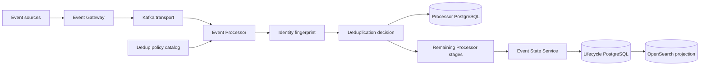
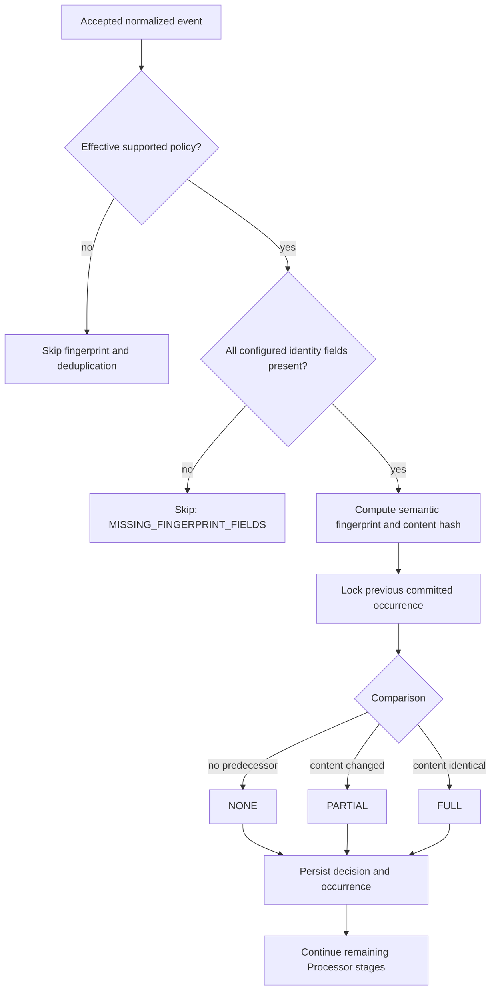
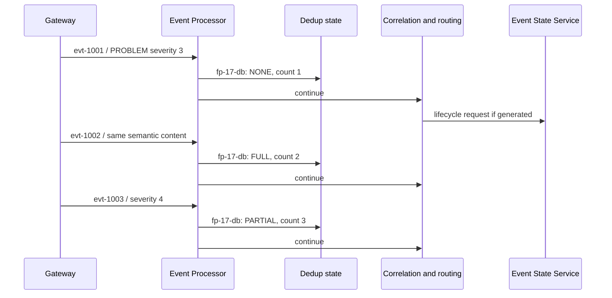

# Deduplication Operations

## 01. Module Overview

Deduplication is the Event Processor capability that assigns a deterministic
semantic fingerprint to an accepted normalized event and compares its canonical
content with the immediately preceding committed occurrence of that fingerprint.
It records whether an occurrence is the first, has changed, or is identical.

Deduplication does not replace `eventId`, `eventKey`, `processingId`, transport
replay identity, or Event State Service lifecycle identity. It preserves the
immutable input and records a separate, tenant-scoped decision.

> **IMPLEMENTED:** deterministic `NONE`, `PARTIAL`, and `FULL` classification.
> **VALIDATED:** local tests cover fingerprints, transactions, concurrency,
> replay, policy transitions, history and request-scoped simulation.

## 02. Functional Capabilities

The current baseline provides:

- explicit tenant-scoped fingerprint policies with immutable revisions;
- one effective policy pointer per tenant, with `ABSENT`, `DISABLED`, or
  `ENABLED` state;
- fingerprint version `v1` and canonical content version `occurrence-v1`;
- deterministic identity and content hashing without mutating source events;
- `NONE`, `PARTIAL`, and `FULL` decisions with reason codes;
- monotonic `occurrenceCount`, `firstSeen`, and `lastSeen` evidence;
- atomic decision, occurrence, processing-evidence and outbox persistence;
- idempotent, compare-and-swap administration with immutable receipts/history;
- activation, disable and rollback transitions;
- request-scoped sequence simulation that does not read or write production
  occurrence state.

There is no seeded business default. Without an effective supported policy, the
fingerprint and deduplication stages are skipped with
`NO_EFFECTIVE_DEDUP_POLICY`.

## 03. Architecture and Dependencies



The Event Processor owns semantic fingerprinting, occurrence history and
deduplication classification. PostgreSQL is the authority for those decisions.
The Event State Service separately owns event lifecycle, version and `tally`;
OpenSearch remains a derived projection. Kafka is transport and a bounded replay
boundary, not the deduplication authority.

## 04. Main Processing Flow

The implemented Processor stage order is:

```text
Contract Validation → Normalization → Context Enrichment → Identity Fingerprint
→ Deduplication → Auto-Suppression → Blackout → Correlation → Policy Evaluation
→ Routing Decision → Command Generation → Processing Audit
```



The fingerprint lock, decision, occurrence pointer, processing evidence and
outbox participate in the Processor transaction. Failed work rolls back as one
unit. An identical accepted transport replay returns before business evaluation
and does not increment `occurrenceCount`.

## 05. Deduplication Criteria

Fingerprint `v1` hashes these values with unambiguous length-prefix encoding:

- tenant;
- explicit identity namespace;
- fingerprint policy version;
- each selected field name and value in lexical field order.

Allowed identity fields are `node`, `nodeAlias`, `component`, `instanceId`,
`monitoringSolution`, and `summary`. A policy selects one to six unique fields.
Every selected field must be present and nonblank.

Canonical `occurrence-v1` content includes tenant, canonical status, canonical
severity, and all present allowed semantic selectors. It excludes transport
timestamps, Kafka coordinates, `eventId`, `eventKey`, `processingId`, arbitrary
original payload fields and unrecognized selectors. Strings are case-sensitive;
no undocumented case, whitespace or Unicode normalization is applied.

The implemented baseline has **no time-based evaluation window or expiry**.
Comparison is against the immediately preceding committed occurrence regardless
of elapsed time. A bounded time window is **PROPOSED**, not implemented.

## 06. Deduplication Rule Creation

A deduplication policy defines identity semantics rather than an action that
suppresses an event. The following is an **IMPLEMENTED contract example**:

```json
{
  "schemaVersion": "1",
  "policyId": "infrastructure-by-node-component",
  "policyRevision": 1,
  "fingerprintPolicyVersion": "v1",
  "identityNamespace": "operations:infrastructure",
  "identityFields": ["node", "component"],
  "contentVersion": "occurrence-v1"
}
```

The namespace partitions identity schemes; it is not a correlation name.
Changing selected identity fields changes the fingerprint. A new policy revision
with unchanged identity semantics preserves the existing occurrence chain.

## 07. Rule Registration

Deduplication has a dedicated governed administration surface under
`/api/v1/dedup`; it is not stored in the shared `/rules` registry.

Register a revision with `POST /dedup/policies`, supplying `{policy, reason}`,
the current `If-Match: "dedup-admin-N"`, and a stable `Idempotency-Key`. Creation
inserts an immutable revision and advances the tenant catalog revision; it does
not activate the policy.

Catalog and evidence reads include:

- `GET /dedup/policies` and `GET /dedup/policies/{id}`;
- `GET /dedup/policies/{id}/history`;
- `GET /dedup/effective-policy` and its transition history;
- `GET /dedup/requests/{requestId}` for an idempotent receipt.

Tenant and actor context remain required administrative boundaries. Availability
of an endpoint is not evidence of production authorization or RBAC completion.

## 08. Rule Validation and Activation

Validate the exact candidate with `POST /dedup/policies/validate`. Validation
checks the closed schema, versions, ID/namespace formats, revision, field count,
allowed fields, duplicate fields, and optional correlation provenance.

Activation is a separate transition:

1. Read the current effective state and catalog ETag.
2. Validate and register the intended immutable revision.
3. Call `POST /dedup/effective-policy/activate` with policy ID, revision, reason,
   current `If-Match`, and a new idempotency key.
4. Re-read the effective state and transition history.

`409` identifies a conflict, while missing conditional or idempotency headers
produce precondition failures. Activation, disable and rollback serialize with
event processing for the tenant; they do not rewrite historical decisions.

## 09. Runtime Processing

For each eligible event, the Processor captures the effective policy, computes
the fingerprint and canonical content hash, locks the prior occurrence, and
persists one immutable decision. The classifications are:

| Classification | Reason | Meaning |
|---|---|---|
| `NONE` | `FIRST_FINGERPRINT_OCCURRENCE` | No committed predecessor exists |
| `PARTIAL` | `PREVIOUS_CONTENT_DIFFERENT` | Same fingerprint, changed canonical content |
| `FULL` | `PREVIOUS_CONTENT_IDENTICAL` | Same fingerprint, identical canonical content |

Only the immediately preceding committed content is compared. Therefore an
`A → B → A` content sequence classifies as `NONE → PARTIAL → PARTIAL`.
`firstSeen` remains the original Processor observation time; `lastSeen` does not
move backward; `occurrenceCount` advances once for each new accepted input.

## 10. Duplicate Event Handling

Every classification currently returns `CONTINUE`. A `FULL` result is durable
evidence, not an implicit suppression rule, event deletion, lifecycle merge,
ticket cancellation, or automation cancellation. Auto-suppression, blackout,
correlation, policy, routing and command generation retain their own decisions.

Transport replay idempotency is distinct: an identical already-accepted replay
does not create another business occurrence. A new accepted input with the same
fingerprint can increment the deduplication count even if its business content is
identical.

## 11. Integration With Correlation

Deduplication executes before correlation in the documented Processor pipeline,
but does not decide group membership. Correlation receives the event after the
deduplication decision and evaluates its own active rule snapshot and state.

Policies may carry `sourceCorrelationId` and `sourceCorrelationName` as catalog
provenance. This linkage does not activate the policy, replace the one-effective-
policy-per-tenant rule, or make `identityNamespace` a correlation identity.
Current correlation-linked derivation is supported for node/component selectors.
Derivation from enrichment-only correlation fields is **PENDING**.

See [Correlation Operations](/operations/correlation/) for group semantics.

## 12. Integration With Other Operational Rules

The evidenced interaction model is:

- ingestion and transport replay establish acceptance before business dedup;
- normalization and context enrichment run before fingerprinting;
- fingerprinting and deduplication produce evidence and continue;
- auto-suppression and blackout evaluate after deduplication;
- correlation evaluates group membership after those stages;
- policy evaluation and routing retain independent authority;
- ticketing, notification and automation occur only through generated commands
  and the responsible Integration Worker/provider flow;
- Event State Service applies lifecycle requests without recalculating the
  Processor's deduplication decision.

This order is implemented and validated for the current 12-stage pipeline. A
future change to ordering is **PROPOSED** until separately designed, implemented
and regression-tested.

## 13. Operational Monitoring

Operators can inspect:

- catalog revision, policy checksum and `ABSENT`/`DISABLED`/`ENABLED` effective
  state;
- immutable policy revisions, transition history and request receipts;
- explainability evidence: classification, reason, fingerprint, content hash,
  policy identity/checksum, namespace, timestamps and `occurrenceCount`;
- explicit skip reasons such as `NO_EFFECTIVE_DEDUP_POLICY`,
  `MISSING_FINGERPRINT_FIELDS`, or unsupported versions;
- Processor health, logs, processing audit and outbox health using existing
  operational surfaces;
- Event State Service lifecycle/history separately from deduplication history.

Do not treat a rising occurrence count as proof that integrations were
suppressed, or treat ESS `tally` as the Processor deduplication count.

## 14. Disable and Delete Lifecycle

Disable the effective policy with `POST /dedup/effective-policy/disable`, using
the current catalog ETag, a unique idempotency key and a reason. Disable preserves
the selected revision and all decisions but skips future deduplication until a
policy is activated or rolled back.

Rollback selects an earlier immutable revision through
`POST /dedup/effective-policy/rollback`. Manual catalog entries support logical
deletion through `DELETE /dedup/policies/{id}`. Logical deletion hides eligible
manual records; it does not physically delete immutable revision or decision
history. Correlation-derived entries are protected from this manual deletion
path. Logical deletion does not perform an effective-policy transition; read and
change effective state through the activate, disable or rollback contract.

## 15. Functional Example

The following is a **CONCEPTUAL example using implemented semantics**. Assume an
enabled policy with namespace `operations:infrastructure`, identity fields
`node` and `component`, and no time window.

| Input | Event identity | Canonical values | Fingerprint | Decision | Count | Downstream |
|---|---|---|---|---|---:|---|
| Original | `evt-1001`, key `alarm-17` | node-17, database, PROBLEM, severity 3 | `fp-17-db` | `NONE` | 1 | Continue |
| Repeat 1 | `evt-1002`, key `alarm-17` | node-17, database, PROBLEM, severity 3 | `fp-17-db` | `FULL` | 2 | Continue |
| Repeat 2 | `evt-1003`, key `alarm-17` | node-17, database, PROBLEM, severity 4 | `fp-17-db` | `PARTIAL` | 3 | Continue |

`fp-17-db` is a readable placeholder; the implementation records a deterministic
SHA-256 value. Repeat 1 has identical canonical content. Repeat 2 has the same
identity criteria but a changed severity, so its content hash differs.



If distinct later OPEN lifecycle requests are accepted, ESS may increment its own
`tally`; that counter is governed by ESS message and timestamp semantics and is
not the deduplication `occurrenceCount`. Ticketing or automation happens only if
the independent downstream rules generate an authorized command.

## 16. Current Implementation vs Target Architecture

| Capability | Status | Boundary |
|---|---|---|
| Deterministic semantic fingerprinting | **IMPLEMENTED** | Fingerprint `v1`, explicit namespace and fields |
| `NONE`/`PARTIAL`/`FULL` occurrence decisions | **IMPLEMENTED** | Comparison with immediate committed predecessor |
| Transaction, concurrency and replay behavior | **VALIDATED** | Local guarded tests and certification evidence |
| Dedicated dedup policy administration | **IMPLEMENTED** | Versioned catalog, validation, transitions and history |
| Console catalog/create/logical-delete flow | **IMPLEMENTED** | Manual policies; activation remains API-governed |
| Correlation provenance | **IMPLEMENTED** | Provenance only; not automatic activation |
| Enrichment-only correlation derivation | **PENDING** | Selector exposure not established |
| Time-window expiry or retention scheduler | **PENDING** | No current evaluation window |
| AI-assisted deduplication | **PENDING** | AI architecture exists, but no dedup-specific implementation evidence |
| AI recommendations under governed approval | **DESIGNED** | General AI-01 boundary; not a deployed dedup capability |
| Production-scale and DR certification | **PENDING** | Local validation is not production certification |
| Alternative similarity/fuzzy strategies | **PROPOSED** | No current contract or implementation |

## 17. Existing Engineering References

- [Correlation, suppression and command contract](/platform/event-processor/correlation-suppression-commands/)
- [Event Processor implementation status](/platform/event-processor/implementation-status/)
- [Event Processor rules and contracts](/platform/event-processor/rules-and-contracts/)
- [Event Processor lifecycle orchestration](/platform/event-processor/lifecycle-orchestration/)
- [Correlation backend evidence](/platform/event-processor/correlation-backend/)
- [Correlation frontend contract](/platform/event-processor/frontend-handoffs/correlation/)
- [Event State Service lifecycle contract](/platform/event-state-service/lifecycle-contract/)
- [Event State Service implementation status](/platform/event-state-service/lifecycle-status/)
- [Data Authority and Replay](/architecture/data-authority-replay/)
- [AI Architecture — AI-01](/architecture/ai-01-aiops-ai-architecture/)
