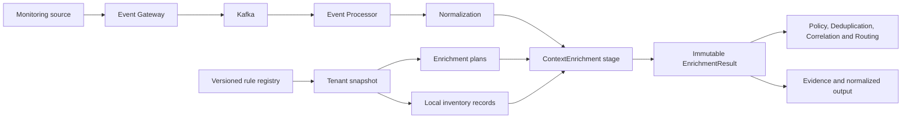
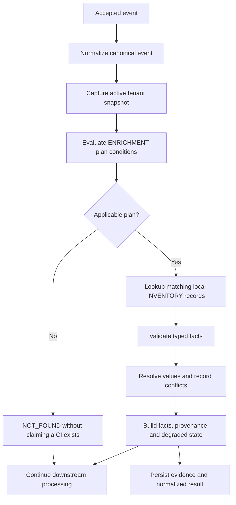
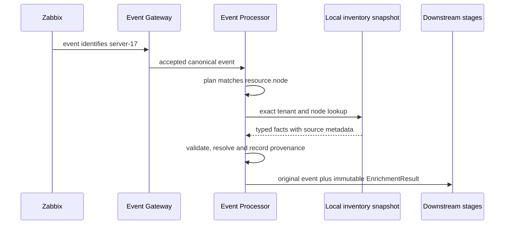

# Enrichment Operations

## 01. Module Overview

Enrichment adds governed contextual facts to an event-processing context without
changing the event's identity or original envelope. The implemented Event Processor
uses versioned local `INVENTORY` records and `ENRICHMENT` plans captured in the same
tenant rule snapshot as other Processor configuration.

The current capability is a local reference-data lookup, not a live CMDB or universal
Datasource integration. External connectors and synchronization remain target work.

> **IMPLEMENTED:** typed local inventory, conditional lookup plans, deterministic
> conflict resolution, provenance, partial/required outcomes, and downstream facts.
> **VALIDATED:** administration, precedence, Policy consumption, normalized delivery,
> and required-lookup DLQ behavior have backend certification evidence.

## 02. Functional Capabilities

The current baseline provides:

- tenant-scoped, immutable `INVENTORY` and `ENRICHMENT` rule versions;
- exact resource matching over supported canonical selectors;
- typed enrichment-plan conditions that cannot depend on enrichment output;
- one shared local inventory lookup for applicable plans;
- seven governed fact names with strict value types;
- deterministic field precedence and explicit conflict evidence;
- per-field source ID, version, checksum, and observation time;
- optional and required lookup semantics;
- simulation using candidate configuration without production writes;
- enrichment result evidence, normalized output, and typed failure/DLQ behavior.

The implementation does not contact an external provider during event evaluation.

## 03. Architecture and Dependencies



The Event Gateway owns admission and canonical input mapping. The Event Processor
owns the local snapshot, plan evaluation, inventory lookup, typed facts, provenance,
conflicts, and result. Event State Service remains lifecycle authority and does not
become an enrichment store. PostgreSQL is operational authority for the local rule
registry; Kafka is transport, not enrichment authority.

## 04. Main Processing Flow



The current `ContextEnrichment` stage uses the captured snapshot synchronously and
performs no network I/O. Future external-source ordering remains **PENDING** until
adapter and consistency contracts are approved.

## 05. Enrichment Sources

The implemented source is `SnapshotInventory`: active local `INVENTORY` definitions
stored in the Processor registry. They are reference facts for decisions, not a new
CMDB service or lifecycle authority.

Potential authorized sources include CMDB, asset inventory, service catalog,
monitoring platforms, external REST APIs, and configuration repositories. These are
**DESIGNED** examples from the external-source/UMC architecture, not implemented
Enrichment connectors. A source must not be treated as authoritative merely because
it is reachable.

## 06. Datasource Integration

There is no dedicated Enrichment Datasource API. Current writes use the shared
Processor rule administration contract. Existing catalog Datasource capabilities
belong to their owning catalog domain and do not automatically feed
`SnapshotInventory`.

An external adapter would require, at minimum, an authorized source identity,
tenant/resource scope, response contract, timeout, retry classification, freshness,
provenance, data minimization, and secret-reference boundary. Those details are
**PENDING**. Do not configure an external endpoint by pretending it is a local
`INVENTORY` record.

## 07. Enrichment Rules

An `ENRICHMENT` plan contains a typed condition and one `LOOKUP_INVENTORY` action.
The action parameter `required` controls missing/error behavior.

Plan conditions use supported canonical event/resource fields. They cannot reference
`enrichment.*`; this prevents circular dependencies and plan-order-dependent results.
Non-applicable plans are `SKIPPED` without invoking inventory lookup.

## 08. Field Mapping and Transformation

Implemented local inventory maps exact configured facts into the enrichment namespace:

| Source fact | Target field | Type | Transformation |
|---|---|---|---|
| `resource.ciId` | `enrichment.resource.ciId` | String | identity |
| `service.name` | `enrichment.service.name` | String | identity |
| `assignment.group` | `enrichment.assignment.group` | String | identity |
| `location.site` | `enrichment.location.site` | String | identity |
| `resource.class` | `enrichment.resource.class` | String | identity |
| `resource.managed` | `enrichment.resource.managed` | Boolean | identity |
| `service.criticality` | `enrichment.service.criticality` | Decimal | identity |

No arbitrary scripting or free-form transformation is implemented. Conversion from
external schemas is **PROPOSED** and requires an approved mapping contract.

## 09. Data Validation

Inventory definitions require at least one resource selector beyond tenant and at
least one supported fact. String facts must be non-empty; Boolean and Decimal values
must retain their JSON types. Null and unknown facts are rejected rather than coerced.

Missing values remain absent. Absence is not false, zero, empty text, or an invented
default. Policy comparisons remain typed; ordered comparison is not valid for Boolean.

## 10. Attribute Conflict Resolution

All matching records remain observable. For each fact, the first value in deterministic
source order wins. A different later value creates a conflict containing references
to both sources and the resolution policy; it is never silently overwritten.

Equal repeated values do not create semantic disagreement, though provenance still
identifies contributing configuration. Conflict presence does not automatically fail
the event under the current contract.

## 11. Source Priority and Precedence

Matching local inventory records are ordered by:

1. priority descending;
2. ID ascending;
3. version ascending.

The first value for a field wins. This is an implemented deterministic rule, not a
claim that one external system is universally authoritative. Future cross-source
authority, trust tiers, and human override rules remain **PENDING**.

## 12. Enrichment Configuration Creation

The following definitions are **IMPLEMENTED contract examples** with illustrative
identifiers:

```json
{
  "id": "ci-server-17",
  "version": 1,
  "type": "INVENTORY",
  "enabled": true,
  "priority": 20,
  "scope": {"customerCode": "tenant-demo", "node": "server-17"},
  "facts": {
    "resource.ciId": "ci-demo-17",
    "service.name": "payments-demo",
    "assignment.group": "linux-demo",
    "resource.managed": true,
    "service.criticality": 4
  },
  "metadata": {"owner": "operations"}
}
```

```json
{
  "id": "inventory-lookup-server",
  "version": 1,
  "type": "ENRICHMENT",
  "enabled": true,
  "priority": 10,
  "condition": {"field": "resource.node", "operator": "EXISTS"},
  "actions": [{"type": "LOOKUP_INVENTORY", "parameters": {"required": true}}],
  "metadata": {"owner": "operations"}
}
```

## 13. Configuration Registration

Register inventory and plans independently through shared `/api/v1/rules` using
`{rule, reason}`, the current `If-Match` revision, and a stable
`Idempotency-Key`. IDs share the tenant namespace with other Processor capabilities.

Saving either definition does not activate it. Saving a record and a plan is not one
atomic operation; partial administrative success must be shown explicitly.

## 14. Validation and Activation

Validate each complete definition before saving. Backend validation is authoritative
for schema, IDs, types, scope, condition vocabulary, action shape, facts, limits, and
unknown fields.

Activation is a separate operation against a selected version and ETag. A newer
saved version does not replace the active version until enabled. On conflict, refresh
and reconcile rather than overwriting. Simulate record and plan together before
activation when their behavior depends on one another.

## 15. Runtime Enrichment

For each event, applicable plans share one lookup against the captured local inventory
snapshot. Exact selectors identify matching records. Typed facts are combined using
the deterministic precedence rule and returned in an immutable `EnrichmentResult`.

The original event ID, event key, tenant, canonical attributes, and original envelope
remain unchanged. Enriched facts are contextual outputs, not silent canonical-field
replacement.

## 16. Synchronous and Asynchronous Processing

The implemented model is synchronous within the Processor unit of work: configuration
and inventory are already in the captured snapshot, so evaluation performs no remote
request. Evidence and output are persisted before Kafka acknowledgement.

Asynchronous remote enrichment, background synchronization, callbacks, and late
result application are **PENDING**. No ordering, state merge, or replay semantics are
claimed for those future models.

## 17. Cache and Freshness Policies

The active rule snapshot provides a consistent local configuration view for one event.
It is not a remote-source cache and has no TTL/freshness contract. A saved inventory
version does not affect evaluation until activated; an event's captured snapshot does
not change mid-pipeline.

External cache TTLs, stale-while-revalidate, maximum data age, refresh ownership, and
stale-data directives are **PENDING**. Stale data must not be silently represented as
fresh when external connectors are introduced.

## 18. Timeout and Retry Handling

The local adapter performs no network I/O, so external request timeout/retry behavior
is not implemented. Registry/database unavailability prevents processing against an
empty configuration and follows durable processing retry behavior.

Future adapters require bounded connection/request timeouts, retryable/permanent
classification, idempotency where mutations exist, and protection against retry
amplification. No generic retry count or fail-open policy is approved today.

## 19. Partial Enrichment and Failure Behavior

Current result semantics are:

- lookup `FOUND`: facts and provenance are returned;
- optional `NOT_FOUND`: valid absence, no default invented;
- required `NOT_FOUND`: `FAILED` with `DEAD_LETTER`;
- optional source `ERROR`: `PARTIAL` and degraded;
- required source `ERROR`: `FAILED`;
- no applicable plan: `NOT_FOUND`, without asserting a CI exists.

Invalid typed output is a controlled enrichment failure. Future authentication
failure, timeout, invalid external response, stale cache, partial response, retry
exhaustion, and unauthorized source access require adapter-specific approved policy.
They must not be assumed fail-open or fail-closed.

## 20. Provenance and Auditability

Each selected field preserves value, source rule ID, version, checksum, and observation
time. Conflicts preserve both source references and the resolution policy. The overall
result is included in processing evidence and normalized output.

An enrichment-originated DLQ identifies `ContextEnrichment`, records a controlled
diagnostic, and still executes processing audit. Explainability must distinguish
original, normalized, enriched, and derived values.

## 21. Security and Secret References

Current local inventory contains facts, not credentials. The Processor rule API's
documented local mode does not provide production identity/RBAC; tenant/actor context
must not be mistaken for verified authorization.

External datasource design requires least privilege, server-side authorization,
governed `SecretRef` resolution, sensitive-attribute allow-lists, data minimization,
redacted audit, and separation between configuration and secret payload. `SecretRef`
is a **DESIGNED** UMC/security requirement, not an implemented Enrichment connector
field. Credentials must never appear in rule JSON, events, logs, or documentation.

## 22. Integration With Deduplication

Context Enrichment precedes Identity Fingerprint and Deduplication in the current
Processor pipeline. The current fingerprint contract remains authoritative; an
enrichment fact is not automatically part of identity merely because it exists.

Future changes to identity inputs require explicit contract/version review. See
[Deduplication Operations](/operations/deduplication/).

## 23. Integration With Correlation

Correlation rules may use supported enrichment facts such as service, CI, assignment
group, site, and resource class. This enables grouping by governed operational context
while preserving the original event identity.

Missing facts do not become empty grouping keys. Required enrichment failure prevents
normal downstream correlation; optional absence remains explicit. See
[Correlation Operations](/operations/correlation/).

## 24. Integration With Suppression

Policy Suppression can evaluate supported `enrichment.*` facts after Context
Enrichment. The Policy Engine remains responsible for its typed condition and
directive; Enrichment does not itself suppress an event.

Auto-Suppression and Blackouts use their own exact scope/schedule contracts and do
not automatically inherit arbitrary enrichment fields. See
[Suppression Operations](/operations/suppression/) and
[Auto-Suppression Operations](/operations/auto-suppression/).

## 25. Integration With Routing and Ticketing

Routing may consume governed context only where its contract explicitly supports it.
Enrichment does not authorize provider calls, create tickets, select arbitrary
payload fields, or make an external system authoritative.

Any enriched value placed into a ticket command must pass the routing/command schema,
data-minimization policy, and provider boundary. Unsupported payload expansion is
**PROPOSED**, not current functionality.

## 26. Integration With Automation

Enriched service, CI, ownership, or criticality facts may inform future automation
selection under explicit contracts. The current local Enrichment capability does not
launch automation or supply credentials.

Automation must preserve separate authorization, command identity, audit, provider
result, and lifecycle ownership. Directly interpreting an enrichment fact as approval
is prohibited.

## 27. Operational Monitoring

Operators should monitor:

- inventory/plan active and latest versions, revisions, checksums, and history;
- applicable/skipped plans and lookup outcome;
- facts, provenance, conflicts, degraded flag, and result status;
- required versus optional configuration;
- `ContextEnrichment` failures, DLQ classifications, and processing retries;
- normalized output, downstream Policy/Correlation decisions, and audit evidence;
- active configuration count against the tenant limit;
- future datasource health, timeout, retry exhaustion, cache age, and authentication
  only after those adapter contracts exist.

## 28. Configuration Lifecycle

Create, validate, save, activate, revise, disable, and retire through the shared rule
lifecycle. Editing creates `latestVersion + 1`; the active version continues until
the new version is explicitly enabled.

Inventory and plan lifecycles are independent. Disabling a record can leave a required
active plan without data, producing a functional failure. Operators should simulate
the intended active set before changing either side.

## 29. Disable and Delete Operations

Disable the selected active version with reason, current ETag, and a new idempotency
key. This affects future snapshots and does not rewrite past results.

Retirement is terminal, preserves immutable history, and prevents ID reuse. The shared
contract exposes no physical delete. Historical catalog records from another store
must not be edited as if they were Processor rules.

## 30. Functional Example

The following is a **CONCEPTUAL example using implemented local behavior**. The
inventory record illustrates data that an authorized CMDB might supply, but no live
CMDB connector is claimed.

A Zabbix event identifies `server-17`. Active plan `inventory-lookup-server` matches
the canonical resource node. Local record `ci-server-17` supplies validated context.

```json
{
  "originalEvent": {
    "source": "Zabbix",
    "eventId": "evt-demo-1701",
    "eventKey": "zbx-server-17-cpu",
    "resource": {"name": "server-17"},
    "summary": "Illustrative CPU alert"
  },
  "conceptualSourceResponse": {
    "ciId": "ci-demo-17",
    "service": "payments-demo",
    "supportGroup": "linux-demo",
    "criticality": 4
  },
  "enrichedFacts": {
    "resource.ciId": "ci-demo-17",
    "service.name": "payments-demo",
    "assignment.group": "linux-demo",
    "service.criticality": 4
  }
}
```



| Step | Result |
|---|---|
| Original event | identity and original envelope preserved |
| Datasource | local Processor inventory snapshot; CMDB is illustrative only |
| Rule | resource node exists, required lookup |
| Mapping | conceptual `ciId/service/supportGroup/criticality` to governed facts |
| Validation | strings non-empty, criticality remains numeric |
| Conflict handling | priority then ID/version; disagreement recorded |
| Provenance | source record ID/version/checksum and observation time per fact |
| Correlation | may group by supported service or CI fact |
| Suppression | Policy may evaluate a supported enrichment fact |
| Routing/ticketing | may consume only fields authorized by its own contract |
| Automation | remains separately authorized; no action launched by enrichment |

If no record exists, required lookup fails and optional lookup returns explicit
absence. No default CI, service, or assignment group is invented.

## 31. Current Implementation vs Target Architecture

| Capability | Status | Boundary |
|---|---|---|
| Local versioned inventory and plans | **IMPLEMENTED** | Shared Processor rule registry |
| Typed facts, provenance and conflicts | **IMPLEMENTED** | Seven governed fact names |
| Required/optional failure behavior | **VALIDATED** | Normalized output and DLQ evidence |
| Policy consumption and precedence | **VALIDATED** | `policy-fields-v2` |
| Browser inventory/plan administration | **DESIGNED** | Frontend handoff; acceptance **PENDING** |
| Live CMDB/asset/catalog/REST connectors | **PENDING** | No remote adapter implemented |
| External cache/freshness/timeouts/retries | **PENDING** | Adapter-specific contract required |
| Arbitrary field transformation/defaulting | **NOT IMPLEMENTED** | Typed identity mapping only |
| UMC Resource/Datasource common contract | **DESIGNED** | Approved target architecture, not implementation |
| SecretRef-backed external access | **DESIGNED** | Enrichment connector implementation **PENDING** |
| Asynchronous/late enrichment | **PROPOSED** | Ordering and merge policy unresolved |
| Production RBAC, scale and DR certification | **PENDING** | Local certification is insufficient |

## 32. Existing Engineering References

- [Enrichment and local inventory](/platform/event-processor/enrichment-and-inventory/)
- [Inventory/Enrichment frontend handoff](/platform/event-processor/frontend-handoffs/inventory-enrichment/)
- [Event Processor rules and contracts](/platform/event-processor/rules-and-contracts/)
- [Event Processor decisions](/platform/event-processor/decisions-adr/)
- [Event Processor implementation status](/platform/event-processor/implementation-status/)
- [Event Processor Defect Prevention](/platform/event-processor/defect-prevention/)
- [Event Processor lifecycle orchestration](/platform/event-processor/lifecycle-orchestration/)
- [Event State Service lifecycle contract](/platform/event-state-service/lifecycle-contract/)
- [Universal Management Contract](/architecture/universal-management-contract/)
- [UMC Data Conformance](/architecture/umc/data-conformance/)
- [Canonical event architecture](/architecture/oem-architecture-definition/)
