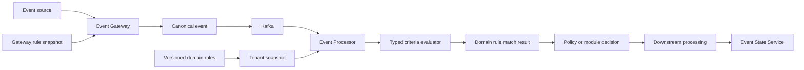
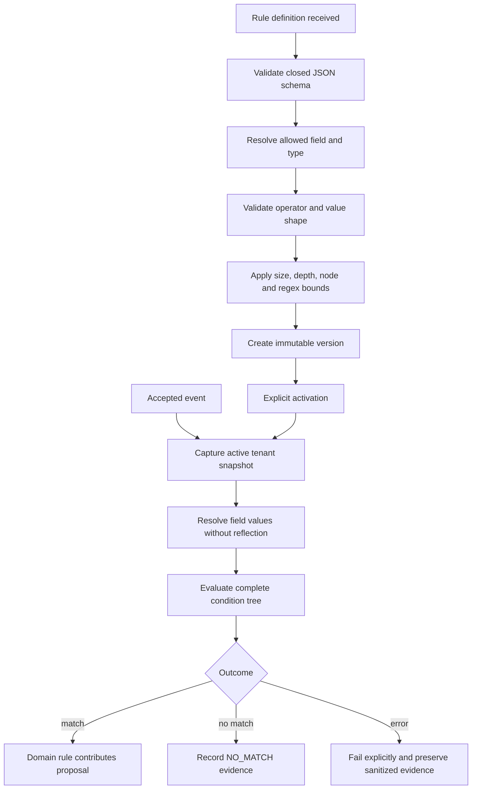

# Filters & Criteria Operations

## 01. Module Overview

Filters & Criteria describes how Event Management selects events and evaluates
conditions without confusing that evaluation with a domain decision or external action.
Two implemented surfaces have different ownership:

- Event Gateway rules perform controlled input matching, admission, normalization,
  validation, and base enrichment before `events.raw` publication.
- Event Processor rules embed a closed, typed condition tree inside domain-owned
  `POLICY`, `ENRICHMENT`, `ROUTING`, and other supported rule definitions.

There is no universal standalone Criteria resource evidenced by the current architecture.

## 02. Functional Capabilities

The current Processor baseline provides:

- a closed field registry with String, Decimal, Boolean, and Instant values;
- 15 named comparison operators;
- `all`, `any`, and `not` logical nodes with nested conditions;
- compile-time schema, type, range, collection, regex, and complexity validation;
- deterministic evaluation against one event and captured configuration snapshot;
- explicit match/no-match/error evidence without recording original event values;
- tenant-scoped, immutable versions and independently selected active versions;
- simulation using the same compiler and evaluator without production writes.

Gateway exact-match filters are implemented separately and must not be represented as
Processor criteria or as a universal policy contract.

## 03. Architecture and Dependencies



Gateway owns input admission and canonical mapping. Processor owns its typed field
contract, condition compilation, evaluation, rule evidence, and policy resolution.
Correlation, deduplication, suppression, enrichment, routing, ticketing, notification,
automation, and ESS retain their own domain authority.

## 04. Main Processing Flow



Saving does not activate a rule. Criteria evaluation contributes a result to the owning
module; it does not itself route, suppress, mutate lifecycle state, or call a provider.

## 05. Filters vs Criteria

An event filter decides whether or how an input proceeds at a controlled boundary.
Criteria are declarative predicates evaluated over authorized typed fields. A rule match
means the full condition evaluated true. A policy decision combines matched rule
proposals using domain precedence. Downstream execution belongs to the owning engine or
Worker.

The dashboard Delivery filter catalog is configuration/read data and is not the active
Processor engine. Similar names do not make these stores or semantics interchangeable.

## 06. Criteria Definition Model

Processor conditions use exactly one of:

- predicate: `field`, `operator`, and `value` when required;
- conjunction: `all` with one or more child conditions;
- disjunction: `any` with one or more child conditions;
- negation: `not` with one child condition.

Conditions live inside a domain-owned rule envelope. No evidence establishes an
independently persisted, universally reusable Criteria object.

## 07. Supported Field Types

The implemented `policy-fields-v2` contract is closed:

| Type | Supported fields |
| --- | --- |
| String | `event.identifier`, `event.key`, `event.status`, `tenant.customerCode`, `resource.applicationId`, `condition.alertKey`, `resource.node`, `resource.component`, `enrichment.resource.ciId`, `enrichment.service.name`, `enrichment.assignment.group`, `enrichment.location.site`, `enrichment.resource.class` |
| Decimal | `event.severity`, `enrichment.service.criticality` |
| Boolean | `enrichment.resource.managed` |
| Instant | `event.receivedAt` |

Fields are resolved explicitly, not through arbitrary reflection or object traversal.
The lifecycle/state namespace is not currently enabled as Processor criteria.

## 08. Comparison Operators

The 15 implemented operators are:

| Class | Operators | Constraint |
| --- | --- | --- |
| Equality | `EQ`, `NE` | same field type |
| Ordering | `GT`, `GTE`, `LT`, `LTE` | Decimal or Instant only |
| Membership | `IN`, `NOT_IN` | non-empty homogeneous collection, maximum 128 |
| String | `CONTAINS`, `STARTS_WITH`, `ENDS_WITH` | String fields only |
| Pattern | `REGEX` | String fields, restricted full-string grammar |
| Presence | `EXISTS`, `NOT_EXISTS` | no `value` property |
| Range | `BETWEEN` | exactly two ordered inclusive Decimal or Instant limits |

No operator outside this table is claimed for Processor criteria.

## 09. Logical Operators

`all` requires every child to match. `any` requires at least one child to match. `not`
negates its child's Boolean result. Logical operators do not coerce missing attributes,
change field types, or grant access to unsupported fields.

Gateway `match` is a separate exact-equality object whose entries are combined with AND;
it does not implement this logical AST.

## 10. Nested Conditions

Logical nodes may contain predicates or additional logical nodes. The rule document is
bounded to depth 32 and 1,024 JSON nodes; the parser also caps JSON nesting at 40. These
limits apply to the full definition, not only visible predicate rows.

Nesting expresses declarative Boolean structure only. Function calls, variables,
scripts, remote lookups, SQL, and browser expressions are not supported.

## 11. Missing and Null Values

For an absent field, `EXISTS` is false and `NOT_EXISTS` is true. Every ordinary
predicate returns no match. `not` then negates the actual result of its child; it does
not make a missing value equal to a typed value.

Criteria values cannot be null when an operator requires a value. Missing is not empty
text, zero, false, or an invented default. Gateway rule `set` values also must be
non-null scalars.

## 12. Type Validation and Coercion

Boolean fields require JSON Boolean values, Decimal fields require JSON numbers, and
String fields require JSON strings. Instant values must be valid timestamp strings.
There is no string-to-number, string-to-Boolean, or string-to-time coercion.

Ordered operators reject String and Boolean fields. String operators reject non-String
fields. Mixed collections are rejected because each member must validate against the
selected field type.

## 13. Expression Validation

The compiler rejects duplicate JSON keys, trailing content, unknown properties,
unsupported fields/operators, invalid value shapes, type mismatches, unsafe regex,
oversized text, and complexity violations before a version is admitted.

Rules are limited to 64 Ki characters, depth 32, 1,024 JSON nodes, collections of 128,
16 actions, and 256 active rules per tenant. A regex is at most 128 characters, forbids
groups, alternation, escapes/backreferences, and brace quantifiers, and allows at most
one simple quantifier. Runtime regex input is capped at 4,096 characters.

## 14. Criteria Creation

Create criteria only as part of a supported owning rule. Select a documented field,
compatible operator, correctly typed value, and bounded logical structure. Then define
the domain action or capability separately.

The UI may help assemble the tree, but backend validation remains authoritative. A
visual editor must not translate user input into executable code.

## 15. Criteria Registration

Processor criteria are registered through the shared `/api/v1/rules` contract as part
of a complete rule using `{rule, reason}`, the current `If-Match` revision, and a stable
`Idempotency-Key`. There is no dedicated `/criteria` Processor endpoint.

Gateway rules use their own `/api/v1/gateway/rules` contract and administrative key.
The Console Catalog `/filters` surface and Delivery filter catalog are separate again.

## 16. Activation and Enablement

Creating a Processor version does not activate it. Enable a selected version with the
current revision; `enabled:true` in the document only makes activation permissible.
A newer saved version does not replace the active version automatically.

Gateway rules use full-definition replacement with `enabled:false` for deactivation.
Do not project one lifecycle contract onto the other.

## 17. Runtime Evaluation

Processor captures one active tenant snapshot per event. Rules are ordered by priority
descending, then ID and version ascending. Each condition resolves values from the
canonical event and governed enrichment facts and appends sanitized predicate evidence.

All applicable policy matches contribute proposals. Ordering is deterministic, but a
higher priority does not override the policy directive precedence model.

## 18. Match / No-Match / Error Semantics

- **MATCH:** the full Boolean tree is true; the owning rule contributes its domain result.
- **NO_MATCH:** the tree is valid and false, including ordinary predicates over missing
  fields; this is a normal outcome.
- **ERROR:** compilation or safe evaluation cannot honor the contract; it must not be
  converted silently to no-match or success.

Runtime oversized regex input is an explicit error with sanitized DLQ evidence. Registry
unavailability prevents Kafka acknowledgement rather than evaluating with empty rules.

## 19. Evaluation Order and Short-Circuiting

The current Processor implementation evaluates child conditions in their declared order
and evaluates every child of `all` and `any` so complete evidence is retained. It does
not short-circuit after the first decisive child.

Consumers must not depend on side effects or timing because predicates are pure and
perform no I/O. A future optimization may preserve Boolean semantics only if it also
preserves the required audit contract; that change is **PROPOSED**, not current behavior.

## 20. Criteria Reuse and References

Reusable UI fragments or templates may be **DESIGNED**, but the current Processor rule
contains its own condition tree and immutable checksum. Copying the same tree into two
rules does not create a shared lifecycle or shared identity.

Domain references such as a Routing rule selecting a Correlation rule are not reusable
Criteria references. Universal criteria persistence, reference resolution, dependency
validation, and version pinning remain **PENDING**.

## 21. Integration With Correlation

Correlation scope uses the shared typed condition vocabulary where documented, while
match fields and grouping semantics remain Correlation-owned. A matching scope does not
create or resolve a group by itself.

Missing grouping attributes are not invented. Correlation lifecycle, window, candidates,
and group identity remain outside Filters & Criteria ownership.

## 22. Integration With Deduplication

Deduplication identity/fingerprint logic is domain-owned and must not be inferred from
the general condition AST. Criteria may select applicability only where the implemented
Deduplication contract explicitly supports them.

An event predicate match does not establish duplicate identity, recurrence, or window.
Unresolved execution-order decisions remain **PENDING**.

## 23. Integration With Suppression

Implemented `POLICY` conditions can contribute `SUPPRESS_INTEGRATIONS`, `STATE_ONLY`,
`CORRELATE_ONLY`, or `CONTINUE`. The directive resolver applies documented precedence
across all matched proposals.

The condition does not delete, clear, or close an event. Suppression semantics and
downstream effects remain policy/domain-owned.

## 24. Integration With Auto-Suppression

Auto-Suppression uses its specialized tenant, scope, source/status, and time-window
contract. It is not evidence that every Processor predicate can be registered as an
Auto-Suppression selector.

Time eligibility, external status, and lifecycle are evaluated by that module. Filters
& Criteria does not verify external maintenance state.

## 25. Integration With Blackouts and Maintenance

Blackouts use a specialized exact selector set, explicit schedule, timezone, and
half-open interval. Those selectors are not arbitrary condition trees. Matching a
blackout can suppress integration intentions without deleting the event or correlation.

Do not substitute Gateway filters or dashboard Delivery filters for blackout rules.

## 26. Integration With Enrichment

Enrichment plan conditions use supported canonical event/resource fields and cannot
depend on enrichment output, avoiding circular selection. After enrichment, later
Processor criteria may consume only the implemented typed enrichment facts.

Missing facts remain missing. Provenance and conflict handling belong to Enrichment,
not the predicate evaluator.

## 27. Integration With Routing

Routing conditions use the same closed typed AST. A match is only one eligibility input;
correlation cycle, payload, supported target/configuration, and independent directives
must also permit command creation.

A matching criterion is not a routing decision, and a routing decision is not successful
delivery or external action completion.

## 28. Integration With Ticketing

Filters & Criteria does not create or update tickets. A domain-owned Routing rule may
consume a condition and generate a supported ticket command. Integration Worker and the
provider adapter own delivery and result confirmation.

Dashboard Delivery filter targets are configuration records and do not prove that a
ticket provider is connected or invoked.

## 29. Integration With Notifications

A matched condition does not send a notification. GNM operations require their own
supported command/profile and confirmation semantics. No general notification action is
introduced by this page.

## 30. Integration With Automation

A matched condition does not run automation. CACF/NEXT execution follows its governed
request, acknowledgement, result, and review contract. Arbitrary commands, scripts, or
event-supplied endpoints are prohibited.

## 31. Security and Input Validation

Security controls include closed schemas, allowed fields/operators, strict JSON types,
bounded documents and collections, safe regex grammar/input, no reflection, no scripts,
no provider I/O, and sanitized evidence. Criteria must not contain secrets or sensitive
event values in metadata.

Processor tenant scope is enforced by the registry and snapshot. Current local
`X-Actor-Id` metadata is not authentication, and full REST RBAC remains **PENDING**.
Field access authorization beyond the closed registry requires explicit architecture;
it must not be inferred from field availability.

## 32. Auditability and Observability

Processor evidence records snapshot checksum, field-contract version, rule identity,
version, checksum, predicate match traces, proposals, resolved directive, and explicit
failure identity/code. Predicate traces contain result labels, not original values.

Monitor validation failures, conflicts, active/latest divergence, error codes, snapshot
load failure, evaluation duration, and DLQ outcomes. Environment SLOs and universal
semantic audit remain **PENDING**.

## 33. Configuration Versioning

Rule versions are immutable and checksummed. Create the next integer version with actor
metadata and reason, then explicitly activate it using optimistic concurrency. The
active version stays stable while a newer draft exists.

Evaluation evidence pins the exact version/checksum. Rollback means explicitly
reactivating an earlier permitted version, not editing history.

## 34. Disable and Delete Lifecycle

Disable the active Processor version to stop new evaluations. Retire is terminal for
the identity. There is no physical DELETE operation and a retired ID is not reused.

Disabling does not erase audit, undo earlier decisions, recall integration commands, or
reprocess historical events. Gateway deactivation uses its own full PUT lifecycle.

## 35. Functional Example

All JSON below is **ILLUSTRATIVE**. It demonstrates current condition semantics but is
not a new standalone Criteria API contract.

Original Zabbix event after canonical mapping:

```json
{
  "eventId": "evt-demo-8801",
  "eventKey": "zabbix:demo:8801",
  "tenant": "tenant-demo",
  "status": "PROBLEM",
  "severity": 5,
  "resource": {"node": "server-demo-21"},
  "enrichment": {"environment": "production"}
}
```

The current field registry does not expose `enrichment.environment`. Therefore the
scenario uses the authorized field `enrichment.service.name` to represent a governed
production-service classification; adding an environment field remains **PROPOSED**.

Illustrative owning `POLICY` definition:

```json
{
  "id": "critical-production-service",
  "version": 1,
  "type": "POLICY",
  "enabled": true,
  "priority": 50,
  "condition": {
    "all": [
      {"field": "event.severity", "operator": "EQ", "value": 5},
      {"field": "enrichment.service.name", "operator": "EQ", "value": "production-payments-demo"}
    ]
  },
  "actions": [{"type": "CONTINUE"}],
  "metadata": {"owner": "operations", "description": "Illustrative critical production service"}
}
```

Validation confirms known fields, numeric severity, String service name, allowed `EQ`,
bounded `all`, and permitted action. With service name `production-payments-demo`, both
predicates match and the owning policy contributes `CONTINUE`. With severity `4`, the
result is no-match. With severity `"critical"`, validation fails with a numeric type
error; it is not coerced to `5`.

Illustrative sanitized audit record:

```json
{
  "fieldContractVersion": "policy-fields-v2",
  "ruleId": "critical-production-service",
  "ruleVersion": 1,
  "result": "MATCH",
  "conditions": [
    "event.severity:EQ:MATCH",
    "enrichment.service.name:EQ:MATCH"
  ],
  "proposal": "CONTINUE"
}
```

The downstream owner may continue processing or combine this proposal with other policy
results. Filters & Criteria does not create a ticket, notify a user, run automation,
route an event, or mutate ESS state.

## 36. Current Implementation vs Target Architecture

| Capability | Status | Boundary |
| --- | --- | --- |
| Closed Processor field registry and typed AST | **IMPLEMENTED** | `policy-fields-v2` |
| Fifteen named comparison operators | **VALIDATED** | exact implemented set documented above |
| `all` / `any` / `not` nesting | **VALIDATED** | all child predicates evaluated for evidence |
| Missing/no-match/error distinction | **VALIDATED** | error is not silently no-match |
| Versioned rule administration and simulation | **VALIDATED** | shared `/api/v1/rules` |
| Gateway exact-match rule catalog | **VALIDATED** | separate Gateway domain/contract |
| Standalone reusable Criteria resource | **PENDING** | no shared persistence or lifecycle evidenced |
| `environment` as Processor criteria field | **PROPOSED** | not in current closed field registry |
| Dynamic expression language or scripting | **PENDING** | intentionally unsupported for safety |
| Field-level authorization policy | **DESIGNED** | closed registry exists; broader authorization unresolved |
| Universal rule/criteria management through UMC | **DESIGNED** | target architecture, not current implementation |
| Universal cross-module ordering | **PENDING** | domain-specific evidence only |

## 37. Existing Engineering References

- [Policy Engine backend acceptance](/platform/event-processor/policy-backend/)
- [Policy frontend handoff](/platform/event-processor/frontend-handoffs/policy/)
- [Versioned rules and contracts](/platform/event-processor/rules-and-contracts/)
- [Event Gateway rules API](/platform/event-gateway/rules-api/)
- [Enrichment and inventory contract](/platform/event-processor/enrichment-and-inventory/)
- [Correlation, suppression, and command contract](/platform/event-processor/correlation-suppression-commands/)
- [Processor implementation status](/platform/event-processor/implementation-status/)
- [Event State lifecycle contract](/platform/event-state-service/lifecycle-contract/)
- [Delivery filter catalog](/platform/dashboards/delivery-model/)
- [Canonical Event Management Architecture](/architecture/oem-architecture-definition/)
- [UMC API conformance](/architecture/umc/api-conformance/)
- [Correlation Operations](/operations/correlation/)
- [Routing Operations](/operations/routing/)
