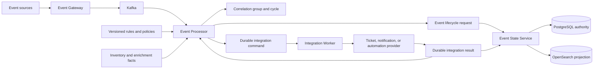
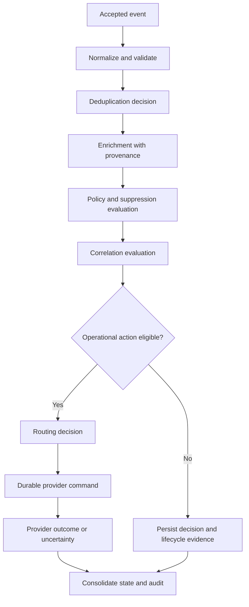
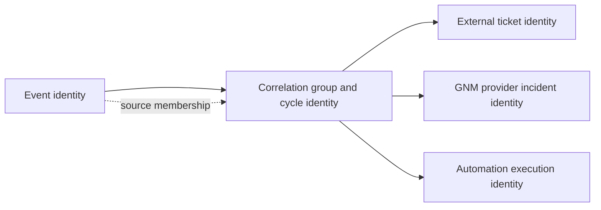
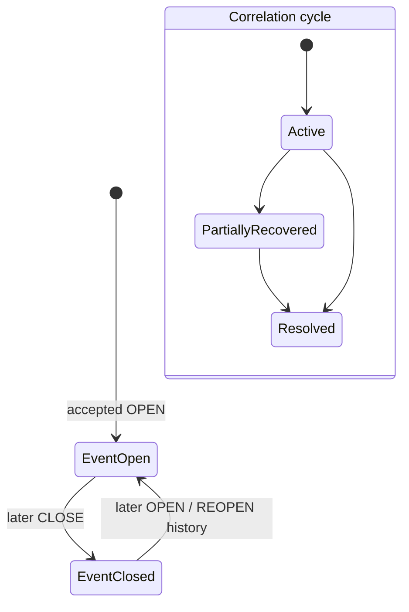

# Incidents Operations

## 01. Module Overview

Incidents Operations explains how Event Management coordinates operational situations
across accepted events, correlation groups, enrichment context, policies, routing,
external tickets, notifications, automation, recovery, and audit evidence.

The current platform does **not** establish a standalone internal Incident Registry or a
universal incident record. An operator may treat a correlated situation as an incident
context, but the authoritative identities and states remain owned by their documented
domains.

> **IMPLEMENTED:** event lifecycle, correlation groups/cycles, enrichment evidence,
> routing decisions, external ticket references, GNM incident references, CACF
> executions, and durable audit identities.
>
> **VALIDATED:** representative lifecycle orchestration against local simulated
> providers. This is not certification of production providers or a universal incident
> management process.

## 02. Functional Capabilities

Current capabilities supporting incident operations include:

- acceptance and normalization of source events;
- explicit event `OPEN` and `CLOSE` requests with derived reopen history;
- deterministic deduplication and correlation grouping;
- governed enrichment facts with provenance;
- policy, blackout, and suppression decisions;
- routing to supported ticket providers;
- optional ticket → GNM notification → CACF automation lifecycle;
- provider-specific resolution or closure confirmation;
- durable command, result, transition, and processing evidence;
- PostgreSQL operational authority with rebuildable OpenSearch projections; and
- monitoring of service health, Kafka lag, outboxes, and integration failures.

An internal incident CRUD API, universal assignment queue, universal priority model,
and independent incident persistence schema are **PENDING / not established**.

## 03. Event vs Incident vs Ticket

| Concept | Meaning | Authority |
| --- | --- | --- |
| Event | A source observation with canonical Event Management identity and lifecycle | Gateway, Processor, and Event State Service contracts |
| Correlated situation | A tenant-scoped group/cycle of related source events | Correlation capability and Processor persistence |
| Incident context | An operational interpretation of one event or a correlated situation | Conceptual coordination view; no standalone registry is established |
| GNM incident | Provider-native notification incident with `incidentId` | GNM/Everbridge provider domain |
| External ticket | ServiceNow or GLPI record with provider-native identity/status | ITSM provider domain |

Not every event qualifies for operator action, joins a correlation group, produces a
ticket, or becomes an incident context. An external ticket is not the internal event,
and an ITSM status does not replace Event State Service state.

## 04. Architecture and Dependencies

Dependencies retain separate ownership. Processor decides and coordinates; ESS owns
event state; providers own their external objects; PostgreSQL is operational authority;
OpenSearch is a derived search and analytics projection.

## 05. Main Process Flow

The diagram is a functional view, not a claim that every rule type has one universal
execution order. The Processor's implemented stage contracts and captured rule snapshot
determine the actual decision path.

## 06. Incident Detection

Detection begins with a source event accepted by the Event Gateway and normalized for
the Processor. The source's problem/recovery semantics can request `OPEN` or `CLOSE` for
the event aggregate.

Detection is **IMPLEMENTED** for supported source contracts. It means “an observation
was accepted,” not “an incident was created.” Invalid events may be rejected or sent to
the bounded failure path without a state request.

## 07. Incident Qualification

Qualification is the combined operational interpretation of validation, deduplication,
enrichment, policy, suppression, correlation, and routing evidence. Current contracts
can determine whether an integration command is eligible, but do not create a universal
internal incident record.

A dedicated Incident Policy type and incident-qualification API are **PENDING**. Until a
domain owner and contract are established, operators must interpret the documented
decision evidence rather than infer a hidden incident status.

## 08. Incident Creation or Association

Current implementation can:

- open or update an event aggregate;
- create or join a correlation group/cycle;
- create or reuse one governed external ticket command for an eligible situation;
- open a GNM notification incident in the explicit lifecycle profile; and
- associate a CACF execution with a confirmed ticket.

None of these operations creates a separate internal Incident Registry entry. “Create
incident” is therefore **DESIGNED / PENDING** as an internal domain operation unless it
explicitly refers to a supported external provider object.

## 09. Incident Identity

| Identity | Required distinction |
| --- | --- |
| Event ID / event key | Source observation and Event State Service aggregate |
| Correlation group ID / cycle | Related operational situation; commands may use `correlation:<groupId>` |
| Incident identity | No universal internal identifier is established; GNM `incidentId` is provider-specific |
| Ticket ID / number | ServiceNow or GLPI identity, never the canonical event ID |
| Execution ID | CACF automation identity, not an event, group, incident, or ticket |

Cross-domain references must retain tenant, provider/configuration, command/result IDs,
and the source membership needed to interpret them.

## 10. Incident Classification

Classification may use normalized source fields, typed enrichment facts, rule matches,
correlation context, source/effective severity, and provider outcomes. These facts are
**IMPLEMENTED** inputs to their owning capabilities.

A universal incident taxonomy, category/subcategory schema, and classification registry
are **PENDING**. Do not map provider categories or free text into authoritative internal
classification without a governed contract.

## 11. Priority and Severity

Event lifecycle requests carry source and effective severity values from 0 through 5;
`CLOSE` requires effective severity 0. Enrichment and policy may contribute context, but
the platform does not establish a universal incident-priority formula.

Ticket-provider priority, impact, urgency, and incident priority remain provider- and
configuration-specific. Severity must not be relabeled as ITSM priority without an
explicit mapping. An incident-level priority model is **DESIGNED / PENDING**.

## 12. Assignment and Ownership

Current assignment semantics exist at provider boundaries. Routing selects a supported
destination. Ticketing owns provider-specific assignment fields. CACF can use original
and holding assignment groups for constrained follow-up actions.

There is no implemented internal incident owner queue or universal assignment API.
Provider assignment does not transfer ownership of Event State Service state or the
correlation group.

## 13. Incident Lifecycle

The conceptual operational lifecycle is:

1. **Detect** — **IMPLEMENTED** through accepted source events.
2. **Qualify** — **IMPLEMENTED** only as bounded processing decisions; a dedicated
   Incident policy/record remains **PENDING**.
3. **Create or associate** — **IMPLEMENTED** for event/group and supported external
   provider objects; internal incident creation is **PENDING**.
4. **Assign** — **IMPLEMENTED** only in supported provider contracts.
5. **Investigate** — **DESIGNED / operational practice**; no universal workflow state.
6. **Escalate** — **IMPLEMENTED** for defined CACF/provider outcomes; not universal.
7. **Resolve** — provider-specific and **IMPLEMENTED** only where confirmed contracts
   exist.
8. **Verify** — **IMPLEMENTED** where provider lookup/state confirmation is documented.
9. **Close** — event, correlation cycle, GNM incident, and ticket each follow their own
   contract.
10. **Reopen** — **IMPLEMENTED** for event lifecycle; a later problem opens a new
    correlation cycle, not a universal incident reopen.

This conceptual sequence must not be converted into universal persisted incident states.

## 14. Incident State Transitions

ESS implements current event state `OPEN`/`CLOSED` and records derived `REOPEN` in
history. Correlation implements active, partial recovery, resolution, and new cycles
according to member state. Provider objects have separate states and confirmation
contracts. No combined universal incident state machine exists.

## 15. Incident Correlation and Grouping

Correlation evaluates active, tenant-scoped rules against a captured snapshot, derives
a deterministic grouping key, and creates or joins a compatible group cycle. Membership
and recovery are persisted with decision evidence.

One member recovery does not resolve a group while another member remains active. A new
problem after resolution opens a new cycle. Expiration alone does not prove recovery.
The correlation group is a situation identity, not proof that an internal incident
record exists.

## 16. Event-to-Incident Relationships

One incident context may be based on one event or on many members of a correlation
group. Each source event retains its own event ID, event key, lifecycle, severity, and
history. The group retains its own ID/cycle and membership evidence.

The current model is **IMPLEMENTED** for event-to-group membership. A general
event-to-internal-incident relationship table or API is **PENDING**.

## 17. Incident-to-Ticket Relationships

An eligible correlation situation may create or reuse one supported ticket command for
its group/cycle. The retained audit chain can relate source event, correlation group,
command, result, provider/configuration, and external ticket reference.

Ticket creation does not create an internal incident entity. Ticket resolution does not
close the source event, and source recovery does not automatically resolve a ticket
unless an explicit lifecycle profile coordinates and confirms that operation.

## 18. Integration With Correlation

Correlation supplies the situation scope, membership, group cycle, and recovery
conditions used by the implemented lifecycle profile. Incident operations must display
member state and group state separately and preserve `NO_MATCH` or unresolved decisions.

The Correlation Operations Home remains the functional authority for grouping rules and
lifecycle details.

## 19. Integration With Enrichment

Enrichment supplies typed facts such as service, CI, assignment, location, or resource
context with provenance and conflict evidence. Missing facts remain missing; enrichment
must not manufacture an incident, owner, or approval.

The original event and its immutable enrichment result continue downstream. A future
incident record could reference those facts, but such persistence is **PROPOSED**.

## 20. Integration With Routing

Routing evaluates eligible rules and processing context, derives a semantic command
identity, and persists the first command/outbox atomically. A routing match means an
integration action is eligible; it does not prove external execution or incident
creation.

Current supported targets remain constrained by their documented contracts. An
“incident destination” must not be invented as a new target or API.

## 21. Integration With Ticketing

Ticketing creates or updates supported ServiceNow/GLPI records through provider adapters,
captures external references, reconciles uncertainty, and publishes durable results.
Provider-specific resolve/close operations require confirmed outcome evidence.

ServiceNow's implemented lifecycle resolves and projects `RESOLVED`; it does not label
the ticket `CLOSED`. GLPI closure has its own supported state and lookup contract.

## 22. Integration With Notifications

The optional lifecycle can launch a GNM/Everbridge notification only after a confirmed
ticket number and requires lookup-confirmed `OPEN_CONFIRMED`. Its provider `incidentId`
is a GNM identity, not an internal Incident Registry ID.

Provider incident confirmation does not prove per-recipient delivery or human
acknowledgement. Those outcomes remain **PENDING / UNKNOWN** where not evidenced.

## 23. Integration With Automation

CACF/NEXT may begin after the implemented lifecycle has a confirmed ticket and GNM open
state. Automation has its own execution ID, acknowledgement, deadline, result, and
review semantics.

`REMEDIATED` can add a governed work note but does not prove source recovery or close the
event. `UNKNOWN`, timeout, or uncertain dispatch preserves review evidence and stops
automatic lifecycle advancement where defined.

## 24. Integration With Recovery

Recovery begins from an observed source `CLOSE`, not from an assumed provider outcome.
ESS records the source transition, correlation tracks member recovery, and the optional
lifecycle closes or resolves supported external objects in dependency order.

Replay is not backup/restore. PostgreSQL remains operational authority; OpenSearch can
be rebuilt. Backups and restoration procedures must be tested in an isolated environment
before production use.

## 25. Escalation and Communication

Escalation can be represented by a defined automation/provider outcome and constrained
ticket reassignment or note. Notifications can communicate a confirmed provider
incident through the supported GNM boundary.

A universal escalation matrix, on-call roster, recipient acknowledgement, and
incident-communications workflow are **DESIGNED / PENDING**. Do not infer communication
success from HTTP acceptance.

## 26. Operational Monitoring

Monitor the boundaries independently:

- Gateway and Processor acceptance/rejection;
- Kafka consumer lag and partition progress;
- lifecycle, correlation, command, result, and rejection ledgers;
- oldest pending outbox and provider-review work;
- ESS current state, transition history, and projection health;
- Integration Worker readiness and provider-specific outcomes; and
- dashboard timestamps so stale data is not interpreted as current health.

Readiness or HTTP 2xx is not functional provider certification. When a source is
unavailable, the console must show unavailable or unknown rather than a successful
incident outcome.

## 27. Resolution and Verification

Resolution must name its authority:

- event resolution: accepted source `CLOSE` persisted by ESS;
- correlation resolution: every required member recovered according to group semantics;
- ticket resolution/closure: provider-specific state confirmed by lookup;
- notification closure: GNM `CLOSED_CONFIRMED` for the known provider incident; and
- automation completion: terminal CACF result with state/outcome/review evaluated.

No single result implies all others. Verification requires the documented confirmation
for each boundary and its matching identities.

## 28. Closure and Reopening

ESS closes an event on a valid later `CLOSE` and derives `REOPEN` history when a later
`OPEN` follows `CLOSED`. Duplicate or stale requests do not mutate the aggregate.

A resolved correlation cycle remains distinct; a later problem opens a new group cycle.
External tickets and notification incidents follow provider-specific contracts. A
universal incident `CLOSED`/`REOPENED` state is **PENDING** and must not be inferred.

## 29. Auditability and Traceability

Traceability can retain tenant, source event ID/key, processing ID, rule revisions,
decisions, correlation group/cycle and members, command/result IDs, provider and
configuration, ticket reference, GNM incident ID, CACF execution ID, lifecycle
transitions, timestamps, and failure/review evidence.

Raw payloads, credentials, personal recipient data, and restricted evidence remain out
of public documentation. An audit trail proves recorded actions and outcomes; it does
not by itself prove authorization or human certification.

## 30. Security and Authorization

Incident-related actions use the authorization and secret boundaries of their owning
services and providers. Rules must not contain credentials. Integration workers resolve
backend configuration, and proposed SecretRefs remain **DESIGNED** where dynamic
administration is not implemented.

High-impact changes may require policy-driven approval, but no universal incident
approval queue/API is established. Local actor metadata, UI visibility, or a provider
identifier is not proof of production RBAC.

## 31. Failure and Recovery Behavior

| Failure | Required behavior |
| --- | --- |
| Invalid source event | Reject/quarantine according to the owning contract; do not create state silently |
| Missing enrichment | Preserve a degraded/not-found result; do not invent service or owner |
| Correlation uncertainty | Preserve members and evidence; do not merge unrelated identities |
| Ticket creation uncertainty | Reconcile using the original command; do not issue a blind second create |
| GNM without confirmed incident | Keep pending/review; do not claim notification success |
| Automation timeout/unknown | Preserve result and review; do not claim remediation |
| ESS projection failure | Retry from authoritative state; do not treat OpenSearch as authority |
| Outbox/Kafka interruption | Retain the durable pending record and stable identity |

Infrastructure failures must remain retryable where documented. Business uncertainty
must remain explicit; absence of evidence never becomes success.

## 32. Functional Example

This scenario is illustrative. It uses existing domain contracts but does not define a
new Incident API or persistence schema.

Two critical infrastructure events arrive for database nodes serving the Payments
service:

| Source event | Observation | Event identity |
| --- | --- | --- |
| A | Database listener unavailable on `db-pay-01` | `event-pay-001` |
| B | Replication unavailable on `db-pay-02` | `event-pay-002` |

Both are accepted as `OPEN`. Enrichment provides validated service `Payments`, CI
references, site, and database-operations assignment context. A correlation rule groups
them into one new cycle because the governed service/resource key matches. The group ID
is the situation identity; no internal incident ID is invented.

Policy and suppression evidence allow operational action. The conceptual incident
qualification is critical because two related service components are affected; the
example priority remains illustrative because no universal incident-priority formula is
implemented. Routing creates one stable ServiceNow ticket command for the group cycle.
The Worker confirms the external ticket number before the lifecycle launches a GNM
notification incident.

GNM lookup confirms its provider incident ID. CACF/NEXT then receives a separate stable
automation execution associated with the ticket. If automation returns `REMEDIATED`, a
governed work note is eligible, but both source events stay open until the monitoring
system sends recovery observations.

Event A recovers first. ESS records its `CLOSE`; the group remains active because B is
still open. Event B then recovers. Correlation resolves the cycle, GNM closure is
confirmed, and the supported ServiceNow lifecycle resolves and verifies the ticket. The
audit chain retains both source events, enrichment provenance, rule revisions, group
membership, command/results, external references, execution, and transitions.

Failure alternatives remain explicit:

- missing enrichment records degraded context and may prevent assignment/routing;
- uncertain ticket creation is reconciled rather than duplicated;
- unconfirmed GNM opening stops automation eligibility;
- CACF timeout/unknown moves the lifecycle to review; and
- source recovery without confirmed external closure keeps external work reviewable.

## 33. Current Implementation vs Target Architecture

| Capability | Status | Boundary |
| --- | --- | --- |
| Event `OPEN`/`CLOSE` with derived reopen history | **IMPLEMENTED / VALIDATED** | ESS lifecycle contract and tests |
| Correlation groups, membership, recovery, new cycles | **IMPLEMENTED / VALIDATED** | Processor correlation capability |
| Enrichment, policy, routing, durable integrations | **IMPLEMENTED** | Per owning module contract |
| External ticket/notification/automation identities | **IMPLEMENTED** | Supported provider adapters and lifecycle profile |
| Complete lifecycle against simulated providers | **VALIDATED** | Local shared/isolated runtime only |
| Standalone internal Incident Registry | **PENDING / not established** | Domain ownership and contract unresolved |
| Universal incident states, priority, assignment, and CRUD | **PROPOSED / PENDING** | Must not be inferred from event or ITSM state |
| Human approval and communication workflow | **DESIGNED / PENDING** | Policy-driven architecture, no universal runtime |
| Real provider certification | **PENDING** | Requires separate authorized validation |

Unresolved ownership decisions include whether a future internal incident is a new
aggregate or a governed view of a correlation cycle, which service owns it, how it
relates to external tickets, and which states/priority/assignment semantics are allowed.

## 34. Existing Engineering References

- [Event State Service Lifecycle Contract](/platform/event-state-service/lifecycle-contract/)
- [Event State Service Lifecycle Status](/platform/event-state-service/lifecycle-status/)
- [Event State Service Validation](/platform/event-state-service/validation/)
- [Correlation Backend](/platform/event-processor/correlation-backend/)
- [Correlation and Suppression Commands](/platform/event-processor/correlation-suppression-commands/)
- [Processor Rules and Contracts](/platform/event-processor/rules-and-contracts/)
- [Lifecycle Orchestration](/platform/event-processor/lifecycle-orchestration/)
- [Data Authority and Replay](/architecture/data-authority-replay/)
- [Solution Flows](/architecture/solution-flows/)
- [Platform Operations Guide](/operations/platform-operations-guide/)
- [Correlation Operations](/operations/correlation/)
- [Enrichment Operations](/operations/enrichment/)
- [Routing Operations](/operations/routing/)
- [Ticketing Operations](/operations/ticketing/)
- [Notifications Operations](/operations/notifications/)
- [Automation Operations](/operations/automation/)
