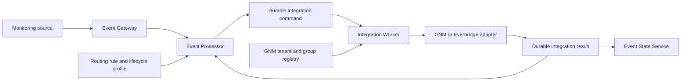
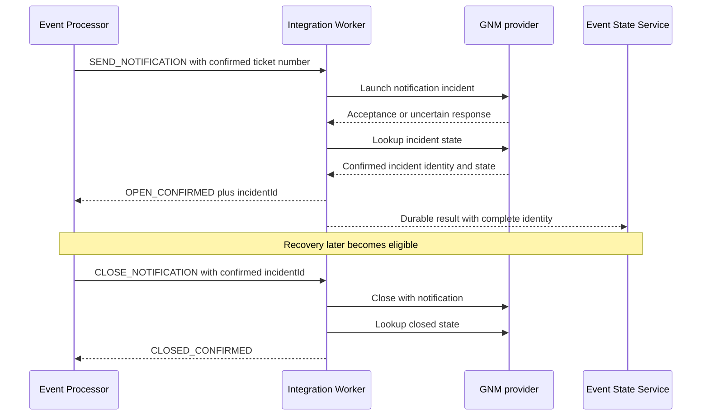
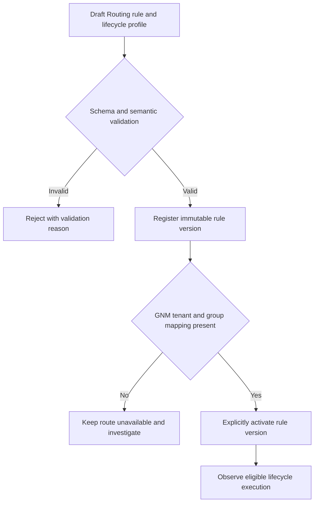

# Notifications Operations

## 01. Module Overview and Functional Scope

Notifications turns an eligible Event Management lifecycle decision into a governed
provider operation while preserving the event, correlation cycle, command, result, and
external incident identities. The current implementation is the GNM/Everbridge
incident-notification lifecycle used by an explicit ServiceNow route profile.

> **IMPLEMENTED:** durable `SEND_NOTIFICATION` and `CLOSE_NOTIFICATION` operations,
> GNM registry lookup, provider launch/close, confirmation by lookup, stable result
> identity, and Processor lifecycle checkpoints.
>
> **VALIDATED:** the ticket → notification → automation → recovery → notification-close
> chain in the shared runtime against local simulated providers. This is not evidence of
> connectivity to a real Everbridge tenant or of delivery to an individual recipient.

The module does not provide a universal messaging API, generic notification-rule type,
or proven email, SMS, Slack, Telegram, or PagerDuty connector.

## 02. Architecture and Main Processing Flow



Processor owns business sequencing and eligibility. Worker owns provider execution,
claiming, retry, reconciliation, and confirmation. The external provider owns its
incident. Event State Service consolidates results without replacing provider or event
authority.



## 03. Channels and Provider Instances

| Channel or provider | Status | Evidence boundary |
| --- | --- | --- |
| GNM / Everbridge incident notification | **IMPLEMENTED / VALIDATED** | Adapter and lifecycle are implemented; validation uses a local mock |
| Real Everbridge account | **PENDING** | No production-account certification is established |
| Email, SMS, Slack, Telegram, PagerDuty | **PROPOSED** | No implemented OEM adapter or operational contract is established |
| Dynamic integration instances | **DESIGNED** | Architecture describes provider profiles and SecretRefs; runtime administration is not implemented |

The current GNM registry maps tenant and logical notification group to provider
configuration. It is startup configuration supplied from the classpath or a local
file for laboratory tenants; it is not a dynamic Operations CRUD resource.

## 04. Rules, Templates, and Recipient Selection

The implemented notification path is enabled by the `lifecycle` parameters of an
eligible `SERVICENOW/CREATE_TICKET` Routing action. The lifecycle profile supplies a
logical `notificationGroup`; it does not accept arbitrary provider endpoints,
credentials, operations, or free-form payloads.

Routing and lifecycle policy select whether the governed notification operation may be
created. The Worker registry resolves the configured provider target. Provider-native
recipient membership and message rendering remain behind that boundary.

- **IMPLEMENTED:** selection of a logical notification group in an explicit lifecycle
  profile and use of the confirmed ticket number in the downstream operation.
- **DESIGNED:** provider profiles managed as integration instances with SecretRefs.
- **PENDING:** general notification rules, user-managed templates, recipient-directory
  administration, and a documented template preview/version contract.

There is no dedicated public `/notifications` management API and no separate universal
notification-rule contract. The internal GNM diagnostic surface is not a public CRUD
contract.

## 05. Configuration Lifecycle

Current configuration is created through two owning boundaries: a versioned Routing
rule with a strict lifecycle profile, and the Worker-owned GNM registry. Validate all
required lifecycle values and the tenant/group mapping before rule activation. Rule
activation does not prove provider credentials, connectivity, or recipient membership.



Configuration changes must not rewrite an active correlation cycle: its first lifecycle
configuration remains frozen. To disable future notifications, deactivate the owning
rule version or route profile according to the shared rules contract. Preserve open
cycles, provider identities, command/result ledgers, and audit records.

Dynamic provider registration, delete, version rollback, or secret rotation through an
Operations UI is **DESIGNED / PENDING**. Do not delete a mapping needed to reconcile an
in-flight or uncertain provider operation.

## 06. Delivery, Acknowledgement, and Outcome Semantics

The following states are deliberately distinct:

| Boundary | Meaning | What it does not prove |
| --- | --- | --- |
| Notification selected | Policy made the operation eligible | Command persistence or delivery |
| Delivery requested | A durable command crossed the Worker boundary | Provider acceptance |
| Provider accepted | Provider transport/API accepted a request | Confirmed incident state or recipient delivery |
| Incident confirmed | Lookup returned the expected incident identity/state | Delivery to, or acknowledgement by, every recipient |
| Recipient delivered | A recipient channel reports delivery | Human acknowledgement |
| Recipient acknowledged | A person or provider-specific workflow records acknowledgement | Resolution of the source event |

Current lifecycle advancement requires `OPEN_CONFIRMED` or `CLOSED_CONFIRMED`, not a
successful HTTP status alone. The evidence set does not establish per-recipient delivery
or human acknowledgement telemetry, so those outcomes remain **PENDING / UNKNOWN**.

## 07. Rate Limits, Retries, Idempotency, and Recovery

Command and result identities, Worker claims, durable ledgers, and reconciliation protect
the lifecycle against duplicate effects. Expired claims republish the original command;
the consumer reconciles rather than inventing a new create. Duplicate results do not
advance the lifecycle twice.

GNM lookup can reconcile a known external incident identity. A provider acceptance lost
before checkpointing can still be uncertain: the platform does not promise external
exactly-once behavior and must not manufacture success.

Provider-specific rate limits, throttling quotas, retry intervals, and a notification
dead-letter/replay operator contract are not established by the current documentation.
They are **PENDING**. Operators must use only documented Worker retry and reconciliation
behavior and preserve the original command identity.

## 08. Partial Failures, Escalation, and Monitoring

| Condition | Operational interpretation |
| --- | --- |
| No result yet | Pending; never convert absence into success |
| Timeout or provider failure | Preserve original result and move the lifecycle to review where defined |
| Acceptance without confirmed incident | Uncertain; reconcile by provider evidence |
| Result with wrong or incomplete identity | Reject/quarantine; do not advance dependencies |
| Duplicate or late result | Deduplicate by stable identity; retain audit evidence |
| Open confirmed but later close uncertain | Keep the external incident and cycle reviewable |
| Recipient delivery/ack unavailable | Report **UNKNOWN**, not delivered or acknowledged |

Monitor lifecycle state, Worker command/result ledgers, pending outbox publication,
review reasons, and ESS integration state for the correlation situation. Current shared
certification also checks GNM confirmed open and close, duplicate safety, and empty
outboxes. Provider and recipient delivery dashboards are **PENDING**.

Repair of `REVIEW`, especially a GNM operation without an incident ID, requires explicit
operator authorization and provider evidence. There is no automatic API that converts
uncertainty into success.

## 09. Security, Tenancy, Privacy, and Audit

Credentials remain backend-owned and must never enter rules, event payloads, commands,
logs, screenshots, or this documentation. Synthetic fixture credentials are not valid
for real providers. The proposed SecretRef relationship is **DESIGNED**; it does not
make the dynamic secrets-administration paths available.

Tenant, logical group, event/correlation identity, command ID, result ID, provider
incident ID, operation, timestamps, and outcome form the minimum auditable chain. Apply
least privilege and redact message content or recipient data from public evidence.
Current local actor metadata is not proof of production authorization or RBAC.

## 10. Integration With Operational Modules

- **Routing:** owns the supported action and explicit lifecycle profile that makes a
  notification eligible. General GNM routing is **PENDING**.
- **Ticketing:** the implemented flow waits for a confirmed ServiceNow ticket number
  before `SEND_NOTIFICATION`.
- **Correlation:** the notification belongs to one tenant/correlation group cycle;
  member events retain their identities.
- **Suppression and Blackouts:** may suppress new lifecycle intentions at their governed
  decision boundary; they do not retract a command already durably emitted.
- **Deduplication:** repeated inputs/results must not create additional external effects.
- **Enrichment and Filters & Criteria:** may contribute governed context or eligibility;
  they are not notification providers.
- **Automation:** begins only after the lifecycle has a confirmed open GNM incident in
  the implemented profile.
- **Event State Service:** consolidates integration results and lifecycle projections; it
  does not execute provider operations.

The ordering above is specific to the implemented opt-in lifecycle profile. It is not a
universal pipeline order for all future notification channels.

## 11. Disable, Delete, Versioning, and Rollback

Disable future use through the owning rule/profile and drain or review existing cycles
before removing runtime capability. Preserve immutable rule versions, the configuration
frozen on each active cycle, provider mappings required for reconciliation, external
incident identities, and durable command/result history.

Rollback requires disabling lifecycle routes and stopping new consumers before returning
to software that does not understand the profile. Additive persistence and audit data are
retained; destructive rollback is not authorized. Dynamic provider delete and one-click
configuration rollback remain **PENDING**.

## 12. Deterministic Functional Example

This example is conceptual and illustrates the implemented lifecycle semantics; field
names are not a public production API contract.

An accepted critical monitoring event joins correlation cycle `corr:db-payments:042`.
An active Routing rule creates a ServiceNow ticket using lifecycle configuration whose
logical target is `primary-operations`. The Worker confirms ticket `INC0042187`. Only
then does Processor create one stable `SEND_NOTIFICATION` intention for that tenant,
cycle, group, and operation.

```json
{
  "tenant": "example-tenant",
  "correlationCycle": "corr:db-payments:042",
  "operation": "SEND_NOTIFICATION",
  "notificationGroup": "primary-operations",
  "ticketReference": "INC0042187",
  "severity": "critical",
  "templateIntent": "critical correlated incident"
}
```

The registry resolves `primary-operations` to the configured GNM provider instance. The
normal response is accepted, then confirmed by lookup as `OPEN_CONFIRMED` with a durable
incident ID. That confirmation allows the next lifecycle dependency; it does not prove
that every recipient received or acknowledged the message.

If the initial response times out, Worker preserves the same command identity and
reconciles. A duplicate retry cannot create a second logical command. If lookup cannot
establish the incident, the cycle remains pending or enters `REVIEW`; delivery and
acknowledgement are reported `UNKNOWN`. On observed source recovery, the confirmed
incident ID is used for `CLOSE_NOTIFICATION`, followed by lookup for `CLOSED_CONFIRMED`.
All decisions and identities remain in the audit chain.

## 13. Current Implementation vs Target Architecture

| Capability | Status | Notes |
| --- | --- | --- |
| Durable GNM open/close lifecycle | **IMPLEMENTED** | Requires explicit opt-in lifecycle profile |
| Shared-runtime GNM lifecycle with restart and duplicates | **VALIDATED** | Local simulated provider only |
| Real Everbridge connectivity and recipient outcomes | **PENDING** | Requires authorized provider certification |
| Stable command/result identity and reconciliation | **IMPLEMENTED / VALIDATED** | Preserves uncertainty rather than assuming success |
| Dynamic provider instances and SecretRefs | **DESIGNED** | Administration paths are not available |
| General notification rules and template management | **PROPOSED / PENDING** | No current public CRUD contract |
| Email, SMS, Slack, Telegram, PagerDuty adapters | **PROPOSED** | Comparative possibilities are not OEM implementation evidence |
| Provider rate-limit and per-recipient SLA telemetry | **PENDING** | No current authoritative operational contract |

## 14. Existing Engineering References

- [Lifecycle Orchestration](/platform/event-processor/lifecycle-orchestration/)
- [GNM / Everbridge Engineering Changelog](/platform/gnm/CHANGELOG/)
- [CACF/GNM Shared Activation](/platform/cacf/shared-activation/)
- [Processor Rules and Contracts](/platform/event-processor/rules-and-contracts/)
- [System Integration Instances](/platform/architecture/system-integration-instances/)
- [Administration API Inventory](/platform/administration-api-inventory/)
- [Event State Service Validation](/platform/event-state-service/validation/)
- [Operations Home](/operations/)
