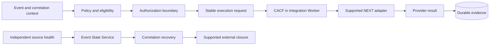
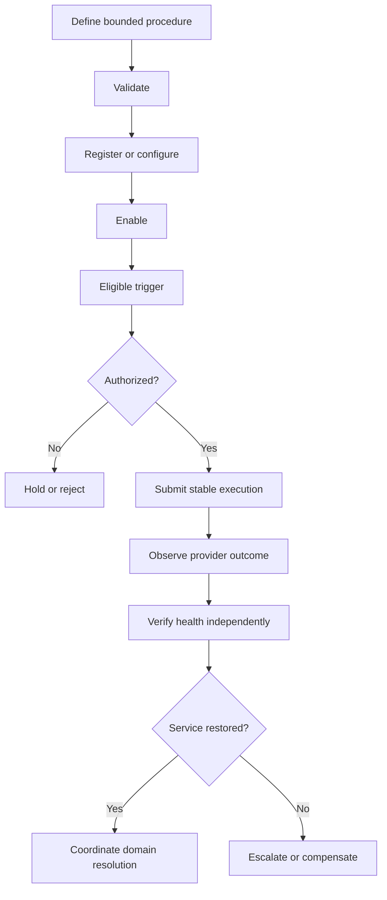

# Recovery Operations

## 01. Module Overview

Recovery Operations describes how Event Management coordinates an authorized attempt
to restore service while preserving the independent states of events, correlation
cycles, incident contexts, tickets, notifications, and automation executions.

> **IMPLEMENTED:** source-driven event recovery, correlation member recovery, durable
> CACF/NEXT execution, provider results, constrained ITSM follow-up, and the opt-in
> lifecycle that closes supported external work after observed recovery.
>
> **VALIDATED:** representative behavior in local environments with simulated
> providers. This is not production-provider certification.

There is no universal Recovery Registry, recovery CRUD API, or generic runbook executor.

## 02. Functional Capabilities

Current capabilities include source `CLOSE` requests and derived reopen history;
correlation member recovery; durable, idempotent CACF automation through the supported
NEXT adapter; deadlines and review evidence; governed ticket follow-up; and
source-recovery-driven external closure in the explicit lifecycle profile.

Generic runbook execution, universal approval, recovery scheduling, and production
provider certification are **PENDING**.

## 03. Recovery Concepts

| Concept | Meaning |
| --- | --- |
| Recovery requested | A governed intention exists; nothing has executed |
| Recovery authorized | Required policy or human approval is established |
| Execution submitted | A stable request was accepted for dispatch |
| Execution started | Provider acknowledgement correlates to the request |
| Execution completed | The provider reported a terminal outcome |
| Recovery verification | Independent health evidence is evaluated |
| Service restored | Defined service-health criteria are satisfied |
| Incident resolved | The owning incident context satisfies its resolution contract |
| Incident closed | The owning domain completes its separate closure contract |

These states are not interchangeable. Execution completion does not prove recovery.

## 04. Architecture and Dependencies

Processor owns eligibility and ordering; Worker owns execution; ESS owns event state;
providers own their records; PostgreSQL is authoritative; OpenSearch is a projection.

## 05. Main Process Flow

This is conceptual. Only the explicit CACF/NEXT and lifecycle-profile paths are
implemented; it is not a universal workflow engine.

## 06. Recovery Triggers

The implemented lifecycle starts automation only after an eligible route has a
confirmed ticket and GNM incident. Direct CACF admission requires its authenticated
contract. An event match, AI suggestion, catalog record, or saved rule is not approval.

Source recovery is separate: an accepted monitoring observation requests `CLOSE`.
Automation completion must not manufacture that observation.

## 07. Recovery Policies

The opt-in lifecycle configuration bounds notification, assignment, resolution, and
closure behavior for one correlation cycle. A universal Recovery Policy resource,
precedence model, or API is **PROPOSED / PENDING**.

## 08. Recovery Procedures

A procedure identifies purpose, prerequisites, authorized target, supported operation,
verification, timeout, failure response, compensation boundary, and evidence. It never
embeds credentials. The platform implements a constrained CACF/NEXT action contract,
not an arbitrary procedure language.

## 09. Runbook Selection

Selection should use validated event, service, resource, tenant, and correlation
context and retain the chosen revision. Automated runbook discovery, compatibility
matching, checksum registration, and a generic catalog are **DESIGNED / PENDING**.

## 10. Recovery Configuration Creation

Current configuration is distributed across authorized deployment settings, route
lifecycle parameters, provider settings, and runbooks; it is not one Recovery object.
A future configuration should be tenant-scoped, revisioned, provider-bounded, and free
of secret material. No new schema or endpoint is defined here.

## 11. Validation and Registration

Before enablement, validate identities, supported provider/operation, timeouts,
assignment context, lifecycle compatibility, health criteria, and secret references.
CACF implements strict request validation and durable admission. Generic procedure
registration is **PENDING**.

## 12. Approval and Authorization

Authenticated CACF admission and opt-in configuration are **IMPLEMENTED**. A human
approval queue, approver-role model, expiry workflow, and separation-of-duties service
are **DESIGNED / PENDING**. Absence or ambiguity is not consent. Approval evidence must
identify actor, tenant, scope, revision, decision, time, and policy.

## 13. Recovery Execution

Execution uses one stable identity. CACF persists request and dispatch evidence,
correlates callbacks, and publishes a durable result/outbox. Acceptance proves only
admission; submission, acknowledgement, result, verification, and recovery are separate.

## 14. Automation Provider Integration

| Provider | Status | Boundary |
| --- | --- | --- |
| NEXT through CACF | **IMPLEMENTED / VALIDATED** | Local simulated provider |
| ServiceNow / GLPI | **IMPLEMENTED dependencies** | Ticket follow-up, not recovery engines |
| Real NEXT environment | **PENDING** | Production behavior not certified |
| Scripts, runbooks, webhooks, other engines | **PROPOSED** | No supported adapter contract |
| Dynamic providers and SecretRefs | **DESIGNED** | Not active runtime reconfiguration |

Provider registration never establishes adapter implementation or authorization.

## 15. Execution Status

CACF distinguishes received, submitting, submitted, in-progress, completed, timed-out,
submission-failed, and review-required outcomes. A result-envelope `SUCCESS` is not
sufficient when the normalized outcome is `UNKNOWN`. No universal recovery state is
inferred from execution status.

## 16. Recovery Verification

Verification compares independent evidence with declared success criteria. A provider
result may prove an action ran; only monitoring or an authorized service check proves
recovery. Missing or stale verification remains unknown.

## 17. Service Health Validation

Health evidence can include source recovery, readiness, functional checks, dependency
health, and sustained stability. Readiness alone does not prove business recovery. The
implemented event path accepts a later source `CLOSE`; a generic health-validation
framework is **PROPOSED**.

## 18. Retry and Idempotency

Execution, command, provider, result, and outbox identities protect documented
boundaries. Same-request retries are idempotent; conflicts are rejected. Uncertain
external mutations are not retried blindly: preserve identity and reconcile evidence.
At-least-once delivery is not distributed exactly-once execution.

## 19. Failure Handling

| Failure | Required behavior |
| --- | --- |
| Invalid or unauthorized request | Reject before provider action |
| Provider acceptance unknown | Preserve uncertainty; do not invent another execution |
| Missing acknowledgement/result | Apply deadlines and require review |
| Unknown callback | Retain `UNKNOWN`; do not claim remediation |
| Health verification fails | Keep recovery unverified and escalate |
| Source remains open | Do not close event, incident context, or ticket |
| Outbox/Kafka interruption | Retain durable pending publication |
| Projection failure | Recover from authoritative PostgreSQL state |

## 20. Rollback and Compensation

Rollback is procedure- and provider-specific. A binary rollback does not reverse a
database migration, and an external effect may not be reversible. Compensation needs
explicit authorization, supported semantics, stable identity, and verification. Where
none exists, stop, preserve evidence, isolate impact, and escalate.

## 21. Escalation

Escalate unknown effects, failed verification, expired approval, exhausted safe retries,
unsafe compensation, or exceeded limits. CACF can request constrained reassignment or
notes. A universal escalation matrix and on-call integration are **DESIGNED / PENDING**.

## 22. Human Intervention

Operators may reconcile provider state, confirm health, authorize sensitive action,
select an alternate procedure, or stop automation. They must use owning interfaces and
must not rewrite ledgers, offsets, or authoritative state. Record actor, reason, target,
authorization, time, and outcome.

## 23. Integration With Incidents

An incident context can supply scope, severity, ownership, and communication needs, but
there is no standalone internal Incident Registry. Requested, completed, restored,
resolved, and closed remain separate. Recovery never automatically closes an incident
without an approved owning-domain contract.

## 24. Integration With Automation

Automation supplies execution, provider status, deadlines, idempotent results, and
review evidence. It does not own event state or service-health truth. A terminal
`REMEDIATED` outcome is not proof of recovery.

## 25. Integration With Correlation

Correlation supplies group/cycle identity and member recovery. One member closing does
not resolve a group while another required member is open. A later problem creates a
new cycle. Expiration is not recovery.

## 26. Integration With Routing

Routing selects eligible integration action and owns the current opt-in lifecycle
profile. A match proves neither authorization nor recovery. Disabling a route prevents
new intentions; it does not cancel submitted provider work.

## 27. Integration With Ticketing

Ticketing supplies external work identity and supported notes, reassignment, resolve,
or close operations. Provider ticket state, source recovery, and event state are
distinct. Uncertain mutations require reconciliation rather than replay.

## 28. Integration With Notifications

The lifecycle may require a confirmed GNM incident before automation and request its
closure after correlation recovery. GNM identity/state are provider-specific. Provider
acceptance does not prove recipient acknowledgement.

## 29. Integration With Event State Service

ESS owns event `OPEN`/`CLOSED` state and derives reopen history. Automation and ticket
results do not close the source event. PostgreSQL is authoritative; OpenSearch must not
be used to decide recovery truth.

## 30. Operational Monitoring

Monitor eligibility, approval, execution age, deadlines, review counts, pending outbox,
Kafka lag, provider health, ESS transitions, correlation members, health verification,
and closure results. Dashboards distinguish stale, unknown, failed, unavailable, and
successful data. Readiness is not end-to-end certification.

## 31. Security and Secret References

Use least privilege, tenant isolation, authenticated admission, authorized targets,
bounded operations, and audit logging. Credentials never belong in rules, requests,
logs, screenshots, Git, or public evidence. SecretRef provider administration is
**DESIGNED**; current settings are not a universal SecretRef lifecycle.

## 32. Auditability and Traceability

Retain tenant, source event, correlation cycle, incident context, procedure revision,
policy, approval, execution/command, provider, ticket, notification, result, health,
escalation, actor, and timestamps. Restricted payloads and secrets stay out of public
evidence. Audit evidence does not itself prove recovery.

## 33. Recovery Lifecycle

1. **Define** — **DESIGNED**; current knowledge is distributed.
2. **Validate** — **IMPLEMENTED** for bounded CACF requests and procedures.
3. **Register** — **PENDING** as a universal Recovery resource.
4. **Enable** — **IMPLEMENTED** through explicit profile/runtime controls.
5. **Trigger** — **IMPLEMENTED** for documented admission paths.
6. **Approve** — explicit enablement exists; human workflow is **DESIGNED / PENDING**.
7. **Execute** — **IMPLEMENTED / VALIDATED** for CACF/NEXT with simulation.
8. **Verify** — event/correlation recovery is **IMPLEMENTED**; generic health is **PROPOSED**.
9. **Escalate** — bounded follow-up exists; universal escalation is **PENDING**.
10. **Disable** — **IMPLEMENTED** through owning controls for new work.
11. **Retire** — **PENDING** as a universal procedure lifecycle.

No universal persisted recovery state machine is implied.

## 34. Disable and Delete Operations

Disable new execution through the owning route/profile or authorized runtime control.
Drain or review in-flight work and preserve mappings, offsets, outboxes, results, and
provider evidence. There is no universal delete operation. Deleting history is not
disablement, rollback, or retirement.

## 35. Functional Example

This scenario is conceptual and defines no new API or schema.

A critical event reports `db-pay-01` unavailable. A replication symptom on `db-pay-02`
joins correlation cycle `corr:payments-db:091`; operators treat it as one incident
context without inventing an internal incident ID.

The route/profile selects the bounded CACF/NEXT procedure “restart database listener
after prerequisite checks.” Policy requires a Payments-tenant match, confirmed ticket,
confirmed GNM incident, database-operations scope, and human approval. The selected
runbook revision records prerequisites, target, timeout, success criteria, and escalation.
This selection is conceptual because no generic runbook registry exists.

An authorized operator approves the exact target/revision. Processor creates one stable
execution. CACF persists and dispatches it, correlates acknowledgement, and records
`COMPLETED / REMEDIATED`. That proves only provider execution.

Independent monitoring must then recover. A `CLOSE` for `db-pay-01` closes that event,
but the group remains active until `db-pay-02` recovers. When both close, correlation
resolves the cycle and the supported lifecycle can confirm GNM closure and ticket
resolution. Incident closure remains subject to its own contract.

If NEXT times out or health stays failed, the request is not blindly repeated. Evidence
remains unknown/failed, events stay active, and database operations is escalated for
review or explicitly approved compensation. The audit trail retains events, group,
policy, runbook revision, approval, execution, provider result, health, external
references, escalation, and timestamps.

## 36. Current Implementation vs Target Architecture

| Capability | Status | Boundary |
| --- | --- | --- |
| Source event close and reopen history | **IMPLEMENTED / VALIDATED** | ESS lifecycle |
| Correlation member recovery | **IMPLEMENTED / VALIDATED** | Processor correlation |
| CACF/NEXT execution and results | **IMPLEMENTED / VALIDATED** | Simulated provider |
| Ticket → GNM → CACF → recovery closure | **VALIDATED** | Local lifecycle with mocks |
| Provider-aware ITSM follow-up | **IMPLEMENTED** | Supported contracts |
| Real production provider certification | **PENDING** | Separate authorization required |
| Generic runbook registry/executor | **PROPOSED** | No contract established |
| Universal Recovery Policy/Registry/API | **PROPOSED / PENDING** | Ownership unresolved |
| Human approval workflow | **DESIGNED / PENDING** | No queue/API/UI |
| Dynamic SecretRef/provider configuration | **DESIGNED** | Not active runtime |
| Generic health-verification framework | **PROPOSED** | Source recovery remains authoritative |
| Automatic incident closure from success | **NOT IMPLEMENTED** | Needs approved contract |

## 37. Existing Engineering References

- [Data Authority and Replay](/architecture/data-authority-replay/)
- [Lifecycle Orchestration](/platform/event-processor/lifecycle-orchestration/)
- [Event State Service Lifecycle Contract](/platform/event-state-service/lifecycle-contract/)
- [Event State Service Lifecycle Status](/platform/event-state-service/lifecycle-status/)
- [CACF Core Foundation](/platform/cacf/README/)
- [CACF Contracts](/platform/cacf/contracts/)
- [CACF Data and States](/platform/cacf/data-and-states/)
- [CACF Operational Runbook](/platform/cacf/operational-runbook/)
- [Processor Rules and Contracts](/platform/event-processor/rules-and-contracts/)
- [Universal Management Contract Conformance](/architecture/umc/conformance/)
- [Platform Operations Guide](/operations/platform-operations-guide/)
- [Historical Disaster Recovery Guidance](/operations/disaster-recovery/)
- [Incidents Operations](/operations/incidents/)
- [Automation Operations](/operations/automation/)
- [Correlation Operations](/operations/correlation/)
- [Routing Operations](/operations/routing/)
- [Ticketing Operations](/operations/ticketing/)
- [Notifications Operations](/operations/notifications/)
