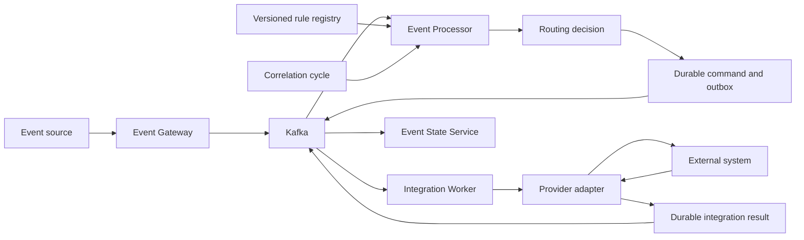
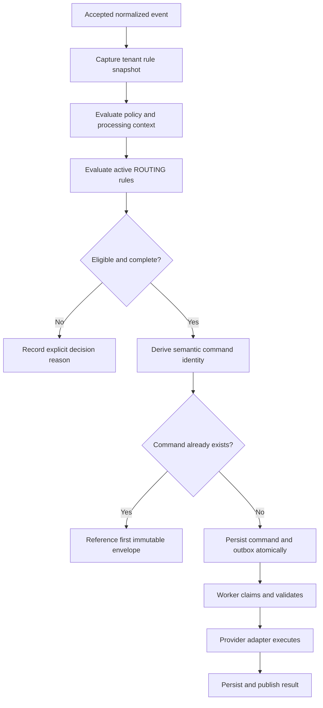
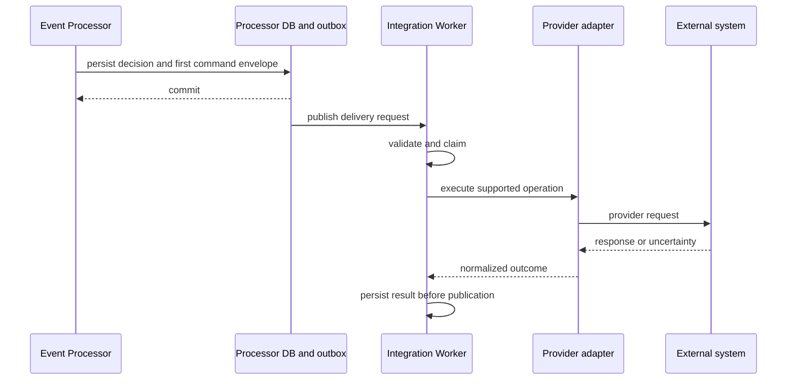

# Routing Operations

## 01. Module Overview

Routing turns an eligible processing decision into one or more governed integration
command intentions. The Event Processor decides; the Integration Worker executes.
Those responsibilities are deliberately separate.

> **IMPLEMENTED:** tenant-scoped, versioned `ROUTING` rules, deterministic evaluation,
> durable command identity, first-envelope retention, transactional outbox publication,
> and Worker execution/result handling.
>
> **VALIDATED:** the base `SERVICENOW/CREATE_TICKET` profile with configuration
> `default`, an applicable correlation cycle, duplicate suppression, replay, rollback,
> and mock-provider success.

A matching rule is not proof of delivery, and delivery is not proof that the external
business action completed successfully.

## 02. Functional Capabilities

The current baseline provides:

- shared rule administration, validation, versions, activation, simulation, and history;
- typed conditions over supported event, resource, and enrichment fields;
- deterministic ordering and evaluation evidence;
- zero-to-many commands when distinct correlation groups and actions qualify;
- semantic command deduplication within a correlation cycle;
- immutable retention of the first command envelope;
- durable Processor command/outbox writes and Worker claim/result records;
- explicit suppression, recovery, missing-payload, and missing-cycle outcomes;
- explain evidence by processing identity.

It does not provide an arbitrary-send button, editable command records, or a universal
provider catalog through Routing.

## 03. Architecture and Dependencies



Event Gateway owns admission and normalization. Event Processor owns the rule snapshot,
routing decision, semantic command identity, and durable intention. Integration Worker
owns claim, adapter execution, retry/reconciliation, and result publication. Event State
Service owns lifecycle/result consolidation; it does not re-evaluate the route.

## 04. Main Processing Flow



The active snapshot is fixed for the processing unit. Kafka acknowledgement follows
the Processor database commit; a failed transactional write rolls the unit back.

## 05. Routing Concepts

| Concept | Meaning |
| --- | --- |
| Routing decision | Processor conclusion that a governed action is eligible |
| Destination resolution | Binding the rule action to a supported integration/configuration |
| Integration instance | Tenant-scoped administrative identity for an external connection; dynamic UMC model is **DESIGNED** |
| Provider adapter | Worker implementation that understands one provider contract |
| Delivery request | Durable command handed to the Worker |
| Delivery acknowledgement | Evidence that a request was accepted or delivered at a defined boundary |
| External action result | Provider-specific confirmed outcome, failure, or uncertainty |

These terms are not interchangeable. A decision can succeed before delivery begins.
An accepted request can still fail, time out, or have an unknown external outcome.

## 06. Routing Rules

The current executable subset is a `ROUTING` definition in the shared rule registry:

```json
{
  "id": "critical-service-ticket",
  "version": 1,
  "type": "ROUTING",
  "enabled": true,
  "priority": 100,
  "condition": {"field": "event.severity", "operator": "GTE", "value": 4},
  "actions": [{
    "type": "CREATE_TICKET",
    "target": "SERVICENOW",
    "parameters": {"configuration": "default", "correlationRuleId": "by-service"}
  }],
  "metadata": {"owner": "operations"}
}
```

This is an implemented contract example with illustrative identifiers. It is not a
request to a real ServiceNow instance.

## 07. Routing Criteria

Conditions use the shared typed AST and supported fields such as canonical severity,
status, resource attributes, tenant context, and implemented enrichment facts. Backend
validation is authoritative. Values are not coerced, scripts are not accepted, and
unknown fields are rejected.

An enabled rule is evaluated only within its tenant snapshot. A matching predicate is
still insufficient when the action lacks required payload fields, the selected
correlation cycle is absent, or an independent directive suppresses integrations.

## 08. Destination Types

Potential destination categories are ITSM, notifications, automation, webhooks, and
external integrations. They are not equally available in the base Routing contract.

| Category | Current Routing status |
| --- | --- |
| ITSM — ServiceNow ticket creation | **VALIDATED** with local mock and `default` profile |
| ITSM — other providers | **PENDING** for the base profile |
| Notifications — GNM | Recognized Worker operation; base Routing action **PENDING** |
| Automation — CACF/NEXT | Optional lifecycle orchestration exists; arbitrary Routing action **PENDING** |
| Webhooks / generic integrations | **PROPOSED**; no generic contract is claimed |

## 09. Integration/Provider Selection

The validated base rule selects `SERVICENOW` and configuration `default`. A configured
record elsewhere does not automatically expand Routing. The Worker validates the
command and chooses the supported adapter at execution time.

The UMC Resource Contract and dynamic integration-instance lifecycle are **DESIGNED**
target architecture. UMC does not prove that a saved instance is connected to current
Routing, nor that a provider action is implemented.

## 10. Routing Rule Creation

Choose a tenant, stable rule ID, next version, priority, typed condition, supported
action, configuration, correlation rule reference, and non-sensitive metadata. IDs
share the tenant namespace with other Processor rule types.

Do not place credentials, endpoint URLs, free-form payloads, or arbitrary provider
parameters in the rule. The simplified base form must not silently rewrite an existing
lifecycle profile.

## 11. Rule Registration

Routing uses the shared `/api/v1/rules` contract; there is no dedicated Routing API.
Save with `{rule, reason}`, the current `If-Match` revision, and a stable
`Idempotency-Key` for the logical operation. A new identity uses `If-Match: "0"`.

Registration creates an immutable version but does not activate it. A successful
create receipt is not an enabled rule and does not process historical events.

## 12. Validation and Activation

Validate the complete definition through `/api/v1/rules/validate`. Validation covers
schema, semantic fields, conditions, action/profile restrictions, and limits. Syntax
validity of `correlationRuleId` does not prove that the referenced group rule exists or
is active; simulation is needed.

Activation is a separate revision-checked operation. Handle `409` by refreshing,
`422` as validation failure, `428` as missing precondition, and `503` as unavailable.
Do not overwrite a conflicting administrator's revision.

## 13. Runtime Evaluation

Active definitions are evaluated from one tenant snapshot ordered by priority
descending, then rule ID and version ascending. Evidence retains the evaluated rule,
version, checksum, condition trace, decision reason, correlation reference, and command
identity where applicable.

Relevant outcomes include `COMMAND_ELIGIBLE`, `EXISTING_SEMANTIC_COMMAND`,
`NO_CORRELATION_CYCLE`, `CONDITION_NO_MATCH`,
`RECOVERY_OPERATION_NOT_IMPLEMENTED`, `DIRECTIVE_SUPPRESS_INTEGRATIONS`, and
`COMMAND_PAYLOAD_FIELDS_REQUIRED`.

## 14. Destination Resolution

For the base profile, resolution requires the supported target, `default`
configuration, operation, tenant, applicable correlation cycle, and required canonical
payload. The payload is constrained to resource, summary, and canonical severity.

Dynamic lookup by a universal integration-instance reference is **DESIGNED**, not a
current base Routing capability. Missing or unsupported destination information must
fail explicitly rather than falling back to another provider.

## 15. Routing Priority and Precedence

Priority controls deterministic rule evaluation order, but it does not by itself define
a universal winner across every operational module. Equivalent routes for the same
group/action are consolidated by semantic command identity. Routes explicitly bound to
different applicable groups can yield multiple commands.

Suppression directives, blackout state, recovery semantics, and correlation eligibility
have documented effects. A universal precedence model across all future modules is
**PENDING** and must not be inferred from this page.

## 16. Single and Multiple Destination Routing

One eligible base action creates at most one semantic command for its correlation cycle.
Repeated or equivalent rules do not create duplicates. Distinct explicitly selected
groups/actions may produce `0..N` commands where the implemented contracts permit them.

General fan-out to arbitrary destinations and policy for partial fan-out success are
**PROPOSED**. Operators must inspect each durable command/result separately; one success
cannot mask another destination's failure.

## 17. Delivery and Execution Boundaries



Processor does not execute provider calls. Worker does not decide whether an event
should route. The adapter translates a governed command; it does not receive arbitrary
event-supplied endpoints or credentials.

## 18. Delivery Status and Acknowledgement

Command persistence means the intention is durable. Outbox publication means it was
offered to transport. Worker claim means execution ownership was acquired. Provider
acceptance may mean only that the remote system accepted a request.

Only the result contract appropriate to the operation can establish completion. In the
optional lifecycle profile, GNM requires confirmed open/close state and CACF requires a
matching completed/remediated execution; immediate acknowledgement is insufficient.

## 19. Retry and Failure Handling

| Condition | Operational interpretation |
| --- | --- |
| Destination unavailable / timeout | delivery failed or outcome may be unknown; inspect durable result |
| Authentication failure | configuration/secret boundary failure; do not retry with event data |
| Invalid response | adapter cannot establish the required contract outcome |
| Delivery rejection | terminal or retryable only as classified by the Worker |
| Retry exhaustion | failed/review state requires operator action |
| Partial multi-destination success | assess each command independently |
| Unknown external outcome | reconcile where supported; never invent success |

Provider retry policy remains Worker-owned. Processor must not create a new command ID
to force a resend.

## 20. Idempotency and Duplicate Delivery

Semantic identity combines tenant, correlation group/cycle, configuration, integration,
and operation. Event ID, processing ID, summary changes, or a new routing version do not
force a second command for the same semantic action. The first envelope remains intact.

This is not exactly-once delivery. A remote acceptance before a lost checkpoint may be
uncertain. Reconciliation can reduce uncertainty only where the provider contract
supports stable lookup; otherwise the outcome remains reviewable, not successful.

## 21. Security and Secret References

Rules and commands contain no plaintext credentials. Endpoint and secret resolution
belong behind the Worker/provider configuration boundary. Event, Kafka, explain output,
logs, and browser storage must not carry secret values.

Tenant selection and `X-Actor-Id` metadata in the current local administrative surface
are not authentication. The proposed UMC/integration-instance model requires governed
identity, authorization, tenant isolation, versioned secret references, and audit before
real secret administration can be claimed.

## 22. Auditability and Traceability

Trace a route with tenant, source event identity, processing ID, rule ID/version/checksum,
correlation group/cycle, decision reason, command ID, outbox evidence, Worker claim,
result ID, provider external ID when available, and lifecycle projection.

`GET /api/v1/explain/{processingId}` exposes Processor routing decisions and commands.
It does not replace Worker/provider evidence. Preserve immutable history and avoid
deleting ledger entries during troubleshooting.

## 23. Integration With Enrichment

Routing may consume only enrichment fields exposed by the implemented typed field
contract. Enrichment provenance and conflicts remain separately observable. A missing
required enrichment fact can prevent a route from matching or prevent payload creation;
it must not be replaced with an invented default.

## 24. Integration With Correlation

The base Routing profile requires an explicitly selected applicable correlation rule and
cycle. Commands represent the correlated situation: their event identity is the group,
while metadata preserves the source event identity. A new resolved-and-reopened cycle
has a distinct group identity.

Correlation does not create tickets. Routing decides the command independently.

## 25. Integration With Deduplication

Transport/event replay protection and semantic command identity prevent different kinds
of duplicate effects. Deduplication of event observations does not replace command
idempotency, and command deduplication does not redefine event recurrence.

The cross-module execution order beyond documented current flows remains an explicit
architecture decision, not a universal assumption.

## 26. Integration With Suppression

`SUPPRESS_INTEGRATIONS`, `STATE_ONLY`, and `CORRELATE_ONLY` can make a route ineligible
for command creation while preserving the event, correlation, and audit evidence.
Suppression does not delete the event, cancel a command that already crossed the durable
boundary, or prove that an external action was reversed.

## 27. Integration With Blackouts and Maintenance

An active applicable blackout or maintenance directive can suppress new integration
intentions. Expiry alone does not trigger autonomous reevaluation; a later eligible
event may create the command if the correlation cycle is still active and no semantic
command exists.

Existing commands are not recalled. Recovery and lifecycle closure during a blackout
follow their documented profile and may remain pending for later eligible input.

## 28. Integration With Ticketing

The validated base path creates a ServiceNow ticket through the Worker and a local mock.
It does not certify a real ServiceNow account, production field mapping, performance, or
all ticket lifecycle actions. The optional lifecycle profile adds governed resolution
semantics with instance-specific values; it is not arbitrary ticket CRUD.

Configured GLPI or other ticket providers do not become Routing destinations merely by
appearing in a system catalog.

## 29. Integration With Notifications

GNM operations are documented in the Worker and optional lifecycle orchestration, but
base Routing does not expose a general notification action. Notification acceptance and
confirmed remote state are distinct. Tenant/group registration and provider contracts
remain independently governed.

## 30. Integration With Automation

CACF/NEXT participates in the optional lifecycle profile after its documented
dependencies. A request acknowledgement supplies execution identity; it does not prove
completion. The profile requires the matching completion/remediation outcome and stops
in review on unknown or inconsistent results.

Routing does not accept arbitrary automation payloads or commands.

## 31. Operational Monitoring

Monitor rule validation/activation conflicts, decision reasons, outbox backlog, Worker
claim age, retryability, result publication, unknown outcomes, lifecycle `REVIEW`, and
provider health where documented. Correlate metrics and logs by non-secret identities.

Absence of a result remains pending. Alerting thresholds and product SLOs are **PENDING**
unless an environment-specific runbook defines them.

## 32. Rule Modification and Versioning

Create the next immutable integer version with an explicit reason. Saving does not
replace the active version. Enable the intended version with the current ETag; the prior
version remains historical and can be explicitly re-enabled unless the identity is
retired.

A version change does not mutate a command already created, alter its destination, or
force redispatch. Lifecycle configuration is frozen for the cycle that first used it.

## 33. Disable and Delete Lifecycle

Disable the active version to prevent new evaluations. Retire is terminal for the rule
identity. There is no DELETE contract and IDs must not be reused after retirement.

Disabling or retiring a rule does not erase history, cancel in-flight commands, delete
external records, or retroactively reprocess events. Command/result ledgers are not CRUD
records for operators to edit or delete.

## 34. Functional Example

The following JSON is **ILLUSTRATIVE** and contains no production endpoint, credential,
or provider-specific persisted schema.

Original Zabbix event:

```json
{
  "eventId": "evt-demo-7301",
  "eventKey": "zabbix:demo:7301",
  "status": "PROBLEM",
  "severity": 5,
  "summary": "Payment API unavailable",
  "resource": {"name": "server-demo-17", "node": "server-demo-17"}
}
```

Enriched context and matching criteria:

```json
{
  "enrichment": {
    "service": {"name": "payments-demo"},
    "assignment": {"group": "platform-demo"},
    "resource": {"managed": true}
  },
  "routingEvaluation": {
    "ruleId": "critical-service-ticket",
    "ruleVersion": 1,
    "criteria": "severity >= 4 and service.name exists",
    "correlationRuleId": "by-service",
    "correlationGroupId": "group-demo-payments-cycle-1"
  }
}
```

Conceptual boundary evidence:

```json
{
  "selectedIntegration": {
    "target": "SERVICENOW",
    "configuration": "default"
  },
  "deliveryRequest": {
    "commandId": "cmd-demo-9f2",
    "operation": "CREATE_TICKET",
    "resource": "server-demo-17",
    "summary": "Payment API unavailable",
    "severity": 5
  },
  "providerResponse": {
    "classification": "SUCCESS",
    "externalId": "ticket-demo-1042"
  },
  "executionStatus": "SUCCESS",
  "audit": {
    "processingId": "processing-demo-7301",
    "decision": "COMMAND_ELIGIBLE"
  }
}
```

The success is established only by the validated Worker/provider result, not by the
routing decision. Failure alternative: a timeout after remote acceptance produces an
unknown outcome; the same command identity is retained and reconciliation is attempted
only if supported. Operators must not create a new ID and assume the first request failed.

The event may also participate in Notifications or Automation only through separately
supported contracts, such as the explicit lifecycle profile. Those actions are not
implied by the ticket route.

## 35. Current Implementation vs Target Architecture

| Capability | Status | Boundary |
| --- | --- | --- |
| Shared versioned ROUTING rules | **IMPLEMENTED** | `/api/v1/rules`; no dedicated Routing API |
| ServiceNow/default CREATE_TICKET | **VALIDATED** | local mock and correlation-cycle profile |
| Durable command/outbox and first envelope | **VALIDATED** | Processor transaction and Worker contract |
| Duplicate semantic command prevention | **VALIDATED** | not exactly-once external delivery |
| Explain/simulation decision evidence | **VALIDATED** | simulation has isolated empty state/ledger |
| Optional multi-system lifecycle orchestration | **IMPLEMENTED** | separate explicit profile and certification |
| Real ServiceNow production account | **PENDING** | environment-specific certification required |
| Dynamic integration instances and secret versions | **DESIGNED** | UMC/system architecture; not current base Routing |
| General ITSM/notification/automation providers | **PROPOSED** | provider-specific contracts required |
| Generic webhooks and arbitrary payloads | **PENDING** | no current governed contract |
| Universal cross-module precedence | **PENDING** | unresolved architecture decision |
| Exactly-once external action | **PENDING** | explicitly not promised |

## 36. Existing Engineering References

- [Routing and commands acceptance baseline](/platform/event-processor/routing-backend/)
- [Routing frontend handoff](/platform/event-processor/frontend-handoffs/routing/)
- [Correlation, suppression, and command contract](/platform/event-processor/correlation-suppression-commands/)
- [Versioned rules and contracts](/platform/event-processor/rules-and-contracts/)
- [Lifecycle orchestration](/platform/event-processor/lifecycle-orchestration/)
- [System integration instances and Secrets](/platform/architecture/system-integration-instances/)
- [Architecture Definition](/architecture/oem-architecture-definition/)
- [Universal Management Contract](/architecture/universal-management-contract/)
- [UMC Master Conformance](/architecture/umc/conformance/)
- [Enrichment Operations](/operations/enrichment/)
