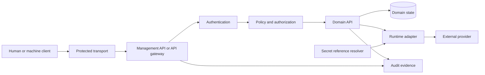
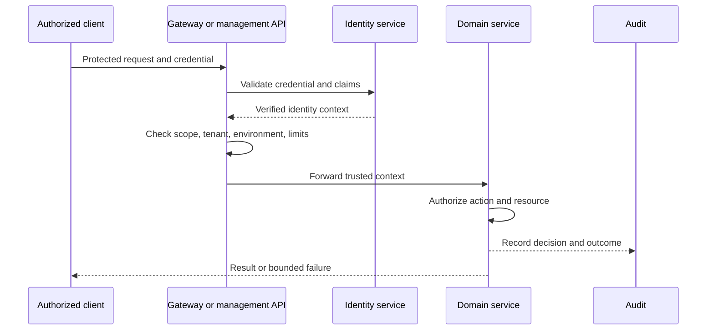
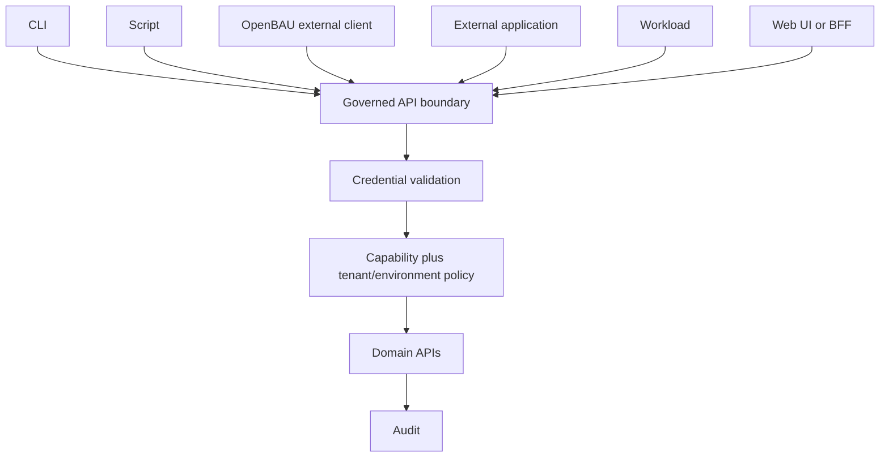
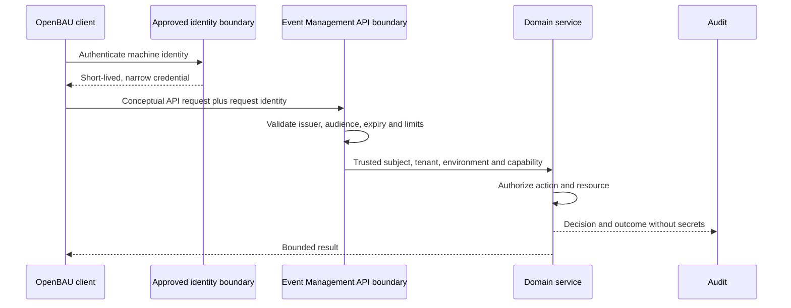
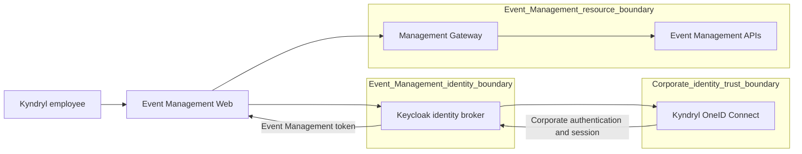
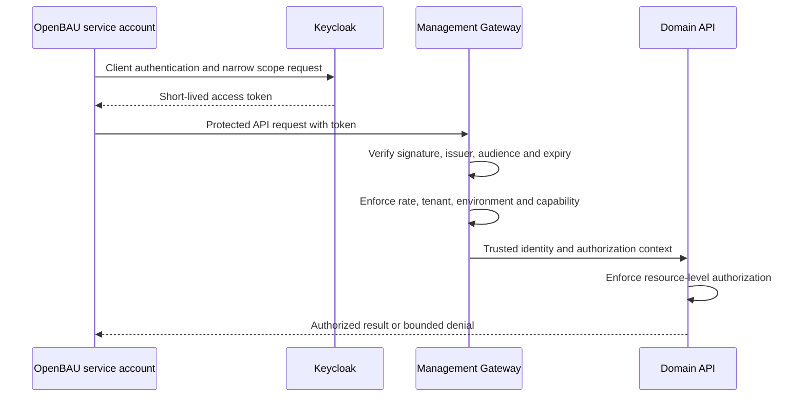
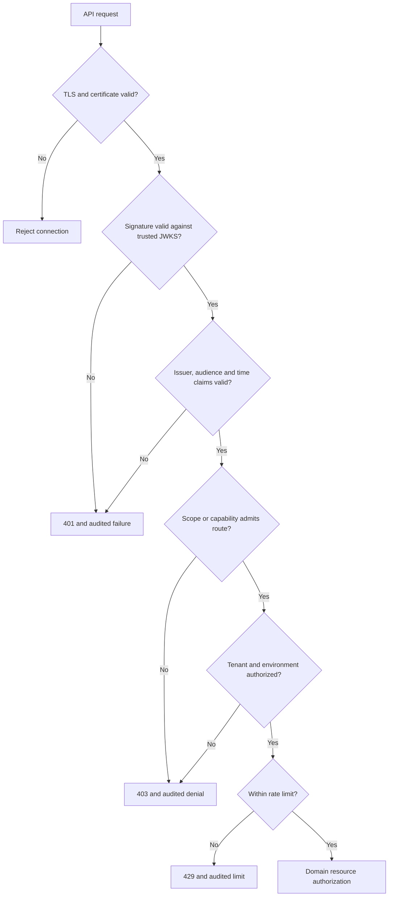

# Security Operations

## 01. Module Overview

Security governs how people, workloads, scripts, external applications, and provider
integrations reach Event Management capabilities without bypassing identity, policy,
tenant, environment, audit, or secret boundaries. A Web UI is optional: API-first
clients remain subject to the same controls.

> **CURRENT:** security behavior is surface-specific. Some integration and state
> services require tokens, while documented Event Processor REST routes are local and
> unauthenticated; `X-Tenant-Id` and `X-Actor-Id` are caller-declared metadata.
>
> **TARGET:** a common authentication boundary plus domain authorization, with
> identity, tenant, environment, action, resource, approval, and audit context.

This page is operational guidance, not a security certification. It does not claim a
particular identity provider, universal OAuth deployment, or production OpenBAO
integration.

## 02. Functional Capabilities

The documented model covers authenticated API access, scoped authorization, tenant and
environment isolation, secret references, audit, credential rotation, failure handling,
and controls for human and non-human callers. Current implementations vary by service;
operators must verify the exact surface before enabling access.

## 03. Security Objectives

- authenticate callers at an approved trust boundary;
- authorize the requested capability and resource, not merely possession of a token;
- preserve tenant and environment isolation;
- keep credentials out of configuration, logs, URLs, and public evidence;
- make administrative and runtime decisions attributable and auditable;
- fail closed when identity, policy, or secret state is missing or uncertain.

## 04. Architecture and Dependencies

The common boundary authenticates and normalizes context. Each domain still owns its
resource-level rules. Runtime adapters own provider protocol handling; a secret store
owns secret material; audit storage preserves decisions and outcomes.

## 05. Main Security Flow

The sequence is the **TARGET** pattern. Existing services may implement only part of
it; caller-supplied identity headers alone do not satisfy it.

## 06. Trust Boundaries

Treat the public edge, management plane, domain services, data stores, message broker,
secret resolver, runtime adapters, and external providers as separate trust zones.
Crossing a boundary requires authenticated transport, explicit authorization, bounded
data, and auditable identity. Network location is not identity.

## 07. Security Roles and Responsibilities

Platform owners define common identity and edge controls. Domain owners define
resource authorization and safe failure behavior. Integration owners maintain provider
contracts and credential references. Tenant administrators grant least-privilege
capabilities. Operators monitor and revoke access. Auditors review evidence without
receiving operational credentials.

## 08. Identity Model

An identity may represent a person, service account, workload, automation, or external
application. Trusted identity context should include an immutable subject, issuer,
credential type, and approved tenant/environment bindings. Display names and
caller-declared actor headers are not authoritative identity.

## 09. Authentication Model

Authentication proves the caller according to the selected boundary. **Keycloak is the
SELECTED_ARCHITECTURE** for the primary IAM and identity-broker role. The target model
supports interactive OIDC, machine-to-machine OAuth, workload identity, mTLS, or
governed tokens. Selection does not establish a deployed or validated Keycloak service.

## 10. Authorization Model

Authorization evaluates the authenticated subject, requested action, resource, tenant,
environment, policy revision, and required approval. Authentication success never
implies permission. Domain services must retain final resource-level enforcement.

## 11. Capability and Resource Authorization

Grant narrow capabilities such as read, administer, activate, execute, or revoke for
defined resources. Avoid broad administrator tokens for routine automation. A gateway
scope can limit admission, but the domain must still validate ownership, lifecycle,
revision, and action constraints.

## 12. Tenant Isolation

Tenant selection must be bound to trusted identity or policy. A supplied
`X-Tenant-Id` can carry context only after that binding is verified; it must not create
authorization. Cross-tenant operations require an explicit, audited capability.

## 13. Environment Isolation

Development, test, staging, and production require separate credentials, audiences,
policies, secrets, and approval paths. Production access must not be inferred from
lower-environment validation. Promotion preserves identity and policy evidence without
copying secret values.

## 14. Network Security

Restrict ingress and egress to approved paths, expose only intended APIs, and isolate
data and control planes. Firewalls, private connectivity, and network policies reduce
reachability but do not replace authentication or domain authorization.

## 15. Transport Security

Use TLS for client, service, broker, database, and provider connections where the
environment supports it. Validate certificate chains and names, reject obsolete
protocols, and manage renewal before expiry. Production TLS posture is
implementation-specific and must be verified.

## 16. Data Protection

Classify event payloads, integration configuration, credentials, audit evidence, and
personal data. Minimize collection and exposure, redact sensitive fields from logs,
bound retention, and authorize exports. Removing obvious identifiers alone does not
make data public.

## 17. Encryption at Rest

Encryption at rest is a **TARGET** infrastructure control for databases, object stores,
backups, queues, and secret systems. Key ownership, rotation, recovery, and separation
of duties must be defined by the deployment; repository documentation does not certify
production encryption.

## 18. Secrets Management

Secrets must be held by an approved secret system or deployment mechanism, not in Git,
documentation, images, browser storage, or public evidence. Runtime access should be
least privilege, short lived where possible, and auditable.

## 19. SecretRef Model

Configuration should store an opaque `SecretRef`, never the credential value. The
runtime resolver maps the reference to authorized material and supplies it only to the
adapter that needs it. SecretRef administration and OpenBAO-backed resolution are
**DESIGNED / PLANNED**, not a completed production capability.

## 20. Credential Handling

Accept credentials only in protected headers or mutually authenticated channels; do
not place them in URLs. Never echo tokens, client secrets, private keys, or provider
passwords. Redact diagnostics and rotate after suspected exposure.

## 21. Human Access

Interactive users should reach Kyndryl OneID Connect through Keycloak federation or
identity brokering and use MFA and Authorization Code with PKCE when supported.
Privileged actions require explicit roles, bounded sessions, reauthentication where
appropriate, and durable audit. The OneID Connect federation protocol is not established.

## 22. CLI Security

A CLI is a first-class client, not a bypass. It should use an approved interactive or
machine flow, avoid plaintext credential arguments and shell history, validate the
target environment, request minimum scope, and present authorization failures clearly.

## 23. Script and Automation Access

Unattended scripts use a dedicated machine identity, non-interactive credential flow,
stable idempotency identity, bounded retries, and narrow capabilities. Personal user
tokens and shared administrator credentials are unsuitable for scheduled work.

## 24. External Application Access

External applications enter through the same governed API boundary as first-party
clients. Registration must establish owner, purpose, redirect or service identity,
allowed environments, scopes, rate limits, contacts, expiry, and revocation procedure.

## 25. Integration Security

Integration instances bind tenant, environment, provider endpoint, adapter type, and
SecretRef. Registration is not runtime activation. Validate endpoints and schemas,
restrict egress, prevent server-side request forgery, and preserve provider result and
uncertainty evidence.

## 26. Provider Security

Provider-native credentials and protocols stay behind adapters. Provider permissions
must be minimal, rotation must not silently change instance identity, and provider
success must be distinguished from acceptance or dispatch. Current provider contracts
do not establish universal security behavior.

## 27. Event Ingestion Security

Authenticate the source where supported, validate envelope and payload, bind tenant and
source identities, apply size and rate limits, preserve idempotency, and quarantine
malformed or unauthorized data. Successful parsing does not establish source trust.

## 28. Management API Security

The target Management API is the common administrative boundary for configuration and
lifecycle actions. It must authenticate callers, enforce capability and tenant context,
validate revisions and idempotency, and emit audit evidence. This target does not imply
that every current API is already behind it.

## 29. Domain API Security

Domain APIs preserve their documented contracts and enforce resource-specific policy.
Some current surfaces use service-specific tokens; others are local and unauthenticated.
Operators must not generalize one service's control to another.

## 30. Web UI Security

The Web UI should call a BFF or management boundary, avoid exposing provider secrets,
protect sessions and state-changing requests, and render only authorized data. The UI
is one client of the API and is not required for secure CLI, script, workload, or
external-application access.

## 31. Audit Logging

Record subject, tenant, environment, action, resource, decision, policy revision,
correlation/request identity, timestamp, and outcome. Do not record credential values.
Audit data must be protected from unauthorized modification and excessive disclosure.

## 32. Security Monitoring

Monitor authentication failures, authorization denials, credential misuse, abnormal
rates, tenant-boundary violations, secret-resolution failures, certificate expiry, and
audit pipeline health. Alerts require owners, severity, runbooks, and retention.

## 33. Security Events and Alerts

Security signals should preserve original evidence and correlation identity. An alert
does not automatically revoke access or prove compromise. Response actions follow
approved incident policy and must themselves be authorized and audited.

## 34. Vulnerability Management

Inventory dependencies and images, scan them, assess exploitability, assign ownership,
patch within policy, and preserve exception decisions. A clean build or dependency scan
alone is not a production security certification.

## 35. Supply Chain Security

Use reviewed sources, locked dependencies, protected builds, provenance, signed
artifacts where supported, and separation between build and deployment authority.
Workload identity, signing, SBOM, and attestations remain target controls where the
deployment has not supplied evidence.

## 36. Configuration Lifecycle

Draft, validate, review, approve where required, activate, observe, disable, and retire
security-sensitive configuration. Preserve revisions and optimistic concurrency. A
saved configuration is not necessarily active.

## 37. Validation and Activation

Validate schema, identity bindings, tenant/environment scope, endpoints, SecretRefs,
capabilities, certificate state, and provider prerequisites before activation. Runtime
health checks must not disclose secrets. Validation cannot replace human approval when
policy requires it.

## 38. Disable, Revoke and Delete Operations

Disable stops new use while preserving evidence. Revoke invalidates credentials or
grants. Delete follows retention and dependency rules and must not erase required audit
history. These are distinct operations with distinct authorization.

## 39. Security Failure Handling

Fail closed on missing, invalid, expired, or ambiguous credentials and policy context.
Return bounded errors, avoid identity enumeration, preserve a request identity, and do
not retry non-transient authorization failures. Uncertain external outcomes require
reconciliation, not blind replay.

## 40. Functional Security Example

**Conceptual example:** an operations script needs read-only event state in production.
Its dedicated machine identity obtains a short-lived credential from an approved
identity boundary, requests only the read capability for one tenant and environment,
and calls the documented API. The gateway verifies the credential and limits; the
domain verifies tenant/resource access; audit records the decision. A missing credential
returns 401, insufficient capability returns 403, and an exceeded limit returns 429.
No Web UI or shared human token is involved.

## 41. Current Implementation vs Target Architecture

| Capability | Maturity | Evidence boundary |
| --- | --- | --- |
| Service-specific tokens on selected ESS, Worker, and BFF paths | **IMPLEMENTED** | Not a universal identity model |
| Local Event Processor REST with caller-declared tenant/actor headers | **IMPLEMENTED** | Explicitly unauthenticated; not production authorization |
| Common authenticated management boundary and domain authorization | **DESIGNED / PENDING** | UMC conformance target |
| Keycloak as primary IAM and identity broker | **SELECTED_ARCHITECTURE** | Owner-approved target; deployment not established |
| Interactive OIDC/RBAC | **PENDING** | Deferred in current Event Processor evidence |
| Workload identity and least-privilege cloud bindings | **DESIGNED** | Target architecture; deployment-specific |
| SecretRef and OpenBAO-backed resolution | **DESIGNED / PLANNED** | No completed production integration established |
| Universal OAuth 2.0, mTLS, gateway limits, and revocation | **UNKNOWN / PENDING** | Must be selected and verified per deployment |

## 42. OpenBAU Integration Security

The OPS-16 request names **OpenBAU** as an external API consumer. The authoritative
repository instead documents **OpenBAO** as a planned secret-management boundary. No
source establishes that these names refer to the same product, or that an OpenBAU
adapter is implemented. This page therefore treats OpenBAU as a conceptual external
client and OpenBAO as the separate, designed SecretRef resolver.

OpenBAU must use the governed API boundary, its own machine identity, least-privilege
capabilities, explicit tenant/environment bindings, bounded rates, and auditable request
identities. It receives no trust because of its name or network location.

## 43. API-First Security Architecture

All clients converge on the same policy concepts. A Web UI can improve usability but
does not create the security boundary.

## 44. API Authentication Without Web UI

Secure API use without the UI requires an approved client identity, protected token or
certificate acquisition, TLS, intended audience, minimum capability, tenant/environment
binding, and safe local credential storage. Headless access must not emulate browser
sessions or scrape UI endpoints.

## 45. OAuth 2.0 Client Credentials

Client Credentials is appropriate for confidential machine clients only when an
approved authorization server and resource server support it. The client authenticates,
requests a narrow audience and scope, receives a short-lived access token, and never
acts as a human user. Rotate the client credential and avoid long-lived bearer tokens.
This is a **RECOMMENDED TARGET**, not an implemented universal Event Management flow.

## 46. OIDC Interactive Authentication

Interactive users should use OIDC Authorization Code with PKCE through an approved
identity provider. Validate issuer, audience, signature, nonce/state, expiry, and
redirect URI. Device Authorization may support constrained CLI devices if the provider
allows it. OIDC implementation remains **PENDING** in current Event Processor evidence.

## 47. Workload Identity

Where the runtime platform supports it, bind a deployed workload to a platform identity
and exchange that identity for short-lived access rather than distributing static
secrets. Trust configuration must constrain repository, namespace, service account,
environment, or equivalent attributes. This is **DESIGNED** in cloud target
architecture; concrete production bindings are deployment-specific.

## 48. Service-to-Service Authentication

Each service authenticates as itself and receives only required downstream capability.
Propagated end-user context must be distinguishable from service identity. Never trust
arbitrary forwarded identity headers from an unverified caller. Token exchange or
delegation requires a defined issuer, audience, and audit model.

## 49. Mutual TLS

mTLS authenticates both transport peers and protects the connection. It does not by
itself authorize a tenant, action, or resource. Map certificate identity to an approved
service identity, validate the chain and name, rotate certificates, and still apply
domain authorization. Universal mTLS deployment is **UNKNOWN**.

## 50. API Tokens and Credential Lifecycle

Issue credentials to named owners and purposes; store only securely; restrict audience,
scope, tenant, and environment; set expiry; monitor use; rotate; revoke; and retain
audit evidence. Hash opaque tokens at rest when verification permits. Never publish
token samples that resemble usable credentials.

## 51. Service Accounts

Service accounts are non-human identities with accountable owners. They must not be
shared across unrelated applications or environments. Review permissions and activity,
disable unused accounts, and define an emergency revocation path. Human administrators
must not use service accounts for routine interactive access.

## 52. API Scopes and Capability Authorization

Scopes constrain what a token may request; domain policy decides whether the subject
may perform the action on the resource. Prefer specific read/administer/execute
capabilities to broad roles. The exact scope vocabulary is **PENDING** and must not be
invented by clients.

## 53. Tenant and Environment Authorization

Bind tenant and environment claims to policy at issuance or trusted evaluation. Reject
conflicts between verified context and request metadata. A client permitted in one
tenant or environment receives no implicit access to another.

## 54. API Gateway Security Controls

The target gateway validates transport and credentials, normalizes trusted context,
enforces route and payload limits, applies quotas, records request identity, and blocks
malformed input before forwarding. It must not become the sole resource-authorization
layer. A universally deployed gateway is **PENDING**.

## 55. Rate Limiting and Abuse Prevention

Apply limits per identity, tenant, route, and risk tier; bound payloads and concurrency;
and protect expensive queries and authentication endpoints. Return 429 with safe retry
guidance where supported. Limits must avoid cross-tenant interference and remain
observable. Current universal limits are **UNKNOWN**.

## 56. Webhook Authentication and Signatures

Webhooks should use TLS plus a verifiable signature or mutually authenticated channel.
Sign the exact canonical payload with timestamp and delivery identity, select the secret
through a governed reference, compare safely, and rotate keys. Provider-specific
callback contracts remain authoritative; no universal webhook signature is claimed.

## 57. Replay Protection

Use a bounded timestamp, unique delivery/request identity, nonce where appropriate, and
durable idempotency record. Reject duplicates outside the documented retry contract.
Signature verification without freshness and uniqueness checks is insufficient.

## 58. Certificate Management and Rotation

Maintain inventory, issuer, subject, owners, environments, expiry alerts, renewal,
overlap, trust-bundle rollout, revocation, and recovery. Test rotation without disabling
peer validation. Certificate values and private keys must never enter documentation or
Git.

## 59. Token Revocation and Expiration

Prefer short-lived access tokens and verify expiration on every request. Revoke refresh
tokens, client credentials, service accounts, or token versions after compromise or
decommissioning. The selected platform must define propagation delay and emergency
containment; repository evidence does not establish a universal revocation service.

## 60. API Security Audit

Audit credential issuance and revocation, authentication result, authorization decision,
tenant/environment resolution, administrative change, rate-limit decision, webhook
verification, and provider dispatch. Link records with non-secret request identities.
Access to audit data is itself authorized and audited.

## 61. API Authentication Failure Handling

Use 401 for missing, invalid, or expired authentication; 403 for an authenticated
subject lacking permission; and 429 for an exceeded limit. These semantics are the
**TARGET** contract unless a current API documents otherwise. Responses must not expose
secrets, validation internals, or whether another tenant's resource exists.

## 62. OpenBAU End-to-End Security Example

This is a **CONCEPTUAL TARGET**, not a production endpoint or implemented OpenBAU
adapter. The OpenBAU owner registers a dedicated machine identity for one environment
and tenant. It acquires a short-lived credential through an approved non-interactive
flow, calls a documented Event Management API over protected transport, and supplies a
unique request identity. The common boundary validates the credential and rate limit;
the domain verifies capability and resource ownership; audit records the outcome.

If authentication is absent or expired, processing stops with 401. If identity is valid
but capability or tenant binding is insufficient, it stops with 403. If the client
exceeds its limit, it receives 429 and follows bounded retry guidance. No Web UI,
shared human token, invented endpoint, embedded secret, or implicit provider trust is
used. OpenBAO, if later implemented, may resolve the client's SecretRef; it is not the
OpenBAU client and does not replace authentication or authorization.

## 63. Keycloak Identity Architecture

Keycloak is the selected primary IAM and identity broker for the Event Management
target architecture. It mediates corporate user authentication, issues tokens to
registered Event Management clients, and supplies verifiable identity claims to the
Management Gateway and APIs. Kyndryl OneID Connect is the corporate identity
integration behind that broker relationship.

OAuth 2.0 governs delegated and machine access; OpenID Connect adds interactive identity
claims. SAML 2.0 may be used on the corporate federation side if selected during
implementation. No evidence selects the OneID Connect federation protocol, so neither
OIDC nor SAML is claimed as the operational corporate link.

## 64. Keycloak Configuration Model

The target Keycloak configuration contains:

- realms as isolation and policy boundaries, with names determined during design;
- clients for Web, CLI, OpenBAU, automation, and other approved consumers;
- users, groups, realm/client roles, client scopes, and service accounts;
- identity providers for OneID Connect federation or brokering;
- bounded access, refresh, session, and offline-token lifetimes;
- signing keys published through JWKS with planned overlap and rotation;
- session, logout, revocation, administration, audit, and security-event controls.

Realm names, client IDs, issuer URLs, redirect URIs, endpoints, and exact token lifetimes
are deliberately unspecified. They require environment-specific design and validation.

## 65. Kyndryl OneID Connect Relationship

Keycloak brokers or federates corporate identity and maps approved corporate attributes,
groups, or entitlements into Event Management roles and capabilities. The mapping is a
policy decision; raw corporate groups must not become permissions implicitly. Corporate
session state and Keycloak/Event Management sessions remain distinct trust boundaries.

Offboarding or corporate revocation must disable future authentication, terminate or
bound downstream sessions, revoke applicable grants, and correlate OneID, Keycloak, and
Event Management audit identities. Federation, mappings, session termination, and audit
correlation are **PENDING** until validated with Kyndryl OneID Connect.

## 66. Keycloak Authentication Flows

Human Web users use Authorization Code with PKCE through Keycloak, which redirects or
brokers to OneID Connect. CLI users may use that flow through a system browser or Device
Authorization if enabled and approved. Machine clients never reuse corporate user
credentials; OpenBAU, scripts, service accounts, and automation engines use Client
Credentials or workload identity where supported.

Keycloak signs tokens; the resource boundary validates signature against trusted JWKS,
issuer, audience, expiry/not-before, and required claims. A valid token proves identity
context, not authorization to the requested tenant, environment, capability, or resource.

## 67. OpenBAU Access Through Keycloak

This is the target machine-to-machine flow. Client authentication material is held by
an approved secret or workload-identity mechanism, never embedded in OpenBAU code or
documentation. Keycloak, OpenBAU authentication, and the client registration are not
claimed as deployed or validated.

## 68. Management Gateway Token Validation

JWKS caching must honor bounded refresh and rotation. Unknown keys trigger controlled
refresh, not disabled signature validation. Rotation uses overlapping valid keys and
removes retired keys after the maximum token lifetime and policy window.

## 69. Roles, Permissions, and Service Identities

Keycloak groups and roles organize identity claims; client scopes bound the requested
token; Event Management capabilities and domain policy authorize actions. Mapping must
be explicit, reviewed, tenant-aware, environment-aware, and least privilege. A role in
the identity platform does not replace resource authorization.

Service accounts belong to one named client and owner. Their capabilities, tenants,
environments, token lifetime, credential state, and activity are reviewed separately
from human access. Web, OpenBAU, CLI, and automation clients receive distinct identities
and grants.

## 70. Identity Operational Lifecycle

The following procedures are **TARGET** operations until implementation evidence exists:

1. Register a Keycloak client with owner, purpose, client type, approved flows,
   environments, redirect URIs when interactive, and expiry/review date.
2. Enable a service account only for a confidential machine client; bind its minimum
   scopes and Event Management capabilities.
3. Map groups and roles through reviewed policy, then test tenant, environment, route,
   and resource denials as well as successful access.
4. Configure OneID Connect as an identity provider without assuming OIDC or SAML until
   the corporate contract is validated; map stable identity attributes conservatively.
5. Rotate client credentials through a protected channel with overlap, verification,
   retirement, and audit; never place values in Git or tickets.
6. Revoke access by disabling the client or service account, removing grants, revoking
   sessions or credentials where supported, and verifying denial.
7. Investigate failures using request identity, Keycloak security events, gateway audit,
   clock/key state, issuer/audience, client status, capability, tenant, environment,
   and rate-limit evidence without logging tokens.

Administrative access to Keycloak itself requires separate privileged identities, MFA,
least privilege, emergency-access governance, and audited changes.

## 71. Identity Security Functional Examples

**Example 1 — Kyndryl employee:** a Kyndryl employee selects sign-in in Event Management
Web. Keycloak brokers authentication to OneID Connect using the protocol selected by the
approved corporate configuration. After corporate authentication, Keycloak issues a
short-lived Event Management token. The Management Gateway validates it, and domain
policy maps approved roles/capabilities to the employee's tenant and environment. This
is **DESIGNED / PENDING**, not a validated federation claim.

**Example 2 — OpenBAU:** a conceptual OpenBAU client uses its dedicated Keycloak service
account to request a narrowly scoped, short-lived access token. It calls an authorized
Event Management API without a Web UI. The Gateway validates the token and the domain
authorizes the resource. Identifiers and URLs are conceptual; OpenBAU authentication is
**PENDING**.

**Example 3 — denied client:** an unregistered client supplies no valid credential and
receives 401. A registered client requesting an unauthorized tenant or capability
receives 403. The Gateway records subject where known, client, request identity, reason
class, tenant/environment context, and outcome without storing the token or secret.

## 72. Identity Implementation Maturity

| Identity capability | Maturity | Required evidence for stronger claim |
| --- | --- | --- |
| Keycloak platform selection | **SELECTED_ARCHITECTURE** | Owner-approved target architecture |
| Keycloak deployment | **PENDING** | Environment, configuration, health and operational evidence |
| OneID Connect federation | **PENDING** | Approved protocol, metadata, mapping and end-to-end validation |
| Web authentication | **PENDING** | Browser flow, session, logout and authorization tests |
| API authentication | **PENDING** | Gateway/resource-server token validation evidence |
| OpenBAU authentication | **PENDING** | Client registration and end-to-end machine-flow validation |
| Service-account provisioning | **DESIGNED** | Provisioning, ownership, review and revocation evidence |
| RBAC integration | **PENDING** | Approved role/capability mapping and denial tests |
| Tenant authorization | **PENDING** | Trusted binding plus cross-tenant negative tests |
| Token validation | **DESIGNED** | Issuer, audience, signature, time and JWKS-rotation tests |
| Credential rotation | **DESIGNED** | Rotation runbook execution and old-credential denial evidence |

## Existing Engineering References

- [Security architecture](/architecture/security/)
- [UMC architecture conformance](/architecture/umc/conformance/)
- [UMC API conformance](/architecture/umc/api-conformance/)
- [Multi-surface interaction](/architecture/multi-surface-interaction/)
- [Secrets management](/security/secrets-management/)
- [Threat model](/security/threat-model/)
- [Event Processor security limitations](/platform/event-processor/defect-prevention/)
- [Event Processor REST and blackouts](/platform/event-processor/rest-and-blackouts/)
- [Event State Service admin API](/platform/event-state-service/admin-api/)
- [Dashboard contracts](/platform/dashboards/contracts/)

These references remain authoritative for their current contracts. This Operations Home
does not alter them or convert target architecture into implementation evidence.
