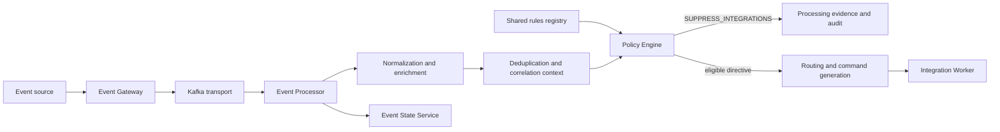
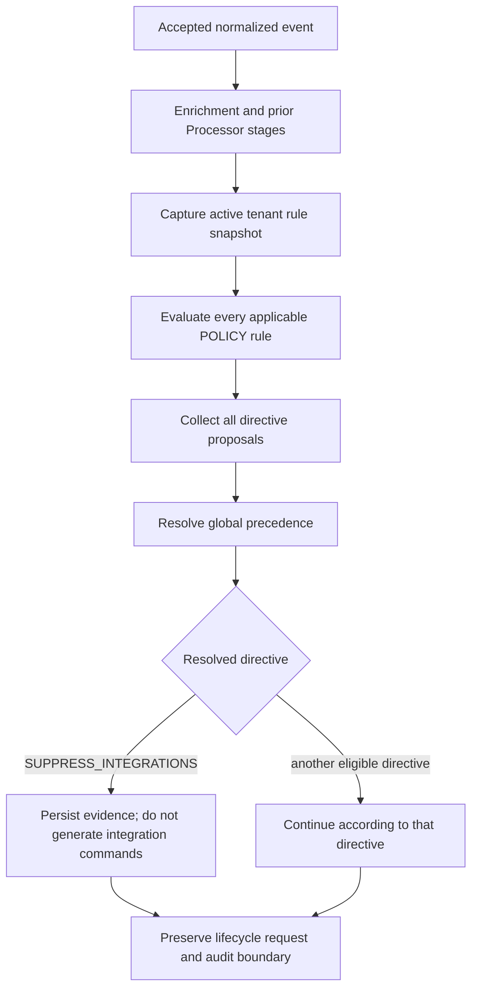
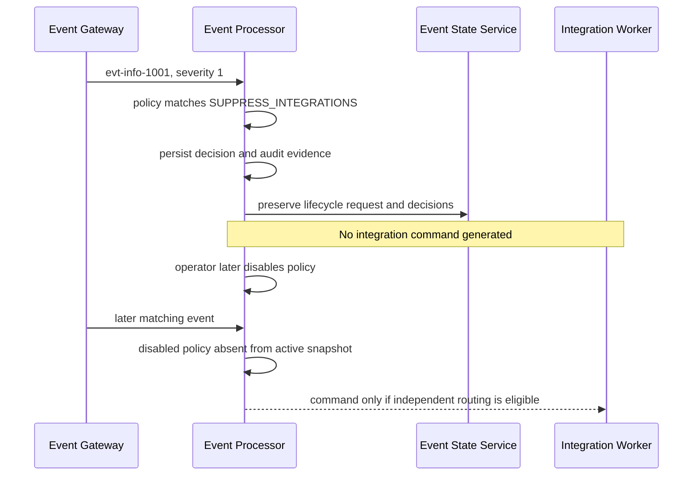

# Suppression Operations

## 01. Module Overview

Suppression is an Event Processor policy decision that prevents selected
downstream integration actions while preserving the accepted event and its
processing evidence. In the current implementation, a matching `POLICY` rule can
propose the `SUPPRESS_INTEGRATIONS` directive during Policy Evaluation.

Suppression does not delete or clear an event, close an incident, change event
severity, remove correlation, or erase audit history. It controls downstream
action eligibility for the current processing decision.

> **IMPLEMENTED:** typed `POLICY` evaluation and `SUPPRESS_INTEGRATIONS`.
> **VALIDATED:** backend certification covers rule administration, matching,
> directive precedence, the Gateway/Kafka path, and absence of durable commands.

## 02. Functional Capabilities

The current baseline provides:

- tenant-scoped, versioned `POLICY` definitions in the shared `/rules` registry;
- typed conditions over the documented event, resource, tenant and enrichment
  field contract;
- `all`, `any`, and `not` condition groups with bounded typed operators;
- multiple matching rules contributing proposals to one resolved directive;
- deterministic evaluation order and explicit global directive precedence;
- validation, immutable versions, active/latest separation and change history;
- simulation through the same policy compiler/evaluator without production
  writes or provider calls;
- explainability with snapshot checksum, rule identity/version/checksum,
  condition traces, proposals and resolved directive;
- preservation of normalized event publication, lifecycle processing,
  correlation and audit within their documented boundaries.

Suppression is not a ticket, notification or automation operation. It prevents
eligible integration commands from being generated; it never calls a provider.

## 03. Architecture and Dependencies



The Event Gateway owns admission, mapping, additional validation and base
enrichment before publication. The Event Processor owns suppression policy
evaluation and routing eligibility. The Event State Service owns lifecycle state
and does not recalculate suppression. The Integration Worker executes only
commands already authorized and durably emitted by the Processor.

## 04. Main Processing Flow

For the current Processor implementation, Policy Evaluation occurs after
deduplication, auto-suppression, blackout and correlation, and before routing:



This is the evidenced order of the current Processor pipeline, not a universal
ordering rule for every future service or capability. Gateway stages remain
upstream; provider execution remains downstream. Any future change is
**PROPOSED** until separately designed and regression-tested.

## 05. Suppression Policies and Criteria

Suppression uses a `POLICY` definition whose matching action is
`SUPPRESS_INTEGRATIONS`. Conditions use the typed rule AST:

- leaf: `field`, `operator`, and, where required, `value`;
- groups: `all`, `any`, or `not`;
- typed equality, ordering, set, existence, range and restricted-regex
  operators supported by the shared contract.

Values are not silently coerced. Ordered comparisons require compatible numeric
or timestamp types. `IN`/`NOT_IN` require homogeneous collections. `BETWEEN` has
two ordered inclusive bounds. `EXISTS`/`NOT_EXISTS` do not accept a value. An
absent field does not match an ordinary predicate.

Gateway ingestion rules are a different catalog. A Gateway `reject:true`
decision prevents admission after preserving its receipt; it is not Processor
suppression and must not be represented as `SUPPRESS_INTEGRATIONS`.

## 06. Suppression Rule Creation

The following is an **IMPLEMENTED contract example**:

```json
{
  "id": "suppress-informational-events",
  "version": 1,
  "type": "POLICY",
  "enabled": true,
  "priority": 20,
  "condition": {
    "field": "event.severity",
    "operator": "LTE",
    "value": 1
  },
  "actions": [{"type": "SUPPRESS_INTEGRATIONS"}],
  "metadata": {
    "owner": "operations",
    "description": "Preserve informational events without external actions"
  }
}
```

`POLICY` permits `CONTINUE`, `STATE_ONLY`, `SUPPRESS_INTEGRATIONS`, and
`CORRELATE_ONLY`. It does not permit provider targets, free-form payloads,
credentials, `GENERATE_COMMANDS`, or `DEAD_LETTER` as configurable actions.

## 07. Policy Registration

Suppression policies use the shared Event Processor administration surface under
`/api/v1/rules`; there is no dedicated suppression API.

Register a validated version with `POST /rules` using `{rule, reason}`, the
current ETag in `If-Match` (`"0"` for a new identity), and a stable
`Idempotency-Key`. IDs share the tenant namespace with other implemented rule
types. Creating `latestVersion + 1` preserves older immutable versions and does
not change the active version.

Read operations include the tenant rule list, a specific rule/version, immutable
history, simulation, and processing explainability. Catalog views may also show
legacy records; only entries sourced from the Event Processor registry represent
definitions executed by this engine.

## 08. Validation and Activation

Validate with `POST /rules/validate` before saving. Backend validation remains
authoritative for schema, types, operators, fields, condition complexity, action
limits and restricted regular expressions.

Activation is separate from registration:

1. Read the current rule and ETag.
2. Validate the intended complete definition.
3. Save the next immutable version with a reason and idempotency key.
4. Activate it through `POST /rules/{id}/enable` with its version and the current
   ETag.
5. Re-read active/latest versions and history.

Handle `409` by refreshing without overwriting another change. Treat validation,
missing-precondition, missing-rule and service-unavailable responses explicitly.
An enabled definition is merely eligible for activation; saving is not activation.

## 09. Runtime Evaluation

Each event uses one captured active rule snapshot. Applicable policies are
evaluated by priority descending, then ID and version ascending. This order makes
evaluation and evidence deterministic; it is neither first-match nor
last-write-wins.

Every matching policy contributes proposals. The current global directive
precedence is:

```text
DEAD_LETTER > STATE_ONLY > SUPPRESS_INTEGRATIONS > CORRELATE_ONLY
> GENERATE_COMMANDS > CONTINUE
```

`DEAD_LETTER` is a pipeline failure outcome, and `GENERATE_COMMANDS` comes from
routing rather than configurable `POLICY` actions. A higher-priority
`CONTINUE` rule does not override a lower-priority matching
`SUPPRESS_INTEGRATIONS` proposal. `STATE_ONLY`, when present, is more restrictive.

## 10. Suppression Decision and Event Handling

When `SUPPRESS_INTEGRATIONS` resolves:

- the accepted and normalized event remains traceable;
- policy match, rule version/checksum, snapshot and decision evidence persist;
- prior correlation remains available because correlation has already evaluated;
- lifecycle and audit behavior continue within their contracts;
- routing does not generate durable integration commands for that decision;
- no ticket, notification or automation request is sent by suppression itself.

Suppression does not change severity, manufacture a `SUPPRESSED` lifecycle state,
close an event or incident, remove group membership, or erase history. Event State
Service stores the Processor decisions it receives but does not reevaluate them.

## 11. Integration With Deduplication

Deduplication runs before Policy Evaluation in the current Processor pipeline.
It records semantic occurrence evidence and always currently continues processing.
A `FULL` duplicate is not automatically suppressed, and a
`SUPPRESS_INTEGRATIONS` policy does not change the deduplication fingerprint,
content hash, classification or `occurrenceCount`.

See [Deduplication Operations](/operations/deduplication/).

## 12. Integration With Correlation

Correlation evaluates before Policy Evaluation. A suppression decision therefore
does not undo membership or recovery evidence already calculated for the event.
It controls downstream actions, not group identity. A correlated situation can
remain active and auditable even when the current event produces no integration
command.

See [Correlation Operations](/operations/correlation/).

## 13. Integration With Other Operational Rules

The current responsibility boundaries are:

- **Event ingestion:** Gateway admission/rejection is separate from suppression.
- **Normalization and enrichment:** provide typed context before Processor policy.
- **Filters and Criteria:** typed `POLICY` predicates select applicable events.
- **Auto-Suppression:** a separate `SUPPRESSION` rule uses declared source,
  external status, exact scope and a finite validity window.
- **Blackouts and Maintenance:** `IMMEDIATE`/`SCHEDULED` rules evaluate operational
  windows in the Blackout stage; they are not Policy Engine suppression.
- **Correlation:** determines durable group membership before Policy Evaluation.
- **Routing:** determines eligible commands after Policy Evaluation.
- **Notifications, ticketing and automation:** are Worker/provider actions only
  when routing and the resolved directive permit a command.
- **Event State Service:** owns lifecycle and preserves decisions without
  recalculating policy.

Auto-suppression, blackout and Policy suppression can all propose
`SUPPRESS_INTEGRATIONS`, but their eligibility, rule types, stages and evidence
remain distinct. The current precedence resolves directives, not competing
business ownership. Cross-capability policy ownership beyond these contracts is
**PENDING** governance.

## 14. Operational Monitoring

Operators can inspect:

- rule status, active/latest versions, registry revision and checksum;
- immutable rule/change history and administrative receipts;
- Policy Evaluation evidence for every rule match and proposal;
- resolved directive, snapshot checksum and field-contract version;
- processing explainability by `processingId`;
- normalized publication, lifecycle evidence, command ledger and outbox health;
- absence of durable commands when suppression wins;
- catalog source, tenant scope and truncation indicators.

Do not infer suppression merely from `enabled: true`; confirm the active version,
condition match, resolved directive and command outcome. Do not infer provider
health from a successful policy decision.

## 15. Disable and Delete Lifecycle

Disable the active policy through `POST /rules/{id}/disable`, using the selected
version, reason, current ETag and a new idempotency key. Disabling affects future
snapshots; it does not retroactively execute previously suppressed actions or
remove historical decisions.

`POST /rules/{id}/retire` is the terminal logical removal operation. Retirement
preserves immutable versions and history and prevents ID reuse. The shared rule
contract exposes no physical delete. A newer saved version does not replace the
active one until explicitly enabled.

The current `POLICY` contract has no embedded expiration schedule. Use explicit
disable/retire for lifecycle control. Time-bounded maintenance behavior belongs
to Auto-Suppression or Blackout rules; adding Policy expiry is **PROPOSED**.

## 16. Functional Example

The following is a **CONCEPTUAL example using implemented semantics**.

At 10:00Z, source `monitoring-east` sends illustrative event `evt-info-1001` for
`router-17`, with status `PROBLEM` and severity `1`. The active policy
`suppress-informational-events` matches `event.severity LTE 1` and proposes
`SUPPRESS_INTEGRATIONS`.

| Element | Example result |
|---|---|
| Original event | `evt-info-1001`, key `alarm-router-17` |
| Source | `monitoring-east` |
| Evaluation context | tenant `acme`, normalized severity `1`, active snapshot |
| Policy criteria | `event.severity <= 1` |
| Decision | `SUPPRESS_INTEGRATIONS` |
| Suppressed action | eligible integration command generation, such as a supported ticket command |
| Preserved traceability | normalized event, processing ID, policy ID/version/checksum, condition trace, correlation and audit evidence |
| End of effect | explicit policy disable at 11:00Z; no implicit expiry |



Disabling the policy changes later snapshots only. It does not replay the
suppressed action from `evt-info-1001`, delete the event, or close anything.

## 17. Current Implementation vs Target Architecture

| Capability | Status | Boundary |
|---|---|---|
| Typed `POLICY` conditions and `SUPPRESS_INTEGRATIONS` | **IMPLEMENTED** | Shared versioned rule registry |
| Multi-match proposal and directive precedence | **IMPLEMENTED** | Not first-match or last-write-wins |
| Backend administration and runtime path | **VALIDATED** | CRUD, simulation, Gateway/Kafka and no-command evidence |
| Explainability and immutable history | **IMPLEMENTED** | Snapshot/rule/checksum/condition evidence |
| Provider call from suppression | **NOT APPLICABLE** | Suppression only controls command eligibility |
| Console policy administration | **IMPLEMENTED** | Full browser certification remains **PENDING** |
| Dedicated suppression endpoint or store | **NOT IMPLEMENTED** | Shared `/rules` contract is authoritative |
| Embedded Policy expiration | **PROPOSED** | Use explicit disable/retire today |
| External policy synchronization | **PENDING** | No provider synchronization contract |
| AI-assisted policy recommendation | **DESIGNED** | General AI-01 governance; no suppression-specific runtime evidence |
| Production-scale, provider and DR certification | **PENDING** | Local validation is not production certification |

## 18. Existing Engineering References

- [Policy Engine backend evidence](/platform/event-processor/policy-backend/)
- [Policy frontend contract](/platform/event-processor/frontend-handoffs/policy/)
- [Event Processor rules and contracts](/platform/event-processor/rules-and-contracts/)
- [Correlation, auto-suppression and command contract](/platform/event-processor/correlation-suppression-commands/)
- [Auto-Suppression architecture and evidence](/platform/event-processor/auto-suppression/)
- [Blackouts and maintenance](/platform/event-processor/rest-and-blackouts/)
- [Routing and command evidence](/platform/event-processor/routing-backend/)
- [Routing frontend contract](/platform/event-processor/frontend-handoffs/routing/)
- [Event Gateway rules API](/platform/event-gateway/rules-api/)
- [Event State Service lifecycle contract](/platform/event-state-service/lifecycle-contract/)
- [Event Processor lifecycle orchestration](/platform/event-processor/lifecycle-orchestration/)
- [AI Architecture — AI-01](/architecture/ai-01-aiops-ai-architecture/)
