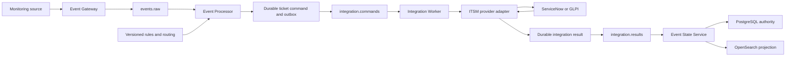
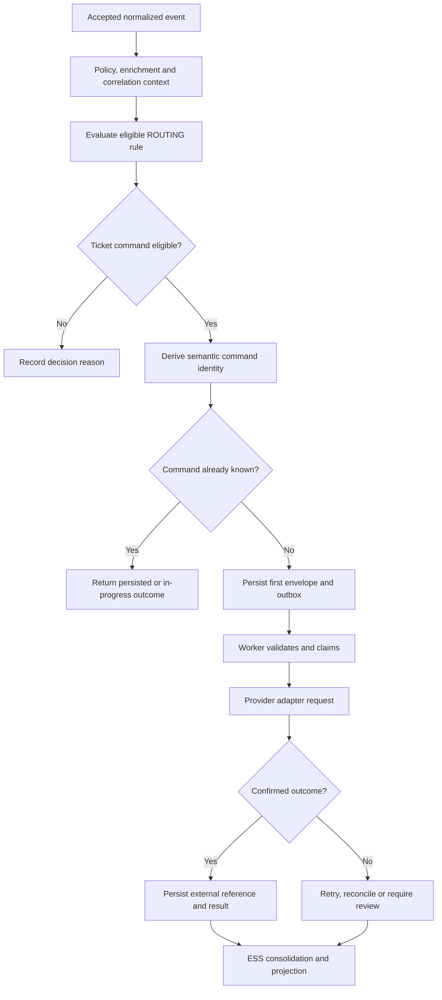
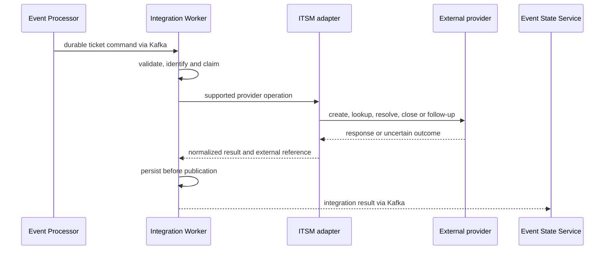

# Ticketing Operations

## 01. Module Overview

Ticketing converts an authorized routing intention into a provider-specific IT service
management operation while preserving Event Management identity, delivery, execution,
and external lifecycle boundaries.

The Event Processor decides whether a ticket command is eligible. The Integration Worker
executes a supported provider adapter. Event State Service consolidates the returned
result. No one of those steps alone proves that a provider ticket exists.

> **IMPLEMENTED:** durable ticket commands/results, Worker adapters for ServiceNow and
> GLPI, provider-specific validation, idempotency ledgers, and reconciliation paths.
>
> **VALIDATED:** ServiceNow and GLPI flows against isolated local mocks/contracts—not
> production provider accounts.

## 02. Functional Capabilities

Current capabilities include:

- routed ticket creation for supported ServiceNow and GLPI profiles;
- immutable command identity and durable Worker claim/result handling;
- provider-specific request validation and error classification;
- bounded retry or conservative reconciliation according to provider evidence;
- external ticket reference capture and ESS projection without replacing event identity;
- ServiceNow resolution in the explicit lifecycle profile;
- GLPI create, resolve, close, and private follow-up operations under its contract;
- simulation and routing evidence without external side effects;
- provider-differentiated operational views and audit identities.

Real-account certification, universal ticket CRUD, and Jira Service Management support
are not established.

## 03. Architecture and Dependencies



Routing, Worker execution, provider state, and ESS lifecycle are separate authorities.
PostgreSQL holds operational platform state; the external ITSM remains authoritative for
its ticket; OpenSearch is a derived projection.

## 04. Main Processing Flow



The first command envelope is retained. An operator must not manufacture another command
identity to force a second create after an uncertain provider outcome.

## 05. Ticketing Concepts

| Concept | Meaning |
| --- | --- |
| Event identity | Canonical source observation identity owned by Event Management |
| Ticket identity | Ticket number/ID within the provider domain |
| External provider identity | Provider and configured connection that own the ticket |
| Ticketing request | Durable governed command sent to the Worker |
| Delivery acknowledgement | Evidence of acceptance at a transport or provider boundary |
| Provider operation result | Confirmed success, explicit failure, or uncertainty |
| Ticket lifecycle status | Provider-owned incident/request state |
| Event lifecycle status | ESS-owned OPEN/CLOSED/REOPEN state |

Ticket IDs never become canonical event IDs. Closing an event does not inherently close
or resolve a ticket, and resolving a ticket does not close the source event.

## 06. ITSM Integration Model

Processor emits a governed integration command; Worker chooses the supported adapter,
validates its provider contract, resolves backend configuration, performs or reconciles
the operation, persists the result, and publishes it for ESS.

Provider-native endpoints remain behind adapters. They are not OEM public management
resources. A dashboard or configuration record does not prove runtime connectivity.

## 07. Supported Provider Categories

| Provider/category | Classification | Evidence boundary |
| --- | --- | --- |
| ServiceNow | **IMPLEMENTED / VALIDATED** | Local mock, command ledger, creation/reconciliation, lifecycle resolution; real account **PENDING** |
| GLPI REST V1 | **IMPLEMENTED / VALIDATED** | Local contract/mock for create, lookup, resolve, close, follow-up; real instance **PENDING** |
| Jira / Jira Service Management | **PROPOSED** | Comparative research only; no OEM JSM adapter or JSM-specific contract established |
| Other provider adapters | **DESIGNED / PROPOSED** | Require explicit capability, schema, security, and validation evidence |

Generic Jira issue creation is not evidence of Jira Service Management requests,
approvals, SLA semantics, or an operational OEM integration.

## 08. Ticketing Rules and Policies

Ticket creation is selected through a domain-owned `ROUTING` rule using the shared rule
registry and typed criteria. The action identifies a supported target, operation,
configuration, and applicable correlation rule/cycle.

Policy and criteria contribute eligibility or directives. They do not call an ITSM
provider. There is no separate universal Ticketing Rules API.

## 09. Ticket Creation

The base ServiceNow flow uses `CREATE_TICKET`, target `SERVICENOW`, configuration
`default`, and an applicable correlation cycle. Payload is restricted to governed
resource, summary, severity, and adapter-approved metadata.

GLPI uses its supported Routing target and provider mapping. Its adapter establishes a
session, creates the ticket, captures the numeric ticket identity, and terminates the
session according to the GLPI contract. No free-form endpoint or credential is accepted
from the event.

## 10. Ticket Update

ServiceNow update actions used by automation are constrained operations such as applying
a holding assignment or confirmed work note. They are not arbitrary ticket PATCH.

GLPI `APPLY_AUTOMATION_RESULT` creates a private follow-up using the existing numeric
ticket ID. Update availability is provider- and operation-specific; universal update
support is **PENDING**.

## 11. Ticket Resolution

The ServiceNow lifecycle profile implements `RESOLVE_TICKET` with configured expected
state, close code, and generated notes. Worker verifies ticket number/system identity,
performs at most one mutation, then confirms by GET. Only matching state, code, and
non-empty notes produce `RESOLVED_CONFIRMED`.

GLPI resolution creates an ITIL solution and confirms provider status 5 or 6. Provider
values and permissions are configuration-specific and must not be invented.

## 12. Ticket Closure

ServiceNow's current lifecycle policy resolves and projects `RESOLVED`; it does not label
that ticket `CLOSED`. No generic ServiceNow close action is claimed.

GLPI `CLOSE_TICKET` requires a ticket already in solved status 5, requests status 6, and
confirms `CLOSED_CONFIRMED` by GET. An already closed ticket is handled idempotently by
lookup. Provider closure does not delete the Event Management event or history.

## 13. Event-to-Ticket Relationships

The platform can retain source event ID/key, processing identity, tenant, correlation
group/cycle, command ID, result ID, provider, operation, and external ticket reference.
The base routed command represents the correlated situation while metadata preserves the
source event reference.

One event may join a group, and one group/cycle may create a ticket. The relationship is
auditable but does not merge the event, group, and ticket identities.

## 14. External Ticket References

ServiceNow may return a system ID and human-readable ticket number. GLPI returns a
provider-native numeric ticket ID. Store each together with provider/configuration and
the command/result identities needed to interpret it.

An external reference is neither a credential nor proof of authorization. ResourceRef
is a **DESIGNED** UMC concept; current provider references retain their domain-specific
contracts until a conforming ResourceRef implementation exists.

## 15. Ticketing Configuration Creation

Current Worker connections are environment/backend configuration. ServiceNow and GLPI
require provider-specific endpoints, timeouts, authentication material, and permitted
domain values. Test credentials belong only in isolated mocks.

The proposed integration-instance form with provider profiles and SecretRefs is
**DESIGNED**, not an implemented dynamic runtime configuration path. Saving a catalog
record alone does not reconfigure the Worker.

## 16. Configuration Registration

The current documentation does not establish a public Ticketing configuration CRUD API.
Routing definitions are registered through `/api/v1/rules`; provider environment
configuration follows its owning deployment/runtime contract.

Proposed `/api/administration/integration-instances` and Secrets endpoints remain target
architecture and must not be used or presented as available.

## 17. Validation and Activation

Validate the complete Routing rule and supported ticket action before saving. Activate
the intended immutable version explicitly with optimistic concurrency. Rule activation
does not validate real provider credentials or connectivity.

Provider configuration validation must check only its approved endpoint/profile and
must not perform an unrequested ticket mutation. Real-account activation requires a
separate authorized certification.

## 18. Runtime Ticketing Evaluation

At runtime, criteria, policy directives, enrichment facts, blackout/maintenance state,
correlation cycle, and supported Routing action determine whether a command is eligible.
The command is then deduplicated by semantic identity and persisted transactionally.

An eligible decision means “create or reuse this governed command,” not “ticket created.”
Unsupported provider/operation/profile or missing required data fails explicitly.

## 19. Routing Integration

Routing owns destination and operation selection. Ticketing begins only after the durable
command boundary. Equivalent routes for the same tenant, group/cycle, configuration,
provider, and operation consolidate to one semantic command.

ServiceNow and GLPI are distinct provider identities. A configuration catalog entry does
not make a provider a supported Routing target unless the Processor contract implements it.

## 20. Provider Adapter Execution



The adapter owns provider-native authentication and mapping. Worker owns durable
execution bookkeeping. Neither may reinterpret the Processor's business eligibility.

## 21. Delivery and Execution Status

Command persistence, Kafka publication, Worker claim, provider request, response,
confirmed external state, result persistence, and ESS projection are separate statuses.
Operators must identify which boundary is known.

`SUCCESS` requires the operation's documented result contract. An HTTP response alone
may be only acceptance, and a transport acknowledgement never proves ticket creation.

## 22. Acknowledgement and Confirmation

ServiceNow creation confirmation requires an external identity that can be retained and
reconciled. Resolution requires a verifying GET after mutation. GLPI creation captures
the ticket ID; solution/closure confirm the resulting provider state.

A `2xx` response with incomplete, inconsistent, or unverified state is not upgraded to
confirmed success. Missing confirmation remains pending, failed, unknown, or reviewable.

## 23. Retry and Failure Handling

| Failure | Required interpretation |
| --- | --- |
| Provider unavailable | retry only under Worker/provider policy |
| Authentication failure | configuration failure; never substitute event credentials |
| Timeout | may be retryable before mutation or unknown after possible mutation |
| Invalid request | explicit non-success; correct configuration/contract |
| Rejected operation | preserve provider classification and evidence |
| Unknown external outcome | reconcile by safe lookup where implemented |
| Duplicate ticket risk | retain the original command identity; do not resend blindly |
| Retry exhaustion | terminal failure or operator review according to contract |
| Partial success | preserve completed boundary and unresolved remainder separately |
| Reconciliation failure | remain uncertain/reviewable; never invent a ticket reference |

## 24. Idempotency and Duplicate Prevention

Processor semantic identity prevents multiple ticket commands for the same governed
group/cycle/provider/configuration/operation. Worker claims `commandId` before mutation
and returns persisted results for replay where available.

Idempotency is not exactly-once external execution. A provider may accept a request
before the checkpoint is durable. Changing the ID to retry creates duplicate risk and is
not an approved recovery strategy.

## 25. Reconciliation and State Synchronization

ServiceNow stale-command recovery uses provider lookup and does not repeat uncertain
mutations without evidence. Resolution reconciliation performs GET only. GLPI checkpoint
recovery also performs GET; uncertain creation can search the exact command marker, and
only one match can confirm identity.

Zero or multiple GLPI matches require review. ESS consumes normalized results and does
not poll the provider as a universal synchronization engine. Ongoing bidirectional state
synchronization is **PENDING**.

## 26. Security and Secret References

Provider credentials and tokens remain backend-only. They must not appear in events,
Kafka commands, browser storage, Explain output, logs, exports, or public evidence.
Use least-privilege provider accounts scoped to required operations and entities.

SecretRef/credential-binding administration is **DESIGNED**. A reference must be
tenant/environment scoped, versioned, authorized, auditable, and resolved only by the
backend. Current local actor metadata is not authentication; full management RBAC
remains pending.

Sensitive ticket text and external references require data minimization and redacted
logging. External IDs are operational data and must not be treated as public secrets or
as authorization tokens.

## 27. Auditability and Traceability

Trace ticketing with tenant, source event, processing ID, rule/version/checksum,
correlation group/cycle, command ID, provider/configuration, operation, claim/retry,
result ID/status, external reference, reconciliation decision, and ESS projection.

Keep immutable command/result history. Do not delete ledger records or alter a command
envelope during investigation. Provider audit should be correlated without logging
credentials or unrestricted ticket bodies.

## 28. Integration With Correlation

The base Routing profile creates a ticket only for an applicable correlation cycle.
Command event identity represents the group while metadata preserves the source event.
New group cycles receive distinct identities.

Correlation does not create, resolve, or close tickets. Ticket lifecycle remains
provider-owned and coordinated only by explicit profiles.

## 29. Integration With Deduplication

Event deduplication and ticket command idempotency solve different problems. A duplicate
event decision does not replace the Worker command ledger; command replay does not change
event recurrence counts.

Duplicate prevention is bounded by documented semantic identity and provider recovery,
not by a universal exactly-once promise.

## 30. Integration With Suppression

`SUPPRESS_INTEGRATIONS`, `STATE_ONLY`, or `CORRELATE_ONLY` can prevent new ticket command
creation. Suppression retains the event, grouping, and audit evidence; it does not delete
an existing ticket or cancel a command already beyond the durable boundary.

## 31. Integration With Auto-Suppression

An active applicable auto-suppression rule prevents eligible new integration intentions.
It does not automatically resolve or close a ticket. External state/status is not
verified by Filters or Auto-Suppression.

## 32. Integration With Blackouts and Maintenance

An applicable blackout/maintenance directive can suppress new ticket intentions while
preserving processing evidence. Window expiry does not autonomously create a ticket; a
later eligible input may do so if the cycle and semantic identity permit it.

Existing external tickets are not recalled or closed by blackout activation.

## 33. Integration With Enrichment

Enrichment may provide authorized non-sensitive service, assignment, resource, and
criticality context. Ticket payload uses only fields allowed by the Routing/command and
provider schemas. Missing facts are not replaced with invented assignments.

Secret material and arbitrary endpoint URLs never come from enrichment.

## 34. Integration With Filters & Criteria

Typed criteria determine whether a domain-owned Routing rule matches. A match is not a
ticketing request until Routing validates all other eligibility conditions and persists
a command. Criteria neither call adapters nor manage ticket lifecycle.

## 35. Integration With Notifications

Notifications may follow a confirmed ticket result in the explicit lifecycle profile so
the correct ticket reference can be included. Notification acknowledgement and confirmed
incident state are separate from ticket creation.

Ticketing alone does not imply that a notification was requested or delivered.

## 36. Integration With Automation

CACF/NEXT can receive an existing ticket association in the explicit lifecycle profile
and may produce governed ServiceNow/GLPI follow-up actions. Automation acknowledgement
does not prove completion; unknown outcomes stop progression for review.

CACF does not create the base ticket and cannot arbitrarily mutate provider records.

## 37. Operational Monitoring

Monitor eligible/blocked routing decisions, command/outbox backlog, Worker claim age,
retry count/classification, provider latency and errors, unknown outcomes, external
reference confirmation, reconciliation attempts, result publication, ESS projection,
and lifecycle `REVIEW` states.

Alert thresholds and production SLOs remain environment-specific and **PENDING** unless
an approved runbook defines them.

## 38. Configuration Lifecycle

Routing rule versions are immutable; saving, validating, and activating are distinct.
Provider runtime configuration has its own controlled deployment lifecycle. Updating a
rule or provider profile does not mutate commands already issued.

The target integration-instance model proposes versioned provider configuration and
SecretRefs. Until implemented, do not claim configuration is dynamically applied.

## 39. Disable and Delete Operations

Disable or retire a Routing rule to prevent new decisions. Retirement is terminal for
the rule identity. This does not delete tickets, command/results, audit, or provider
configuration.

Provider ticket deletion is not an authorized universal operation. Integration-instance
deactivation/deletion remains provider/management-contract specific and **PENDING**.

## 40. Functional Example

The following JSON is **ILLUSTRATIVE** and does not define a production provider API.

Original Zabbix event:

```json
{
  "eventId": "evt-demo-9101",
  "eventKey": "zabbix:demo:9101",
  "tenant": "tenant-demo",
  "status": "PROBLEM",
  "severity": 5,
  "summary": "Checkout API unavailable",
  "resource": {"name": "server-demo-31", "node": "server-demo-31"}
}
```

Enriched context and Routing decision:

```json
{
  "enrichment": {
    "service": {"name": "checkout-demo"},
    "assignment": {"group": "platform-demo"},
    "resource": {"managed": true}
  },
  "routing": {
    "ruleId": "critical-service-ticket-demo",
    "ruleVersion": 1,
    "decision": "COMMAND_ELIGIBLE",
    "correlationGroupId": "group-demo-checkout-cycle-1",
    "target": "SERVICENOW",
    "configuration": "default"
  }
}
```

Ticketing request and confirmed result boundary:

```json
{
  "request": {
    "commandId": "cmd-demo-ticket-9101",
    "operation": "CREATE_TICKET",
    "resource": "server-demo-31",
    "summary": "Checkout API unavailable",
    "severity": 5
  },
  "providerAcknowledgement": {
    "classification": "ACCEPTED",
    "note": "acceptance alone is not final confirmation"
  },
  "confirmedResult": {
    "status": "SUCCESS",
    "provider": "SERVICENOW",
    "externalReference": "INC-DEMO-9101"
  },
  "audit": {
    "sourceEventId": "evt-demo-9101",
    "commandId": "cmd-demo-ticket-9101",
    "resultId": "result-demo-ticket-9101"
  }
}
```

The confirmed provider reference, persisted result, and corresponding evidence establish
the successful example—not the Routing decision or HTTP acceptance alone. Failure
alternative: if the create request times out after possible provider acceptance, retain
the same command identity and reconcile using supported lookup. No match or multiple
matches remains reviewable; do not send a new create under another ID.

## 41. Current Implementation vs Target Architecture

| Capability | Status | Boundary |
| --- | --- | --- |
| Durable ticket commands/results and Worker ledger | **IMPLEMENTED** | shared integration contracts |
| ServiceNow create/reconcile | **VALIDATED** | isolated mock; real account **PENDING** |
| ServiceNow lifecycle resolution | **VALIDATED** | explicit profile, synthetic values in lab |
| GLPI create/resolve/close/follow-up/reconcile | **VALIDATED** | REST V1 mock/contract; real account **PENDING** |
| ESS provider-differentiated projection | **IMPLEMENTED** | external ticket remains provider authority |
| Dynamic integration-instance and SecretRef lifecycle | **DESIGNED** | proposed administration architecture |
| Jira Service Management provider | **PROPOSED** | comparison evidence only; no OEM adapter contract |
| Universal ticket CRUD | **PENDING** | operations remain provider/capability specific |
| Bidirectional state synchronization | **PENDING** | bounded reconciliation only |
| Exactly-once provider mutation | **PENDING** | explicitly not guaranteed |

## 42. Existing Engineering References

- [Routing Operations](/operations/routing/)
- [Filters & Criteria Operations](/operations/filters-criteria/)
- [Routing and command acceptance](/platform/event-processor/routing-backend/)
- [Correlation, suppression, and command contract](/platform/event-processor/correlation-suppression-commands/)
- [Lifecycle orchestration](/platform/event-processor/lifecycle-orchestration/)
- [GLPI baseline](/platform/integrations/glpi/)
- [ServiceNow changelog](/platform/servicenow/CHANGELOG/)
- [Event State lifecycle contract](/platform/event-state-service/lifecycle-contract/)
- [Event State validation](/platform/event-state-service/validation/)
- [System integration instances and Secrets](/platform/architecture/system-integration-instances/)
- [Solution flows](/architecture/solution-flows/)
- [UMC API conformance](/architecture/umc/api-conformance/)
- [Event Management Architecture Definition](/architecture/oem-architecture-definition/)
